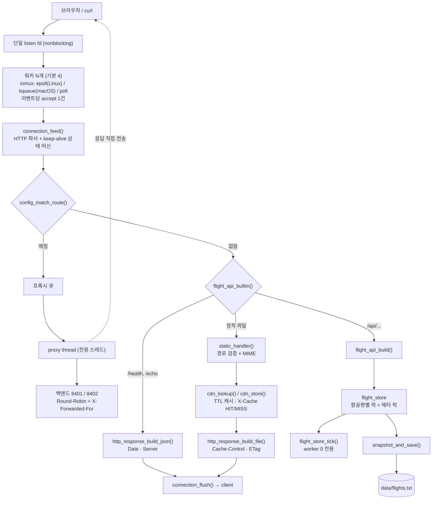

# C POSIX 웹서버 — 오늘 작업 문서

## 핵심 문제

TCP는 바이트 스트림만 주지만, 클라이언트는 요청과 응답을 원합니다. 이 차이를 안전하게 메우고, 여러 클라이언트가 동시에 써도 상태가 깨지지 않게 만드는 것이 이 프로젝트의 출발점입니다. 자세한 문제 정의는 [docs/why_webserver.md](./docs/why_webserver.md)에 있습니다.

## 문서 범위

작업 범위는 TCP 서버부터 정적 파일 서빙, 워커 풀·동시성, 항공편 예약, 별도 백엔드·결제 서비스 연결까지입니다.

| 문서 | 범위 |
|---|---|
| [STEP1_TCP_SERVER.md](./docs/iterations/STEP1_TCP_SERVER.md) | TCP 소켓 서버 |
| [STEP2_HTTP_PARSER.md](./docs/iterations/STEP2_HTTP_PARSER.md) | HTTP 요청 파싱 |
| [STEP3_HTTP_RESPONSE.md](./docs/iterations/STEP3_HTTP_RESPONSE.md) | HTTP 응답 생성 및 전송 |
| [STEP4_STATIC_FILE.md](./docs/iterations/STEP4_STATIC_FILE.md) | 정적 파일 서빙 |
| [STEP5_CONCURRENCY.md](./docs/iterations/STEP5_CONCURRENCY.md) | 워커 풀 + 이벤트 루프, keep-alive, 동시성 검증 |
| [STEP6_FLIGHT_DEMO.md](./docs/iterations/STEP6_FLIGHT_DEMO.md) | 항공편 예약·출발/도착 추적, 좌석 경쟁 before/after |
| [STEP7_DOMAIN_COMPLETION.md](./docs/iterations/STEP7_DOMAIN_COMPLETION.md) | 영속 저장·락·시계 전이로 도메인 완성 |
| [STEP8_REQUIREMENTS_WRAPUP.md](./docs/iterations/STEP8_REQUIREMENTS_WRAPUP.md) | 요구사항 확정, 헤더·로그·경계 케이스 |
| [STEP9_BACKEND_SERVICES.md](./docs/iterations/STEP9_BACKEND_SERVICES.md) | mini-redis·mini-dbms 별도 프로세스 연결 |
| [STEP10_PAYMENT_SERVICE.md](./docs/iterations/STEP10_PAYMENT_SERVICE.md) | 결제 서비스 분리, 중복 방지 키·환불·화면 흐름 |
| [DECISIONS.md](./docs/DECISIONS.md) | 구현 과정에서 실제로 확정한 결정 기록 |
| [PROGRESS.md](./docs/workflow/PROGRESS.md) | STEP1~10 진행 지도와 현재 검증 지점 |
| [CONVENTIONS.md](./docs/workflow/CONVENTIONS.md) | 문서·결정·검증을 남기는 운영 규칙 |
| [COLLABORATION.md](./docs/workflow/COLLABORATION.md) | 질문이 판단으로 바뀐 협업 기록 |
| [TEAM_PROCESS.md](./docs/workflow/TEAM_PROCESS.md) | 협업 흐름 초안 (팀 합의 전) |

각 문서에는 단계별 작업 범위와 실제 구현·검증 기록이 들어 있습니다.

## 현재 구현 상태 (2026-11-22)

정적 파일 서빙을 넘어 아래 기능까지 구현·검증했습니다.

| 기능 | 진입점 | 검증 명령 |
|---|---|---|
| 워커 풀 + `iomux` 이벤트 루프(Linux epoll / macOS kqueue / 폴백 poll) + keep-alive(최대 100회) | `src/worker.c`, `src/iomux.c`, `src/connection.c` | `make integration`, `make load-test` |
| 항공편 예약 + 파일 영속 저장 | `src/flight_store.c`, `src/flight_api.c` | `make test-flight`, `make integration-flight`, `make integration-persist` |
| 출발/도착 자동 추적 + 지연 | `src/flight_clock.c`, `www/ops.html` | `make test-tracking`, `make integration-tracking` |
| Date/Server 헤더, `/health`, `/echo`, 접근 로그, `-p/-r/-c` | `src/http_response.c`, `src/config.c` | `make integration-req` |
| 리버스 프록시(게이트웨이 라우팅 + Round-Robin 로드밸런싱) | `src/proxy.c`, `conf/tcpserver.conf` | `make integration-req` |
| 로컬 미니 CDN(TTL 캐시, `X-Cache: HIT/MISS`) | `src/cdn.c` | `make integration-req` |

실제 실행:

```sh
make
./webserver                      # http://127.0.0.1:8080/
# 또는: ./webserver -p 8083 -r ./www -c conf/tcpserver.conf
```

브라우저 화면: `http://127.0.0.1:8080/flights.html`(예약), `http://127.0.0.1:8080/ops.html`(운항 관제).
동시성 before/after는 앱 UI가 아니라 `make integration-flight`, `make tsan`으로 확인합니다.

## 전체 아키텍처 한눈에 보기



상세한 계층 설명과 리스크 메모는 [`verify/reviews/ARCHITECTURE_REVIEW.md`](./verify/reviews/ARCHITECTURE_REVIEW.md)에 있습니다.

## 기술 영역 및 학습 목표

이 프로젝트를 통해 아래의 핵심 기술 영역들을 깊이 있게 다루고 검증합니다.

| 기술 영역 | 핵심 학습 내용 |
|---|---|
| Network | TCP/IP 작동 원리, 포트 할당, 소켓 연결 관리 |
| Linux/POSIX | 파일 디스크립터(FD) 개념, 시스템 콜 활용 |
| HTTP | HTTP 프로토콜 규격, 요청과 응답 구조, 상태 코드 |
| C Programming | 포인터 활용, 데이터 버퍼 관리, 메모리 할당과 해제 |
| File I/O | 파일을 열고 읽고 닫는 저수준 제어 |
| Network I/O | 소켓을 통한 데이터 송수신 흐름 설계 |
| Security | 지정된 폴더 밖의 파일 접근 차단, 잘못된 메모리 접근 방지 |
| Testing | 단위 및 통합 테스트 설계, 메모리 오류 검사 |
| Architecture | 기능별 모듈 분리, 자원 소유권 관리, 코드 구조 설계 |

## 구현 마일스톤 및 진행 상태

구현 순서대로 9개 마일스톤을 나눠 "구현 → 실제 실행으로 검증 → 다음" 순서로 진행했습니다.

| 마일스톤 | 내용 | 상태 |
|---|---|---|
| 1 | TCP 서버 골격: listen → accept → 요청/응답 + graceful shutdown | 완료·검증 |
| 2 | HTTP 요청 파싱: connection 누적 읽기 + `http_parser` (`PARSE_COMPLETE/NEED_MORE/ERROR`) | 완료·검증 |
| 3 | 정적 파일 찾기: `static_handler` 경로 검증 + MIME + 404/403/500 | 완료·검증 |
| 4 | HTTP 응답: `http_response` 직렬화 + 청크 전송 + 바이너리 무결성 | 완료·검증 |
| 5 | 견고함: 단일 정리 지점 + 타임아웃 + ASan/valgrind 누수 0 | 완료·검증 |
| 6 | 워커 풀 + 이벤트 루프: `worker`, `iomux`(epoll/kqueue/poll), accept 분산, keep-alive 100회 | 완료·검증 |
| 7 | 항공편 도메인: 예약·취소·영속 저장, 좌석 경쟁 before/after, 출발/도착 추적 | 완료·검증 |
| 8 | 요구사항 마무리: Date/Server, health/echo, 접근 로그, `-p/-r/-c`, 프록시 게이트웨이+RR, 미니 CDN | 완료·검증 |
| 9 | 별도 백엔드 프로세스 연결: mini-redis·mini-dbms를 게이트웨이 뒤에 연결, 리소스 제한·독립 재시작 시연 | 완료·검증 |
| 10 | 결제 서비스 분리: 자기 DB·중복 방지 키·환불, `flights.html` 결제 버튼, 독립 재시작 | 완료·검증 |

### 마일스톤 1에서 실제로 검증한 것

- `make` → exit 0, `webserver` 실행 파일 생성 (`-std=c11 -Wall -Wextra -Werror` 통과).
- `./webserver` 실행 후 `nc -zv 127.0.0.1 8080` → "Connection ... succeeded!" (포트 열림 확인).
- `kill -TERM <pid>` → 종료 코드 0 (graceful shutdown, NFR-02).

### 마일스톤 2에서 실제로 검증한 것

- `make` → exit 0 (`-std=c11 -Wall -Wextra -Werror` 통과).
- 정상 `GET /` → `200 OK` + 본문 `hi`.
- 잘못된 요청 라인 → `400`, POST Content-Length 누락 → `411`, 미지원 메서드(DELETE) → `405`,
  HTTP/1.1 Host 누락 → `400`. (curl/nc로 실제 확인)
- `kill -TERM` → 종료 코드 0 (graceful shutdown 유지).

### 마일스톤 3·4에서 실제로 검증한 것 (정적 파일 서빙 완성)

- `make` → exit 0 (`-std=c11 -Wall -Wextra -Werror` 통과).
- `GET /` → `200` + `Content-Type: text/html` + index.html 전체 내용.
- `GET /nope` → `404`.
- `GET /../etc/passwd`, `GET /%2e%2e/etc/passwd` → `403` (경로 탈출 차단, 퍼센트 인코딩 포함).
- `GET /test.png` → 원본과 바이트 일치(`cmp` 통과), `Content-Type: image/png`, `Content-Length: 149`.
- `GET /style.css` → `text/css`, `GET /sample.txt` → `text/plain` (MIME 매핑).
- `POST /`(본문 있음) → `405` (정적 서빙은 GET 의미론).
- `kill -TERM` → 종료 코드 0.

마일스톤 1~5(정적 파일 서빙과 견고함) 완료 이후, 6~9에서 동시성·도메인·요구사항·별도 백엔드 연결까지 마무리했습니다.

### 테스트 실행 방법

```sh
make test        # 단위 테스트: 파서 + 경로보안/MIME (tests/unit/)
make integration # 기능 테스트: 서버 기동 후 curl 검증 (tests/integration/run.sh)
make asan        # ASAN+UBSan 빌드 → 메모리 오류 검사
```

- 단위/기능 테스트: 전부 통과 (파서 오류코드, 경로 탈출 403, MIME, 바이너리 무결성 등).
- ASAN(macOS): 메모리 오류·UB 0건.
- 누수 검사(Linux Valgrind, Docker): **누수 0 bytes, 오류 0건 확정** (NFR-01 충족).
  Docker Desktop 실행 후 `docker compose run --rm dev sh`에서 valgrind로 수행.
- 상세 검증 기록: [verify/VERIFICATION_LOG.md](./verify/VERIFICATION_LOG.md).

### 직접 확인하는 방법 (마일스톤 1)

```sh
make                    # 빌드 → exit 0 확인
./webserver             # 서버 실행 (포트 8080)
# 다른 터미널에서:
nc -zv 127.0.0.1 8080   # 포트 열림 → "succeeded!" 확인
# 서버 터미널에서 Ctrl+C 로 종료 후:
echo $?                 # 종료 코드 0 확인 (graceful shutdown)
```

### 마일스톤 1~4: 정적 파일 서빙 검증 명령

```sh
curl -i http://127.0.0.1:8080/                          # 200 + index.html
curl -i http://127.0.0.1:8080/nope                      # 404
curl -i --path-as-is http://127.0.0.1:8080/../etc/passwd  # 403 (경로 탈출 차단)
curl -s http://127.0.0.1:8080/test.png | cmp - www/test.png && echo "binary OK"
```

### 마일스톤 5: 견고함 검증

```sh
make test                       # 단위 테스트 전체 PASS
make asan                       # macOS ASan: 메모리 오류 0
docker compose run --rm dev make leak   # Linux valgrind: 누수 0 bytes, ERROR SUMMARY 0
```

### 마일스톤 6: 워커 풀 + 이벤트 루프 검증

```sh
WEB_WORKERS=4 ./webserver       # 기본 4워커, epoll/kqueue/poll 백엔드 사용
make integration                # keep-alive/느린 클라이언트/100동시 검증
make load-test                  # 200요청·동시 20, Non-2xx 0 확인
```

`:8080/health` 응답의 접근 로그에서 `[wN]`으로 서로 다른 워커가 처리했는지 확인합니다.
상세 흐름은 [STEP5_CONCURRENCY.md](./docs/iterations/STEP5_CONCURRENCY.md) 참고.

### 마일스톤 7: 항공편 도메인 검증

```sh
make test-flight                # 좌석 경쟁 단위 (before 32/32, after 1/32)
make integration-flight         # HTTP 100동시 + keep-alive + slow client
make integration-persist        # 재시작 후 data/flights.txt 유지
make test-tracking              # 시계 전이·지연 단위
make integration-tracking       # 자동 출발/도착 통합
make tsan                       # after 레이스 0, before 1건 검출
```

상세 설계는 [STEP6_FLIGHT_DEMO.md](./docs/iterations/STEP6_FLIGHT_DEMO.md) 참고.

### 마일스톤 8: 요구사항 마무리 검증

```sh
make integration-req            # Date/Server, /health, /echo, -p/-r/-c,
                                # 게이트웨이 RR/XFF/502, 접근 로그, X-Cache HIT
```

요구사항 원문은 [REQUIREMENTS.md](./docs/REQUIREMENTS.md),
결정 근거는 [DECISIONS.md](./docs/DECISIONS.md) 참고.

### 마일스톤 9: 별도 백엔드 프로세스 검증

```sh
make integration-backends       # mini-redis·mini-dbms를 게이트웨이 뒤에 띄움
# ulimit 64/128/256으로 자원 제한 차등, 8401 종료 시 200/502 혼재,
# 8401 재시작 후 전부 200, /health 200 확인
```

### 마일스톤 10: 결제 서비스 검증

```sh
make integration-backends     # 8500 결제 프로세스까지 함께 기동
make integration-payments     # 충전·중복 방지 키·조회·환불·잘못된 금액·독립 재시작
# http://127.0.0.1:8085/flights.html → 예약하기 → 오른쪽 결제 패널의 "결제하기" → /pay.html → 결제 완료 후 내 예약에 표시
# 내 예약: 출발 7~5일 전 100%, 5~2일 전 80%, 2~1일 전 50%, 1일 이내 신청 마감
```

### 항공권 예약 앱 (STEP5/6)

```sh
make && ./webserver            # 기본 워커 4개, after 모드
# 브라우저: http://127.0.0.1:8080/flights.html
#   검색 → 항공편 선택 → 승객 정보 입력 → 예약 → 내 예약 → 취소
# 예약은 data/flights.txt에 저장되어 재시작 후에도 유지된다.
# 테스트는 FLIGHT_DATA_FILE=/dev/null로 격리한다.

make test-flight               # 좌석 경쟁 단위 검증 (before/after)
make integration-flight        # HTTP 100동시 + keep-alive + slow client
make integration-persist       # 재시작 후 예약 유지 검증
make tsan                      # 데이터 레이스 비교 빌드
```

동시성 before/after는 앱 화면에 노출하지 않는다. 터미널 검증과 TSan으로만 확인한다.

### 출발/도착 추적 (운영 콘솔)

```sh
FLIGHT_TIME_MODE=sim FLIGHT_SIM_SPEED=3000 ./webserver
# 운영 화면: http://127.0.0.1:8080/ops.html
#   예정/실제 출발·도착, 카운트다운, 지연 입력, 운항 이력
make test-tracking          # 시계·전이 단위 검증
make integration-tracking   # 8081 포트에서 자동 출발/도착 통합 검증
```

기본은 실제 시간 모드이고, `FLIGHT_SIM_SPEED`는 가상 모드에서만 의미가 있다.

## 로컬에서 돌려보는 방법

기본 실행:

```sh
cd /Users/velocitygoal/Desktop/jungle/SW-AI-W13-Web-Server
make
./webserver
# 또는: FLIGHT_DATA_FILE=/dev/null ./webserver -p 8086 -r ./www -c conf/tcpserver.conf
```

브라우저에서 확인:

- `http://127.0.0.1:8080/` — 기본 페이지
- `http://127.0.0.1:8080/flights.html` — 항공편 예약/취소/내 예약/운항 이력
- `http://127.0.0.1:8080/ops.html` — 출발·도착 추적 콘솔
- `http://127.0.0.1:8080/health`, `/echo`, `/api/flights`

실제 실행 예시(8086 포트):

```text
/health          200 application/json
/                200 text/html
/flights.html    200 text/html
/ops.html        200 text/html
/api/flights     200 application/json
/echo            200
SIGTERM 전송 후 종료
```

검증 명령:

```sh
make test                      # 단위 테스트
make integration               # keep-alive·slow client·100동시
make integration-flight        # 좌석 경쟁 HTTP 통합(before/after 모두 수행)
make integration-persist       # 재시작 후 예약 유지
make test-tracking             # 시계 전이 단위
make integration-tracking      # 자동 출발/도착
make integration-req           # 헤더/health/echo/프록시/캐시
make integration-backends      # mini-redis·mini-dbms·결제 별도 프로세스 연결
make integration-payments     # 결제 충전·중복 방지 키·환불·독립 재시작
make tsan                      # 데이터 레이스 비교
make load-test                 # 부하 (동시 20, 200요청)
make load-test-heavy           # 동시 100, 1000요청
make mutation                  # 뮤테이션 테스트(조건 뒤집기 → 테스트가 실패해야 PASS)
```

기능별 시연:

```sh
# 로컬 캐시 헤더 (첫 MISS, 두 번째 HIT)
curl -i http://127.0.0.1:8080/style.css | grep -i x-cache
curl -i http://127.0.0.1:8080/style.css | grep -i x-cache

# 캐시 무효화 API는 아직 없음. TTL 만료로만 정리됨.
# /api/cache/miss는 프록시 502 검증용 경로이며 캐시를 지우지 않음.

# before/after는 관리 API로 전환 (UI에는 데모 컨트롤 없음)
curl -X POST -d '{"lock":false}' http://127.0.0.1:8080/api/admin/mode  # before
curl -X POST -d '{"lock":true}'  http://127.0.0.1:8080/api/admin/mode  # after

# 출발/도착 시뮬레이션
FLIGHT_TIME_MODE=sim FLIGHT_SIM_SPEED=3000 ./webserver
# http://127.0.0.1:8080/ops.html

# 게이트웨이 + 별도 백엔드 4종 (8085/8000/8002/8401/8402 사용)
make integration-backends

# Linux(epoll) 전체 회귀 — Docker 필요
docker compose run --rm dev sh /workspace/tests/linux_check.sh
```

정리:

```sh
kill -TERM <pid>         # graceful shutdown, 종료 코드 0
make reset-flights      # 예약 데이터 초기화 후 16편 시드로 다시 시작
# 또는: rm -f data/flights.txt   (테스트는 FLIGHT_DATA_FILE=/dev/null 사용)
```

`integration-backends`는 8085, 8000, 8002, 8401, 8402 포트를 쓰므로 다른 서버가 해당 포트를 점유하고 있으면 먼저 정리해야 합니다.

## 파일 분리 기준

함수 하나마다 파일을 만들지 않고, 같은 책임을 수행하는 함수들을 모듈 하나에 묶습니다.

- `server`: TCP 서버 소켓 생성과 클라이언트 접속 수락
- `connection`: 클라이언트 연결별 데이터와 상태 관리
- `http_parser`: 수신한 HTTP 요청 해석
- `http_response`: HTTP 응답 생성 및 전송
- `static_handler`: 요청 경로에 대응하는 정적 파일 처리

## 현재 디렉터리 구조

```text
include/   iomux, worker, connection, config, flight_*, proxy, cdn, http_*
src/       main, tcpserver, worker, iomux, connection, config, flight_*, proxy, cdn, http_*
www/       flights.html/js, ops.html/js, 정적 자산
conf/      tcpserver.conf (포트·워커·라우트·TTL)
tests/     unit/, integration/, integration/fixtures/
verify/     TEST_MATRIX.md, VERIFICATION_LOG.md, reviews/
docs/       REQUIREMENTS.md, DESIGN.md, DECISIONS.md, iterations/, workflow/
```

## 모듈 책임 (현재)

| 모듈 | 책임 |
|---|---|
| `main` | 설정 로드, 리스닝 소켓 생성, 워커 풀·프록시 스레드 시작/종료 |
| `tcpserver` | 소켓 생성·bind·listen, graceful shutdown |
| `worker` | 워커별 이벤트 루프, 이벤트당 accept 1건, 유휴 정리 |
| `iomux` | epoll(Linux)/kqueue(macOS)/poll 백엔드 추상화 |
| `connection` | 비동기 feed/flush 상태 머신, keep-alive, 접근 로그 |
| `flight_store` | 항공편·예약·타임라인, 항공편별 락, 스냅샷 파일 저장 |
| `flight_api` | `/api/*` 라우팅, 최소 JSON 직렬화, `/health`·`/echo` |
| `flight_clock` | real/sim 시계, 자동 출발·도착 전이 |
| `proxy` | 경로 기반 게이트웨이 + Round-Robin 로드밸런서(전용 스레드) |
| `cdn` | 정적 자산 TTL 캐시, `X-Cache` HIT/MISS |
| `static_handler` | 경로 검증, MIME, 정적 파일/캐시 서빙 |
| `http_response` | Date/Server/Cache-Control/ETag 포함 응답 직렬화 |

초기 단계의 "제안 구조"는 위 현재 구조로 대체됐습니다.


## 문서 작성 원칙

- 구현하지 않은 기능을 완료한 것처럼 기록하지 않습니다.
- 실행하지 않은 테스트를 통과했다고 기록하지 않습니다.
- 합의하지 않은 설계를 확정된 결정으로 기록하지 않습니다.
- 새로 결정한 내용은 `DECISIONS.md`에 근거와 함께 기록합니다.

참고 문서: [REQUIREMENTS.md](./docs/REQUIREMENTS.md) · [DESIGN.md](./docs/DESIGN.md) · [TEST_MATRIX.md](./verify/TEST_MATRIX.md) · [VERIFICATION_LOG.md](./verify/VERIFICATION_LOG.md) · [ARCHITECTURE_REVIEW.md](./verify/reviews/ARCHITECTURE_REVIEW.md)
