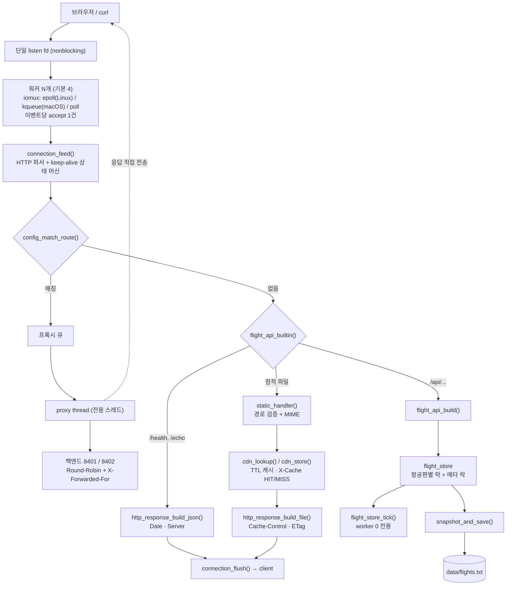

# C POSIX 웹서버 — 오늘 작업 문서

## 문서 범위

오늘 작업 범위로 잡은 TCP 서버, HTTP 요청 파싱, HTTP 응답 생성, 정적 파일 서빙을 다룹니다.

| 문서 | 범위 |
|---|---|
| [STEP1_TCP_SERVER.md](./eungi/STEP1_TCP_SERVER.md) | TCP 소켓 서버 |
| [STEP2_HTTP_PARSER.md](./eungi/STEP2_HTTP_PARSER.md) | HTTP 요청 파싱 |
| [STEP3_HTTP_RESPONSE.md](./eungi/STEP3_HTTP_RESPONSE.md) | HTTP 응답 생성 및 전송 |
| [STEP4_STATIC_FILE.md](./eungi/STEP4_STATIC_FILE.md) | 정적 파일 서빙 |
| [DECISIONS.md](./eungi/DECISIONS.md) | 구현 과정에서 실제로 확정한 결정 기록 |

각 문서에는 단계별 작업 범위와 실제 구현·검증 기록이 들어 있습니다.

## 현재 구현 상태 (2026-11-22)

정적 파일 서빙을 넘어 아래 기능까지 구현·검증했습니다.

| 기능 | 진입점 | 검증 명령 |
|---|---|---|
| 워커 풀 + poll 이벤트 루프 + keep-alive(최대 100회) | `src/worker.c`, `src/iomux.c`, `src/connection.c` | `make integration`, `make load-test` |
| 항공편 예약 + 파일 영속 저장 | `src/flight_store.c`, `src/flight_api.c` | `make test-flight`, `make integration-flight`, `make integration-persist` |
| 출발/도착 자동 추적 + 지연 | `src/flight_clock.c`, `www/ops.html` | `make test-tracking`, `make integration-tracking` |
| Date/Server 헤더, `/health`, `/echo`, 접근 로그, `-p/-r/-c` | `src/http_response.c`, `src/config.c` | `make integration-req` |
| 리버스 프록시(게이트웨이 라우팅 + Round-Robin 로드밸런싱) | `src/proxy.c`, `conf/tcpserver.conf` | `make integration-req` |
| 로컬 미니 CDN(TTL 캐시, `X-Cache: HIT/MISS`) | `src/cdn.c` | `make integration-req` |

실제 실행:

```sh
make
./webserver                      # http://127.0.0.1:8080/
# 또는: ./webserver -p 8083 -r ./www -c conf/tcpserver.conf
```

브라우저 화면: `http://127.0.0.1:8080/flights.html`(예약), `http://127.0.0.1:8080/ops.html`(운항 관제).
동시성 before/after는 앱 UI가 아니라 `make integration-flight`, `make tsan`으로 확인합니다.

## 전체 아키텍처 한눈에 보기



상세한 계층 설명과 리스크 메모는 [`verify/ARCHITECTURE_REVIEW.md`](./verify/ARCHITECTURE_REVIEW.md)에 있습니다.

## 기술 영역 및 학습 목표

이 프로젝트를 통해 아래의 핵심 기술 영역들을 깊이 있게 다루고 검증합니다.

| 기술 영역 | 핵심 학습 내용 |
|---|---|
| Network | TCP/IP 작동 원리, 포트 할당, 소켓 연결 관리 |
| Linux/POSIX | 파일 디스크립터(FD) 개념, 시스템 콜 활용 |
| HTTP | HTTP 프로토콜 규격, 요청과 응답 구조, 상태 코드 |
| C Programming | 포인터 활용, 데이터 버퍼 관리, 메모리 할당과 해제 |
| File I/O | 파일을 열고 읽고 닫는 저수준 제어 |
| Network I/O | 소켓을 통한 데이터 송수신 흐름 설계 |
| Security | 지정된 폴더 밖의 파일 접근 차단, 잘못된 메모리 접근 방지 |
| Testing | 단위 및 통합 테스트 설계, 메모리 오류 검사 |
| Architecture | 기능별 모듈 분리, 자원 소유권 관리, 코드 구조 설계 |

## 구현 마일스톤 및 진행 상태

오늘 범위(정적 파일 서빙까지)를 5개 마일스톤으로 나눠 순서대로 구현·검증합니다.
각 마일스톤은 "구현 → 실제 실행으로 검증 → 다음" 순서로 진행합니다.

| 마일스톤 | 내용 | 상태 |
|---|---|---|
| 1 | TCP 서버 배관: listen → accept → 수락 후 닫기 + graceful shutdown | 완료·검증 |
| 2 | HTTP 요청 파싱: connection 누적 읽기 + http_parser (COMPLETE/NEED_MORE/ERROR) | 완료·검증 |
| 3 | 정적 파일 찾기: static_handler 경로 검증(탈출 차단) + MIME + 404/403/500 | 완료·검증 |
| 4 | HTTP 응답: http_response 직렬화 + 청크 전송 + 바이너리 무결성 | 완료·검증 |
| 5 | 견고함: 단일 정리 지점 + 타임아웃 + asan/valgrind 누수 0 | 완료·검증(누수 0) |

### 마일스톤 1에서 실제로 검증한 것

- `make` → exit 0, `webserver` 실행 파일 생성 (`-std=c11 -Wall -Wextra -Werror` 통과).
- `./webserver` 실행 후 `nc -zv 127.0.0.1 8080` → "Connection ... succeeded!" (포트 열림 확인).
- `kill -TERM <pid>` → 종료 코드 0 (graceful shutdown, NFR-02).

### 마일스톤 2에서 실제로 검증한 것

- `make` → exit 0 (`-std=c11 -Wall -Wextra -Werror` 통과).
- 정상 `GET /` → `200 OK` + 본문 `hi`.
- 잘못된 요청 라인 → `400`, POST Content-Length 누락 → `411`, 미지원 메서드(DELETE) → `405`,
  HTTP/1.1 Host 누락 → `400`. (curl/nc로 실제 확인)
- `kill -TERM` → 종료 코드 0 (graceful shutdown 유지).

### 마일스톤 3·4에서 실제로 검증한 것 (정적 파일 서빙 완성)

- `make` → exit 0 (`-std=c11 -Wall -Wextra -Werror` 통과).
- `GET /` → `200` + `Content-Type: text/html` + index.html 전체 내용.
- `GET /nope` → `404`.
- `GET /../etc/passwd`, `GET /%2e%2e/etc/passwd` → `403` (경로 탈출 차단, 퍼센트 인코딩 포함).
- `GET /test.png` → 원본과 바이트 일치(`cmp` 통과), `Content-Type: image/png`, `Content-Length: 149`.
- `GET /style.css` → `text/css`, `GET /sample.txt` → `text/plain` (MIME 매핑).
- `POST /`(본문 있음) → `405` (정적 서빙은 GET 의미론).
- `kill -TERM` → 종료 코드 0.

오늘 범위(마일스톤 1~4, 정적 파일 서빙) 완료. 마일스톤 5(ASAN/Valgrind 누수 0 등 견고함 증명)는 대기.

### 테스트 실행 방법

```sh
make test        # 단위 테스트: 파서 + 경로보안/MIME (tests/unit/)
make integration # 기능 테스트: 서버 기동 후 curl 검증 (tests/integration/run.sh)
make asan        # ASAN+UBSan 빌드 → 메모리 오류 검사
```

- 단위/기능 테스트: 전부 통과 (파서 오류코드, 경로 탈출 403, MIME, 바이너리 무결성 등).
- ASAN(macOS): 메모리 오류·UB 0건.
- 누수 검사(Linux Valgrind, Docker): **누수 0 bytes, 오류 0건 확정** (NFR-01 충족).
  Docker Desktop 실행 후 `docker compose run --rm dev sh`에서 valgrind로 수행.
- 상세 검증 기록: [verify/VERIFICATION_LOG.md](./verify/VERIFICATION_LOG.md).

### 직접 확인하는 방법 (마일스톤 1)

```sh
make                    # 빌드 → exit 0 확인
./webserver             # 서버 실행 (포트 8080)
# 다른 터미널에서:
nc -zv 127.0.0.1 8080   # 포트 열림 → "succeeded!" 확인
# 서버 터미널에서 Ctrl+C 로 종료 후:
echo $?                 # 종료 코드 0 확인 (graceful shutdown)
```

### 마일스톤 4 이후 정적 파일 서빙 검증 명령  

```sh
curl -i http://127.0.0.1:8080/                          # 200 + index.html
curl -i http://127.0.0.1:8080/nope                      # 404
curl -i --path-as-is http://127.0.0.1:8080/../etc/passwd  # 403 (경로 탈출 차단)
curl -s http://127.0.0.1:8080/test.png | cmp - www/test.png && echo "binary OK"
```

### 항공권 예약 앱 (STEP5/6)

```sh
make && ./webserver            # 기본 워커 4개, after 모드
# 브라우저: http://127.0.0.1:8080/flights.html
#   검색 → 항공편 선택 → 승객 정보 입력 → 예약 → 내 예약 → 취소
# 예약은 data/flights.txt에 저장되어 재시작 후에도 유지된다.
# 테스트는 FLIGHT_DATA_FILE=/dev/null로 격리한다.

make test-flight               # 좌석 경쟁 단위 검증 (before/after)
make integration-flight        # HTTP 100동시 + keep-alive + slow client
make integration-persist       # 재시작 후 예약 유지 검증
make tsan                      # 데이터 레이스 비교 빌드
```

동시성 before/after는 앱 화면에 노출하지 않는다. 터미널 검증과 TSan으로만 확인한다.

### 출발/도착 추적 (운영 콘솔)

```sh
FLIGHT_TIME_MODE=sim FLIGHT_SIM_SPEED=3000 ./webserver
# 운영 화면: http://127.0.0.1:8080/ops.html
#   예정/실제 출발·도착, 카운트다운, 지연 입력, 운항 이력
make test-tracking          # 시계·전이 단위 검증
make integration-tracking   # 8081 포트에서 자동 출발/도착 통합 검증
```

기본은 실제 시간 모드이고, `FLIGHT_SIM_SPEED`는 가상 모드에서만 의미가 있다.

## 파일 분리 기준

함수 하나마다 파일을 만들지 않고, 같은 책임을 수행하는 함수들을 모듈 하나에 묶습니다.

- `server`: TCP 서버 소켓 생성과 클라이언트 접속 수락
- `connection`: 클라이언트 연결별 데이터와 상태 관리
- `http_parser`: 수신한 HTTP 요청 해석
- `http_response`: HTTP 응답 생성 및 전송
- `static_handler`: 요청 경로에 대응하는 정적 파일 처리

## 현재 제안하는 디렉터리 구조

```text
webserver/
├── Makefile                  # 컴파일 및 빌드 작업을 관리하는 파일
├── include/                  # 헤더 파일(.h)을 모아두는 디렉터리
│   ├── tcpserver.h           # 서버 초기화 및 실행 관련 함수 선언
│   ├── connection.h          # 클라이언트 연결 및 연결 상태 관련 함수 선언
│   ├── http_parser.h         # HTTP 요청 메시지 파싱 관련 함수 선언
│   ├── http_response.h       # HTTP 응답 생성 및 전송 관련 함수 선언
│   └── static_handler.h      # 정적 파일 요청 처리 관련 함수 선언
│
├── src/                      # C 소스 파일(.c)을 모아두는 디렉터리
│   ├── main.c                # 프로그램 진입점 및 서버 실행
│   ├── tcpserver.c           # TCP 소켓 생성, bind(), listen(), accept() 처리
│   ├── connection.c          # 클라이언트 연결별 데이터 수신 및 전송 관리
│   ├── http_parser.c         # HTTP 요청 메서드, URI, 헤더, 본문 파싱
│   ├── http_response.c       # HTTP 응답 상태 줄, 헤더, 본문 생성 및 전송
│   └── static_handler.c      # 요청 URI에 대응하는 정적 파일 탐색 및 응답 처리
│
├── www/                      # 클라이언트에게 제공할 정적 파일 디렉터리
│   └── index.html            # 기본 웹 페이지
│
└── tests/                    # 테스트 코드 디렉터리
    ├── unit/                 # 개별 함수 및 모듈 단위 테스트
    └── integration/          # 서버와 클라이언트 간 통합 테스트
```

위 구조는 파일 분리를 위한 제안입니다. 실제 파일 생성 여부와 최종 모듈 경계는 구현하면서 확인합니다. 아직 구현하지 않는 프록시, CGI, 캐시 등의 모듈은 포함하지 않습니다.

## 모듈 책임과 의존 관계 초안

| 모듈 | 책임 | 사용할 모듈 |
|---|---|---|
| `main` | 프로그램 시작 및 서버 실행 | `server` |
| `server` | 서버 소켓 생성, 설정, 접속 수락 | `connection` |
| `connection` | 클라이언트 연결과 수신 데이터 관리 | `http_parser`, `http_response` |
| `http_parser` | HTTP 요청 줄·헤더·본문 해석 | 없음 |
| `http_response` | HTTP 응답 형식 생성 및 전송 | 없음 |
| `static_handler` | 파일 경로 확인, 파일 정보 조회 및 파일 내용 처리 | `http_response` |

의존 관계는 구현 전에 정리한 초안입니다. 실제 함수 호출 관계와 인터페이스가 정해지면 수정합니다.

## 모듈 간 관계 초안

아래 그림은 위 표의 의존 관계를 간단히 나타낸 것입니다.

```text
                 main.c
                   |
                   v
                 server
                   |
                   v
               connection
                /       \
               v         v
         http_parser  http_response
                          ^
                          |
                   static_handler
```

- `main.c`에서 `server`를 실행합니다.
- `server`가 클라이언트 연결을 수락하면 `connection`이 연결별 처리를 담당합니다.
- `connection`은 `http_parser`를 이용해 요청을 해석하고, `http_response`를 이용해 응답을 생성·전송합니다.
- `static_handler`는 정적 파일 요청을 처리하며, 응답 생성에 `http_response`를 사용하도록 제안했습니다.

위 관계는 구현 전 초안입니다. 실제 함수 호출 순서와 인터페이스는 구현하면서 확인하고 수정합니다.


## 문서 작성 원칙

- 구현하지 않은 기능을 완료한 것처럼 기록하지 않습니다.
- 실행하지 않은 테스트를 통과했다고 기록하지 않습니다.
- 합의하지 않은 설계를 확정된 결정으로 기록하지 않습니다.
- 새로 결정한 내용은 `DECISIONS.md`에 근거와 함께 기록합니다.
