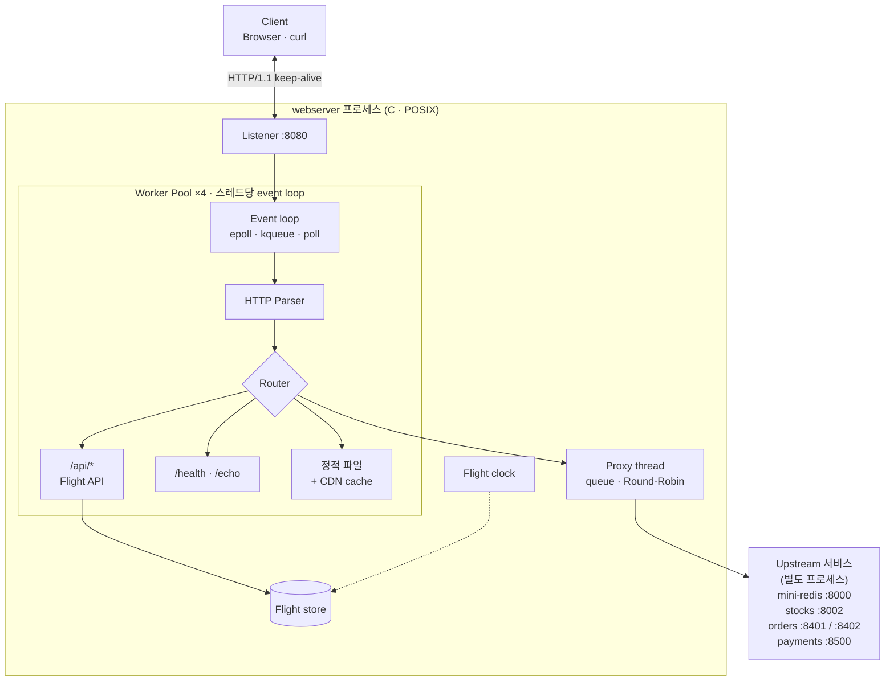

# C POSIX 웹서버 — 오늘 작업 문서

## MOTO

실제 구현 및 동작 원리를 알자, 주위의 불편을 개선하자 

## 현재 작업 상태

오늘 작업 범위와 다음 단계는 [DAILY_SCOPE.md](docs/agent/DAILY_SCOPE.md)에 있습니다.

## 핵심 문제

TCP는 바이트 스트림만 주지만, 클라이언트는 요청과 응답을 원합니다. 이 차이를 안전하게 메우고, 여러 클라이언트가 동시에 써도 상태가 깨지지 않게 만드는 것이 이 프로젝트의 출발점입니다. 자세한 문제 정의는 [docs/REQUIREMENTS.md](docs/REQUIREMENTS.md)에 있습니다.

동시성은 **두 축을 따로 고릅니다**.

- **일하는 주체** — 워커 스레드 4개. 좌석 같은 공유 데이터를 `fork`로 나누면 워커마다 사본이 생겨 공유 메모리·IPC가 필요해지므로 스레드를 골랐습니다.
- **I/O를 기다리는 방식** — 멀티플렉싱(Linux `epoll`, macOS `kqueue`, 그 외 `poll`). 연결은 많은데 대부분 유휴라서, 블로킹처럼 한 연결씩 붙잡고 있지 않고 **준비된 연결만** 받습니다.

그래서 각 스레드는 한 연결을 끝까지 도맡지 않고, 여러 연결을 돌아가며 처리합니다. 세 가지 방식을 비교한 근거는 [notes/iomux.md](docs/notes/iomux.md)와 [DECISIONS.md](docs/DECISIONS.md)에 있습니다.

## 문서 범위

작업 범위는 TCP 서버부터 정적 파일 서빙, 워커 풀·동시성, 항공편 예약, 별도 백엔드·결제 서비스 연결까지입니다.

| 문서 | 범위 |
|---|---|
| [STEP01_TCP_SERVER.md](docs/iterations/STEP01_TCP_SERVER.md) | TCP 소켓 서버 |
| [STEP02_HTTP_PARSER.md](docs/iterations/STEP02_HTTP_PARSER.md) | HTTP 요청 파싱 |
| [STEP03_HTTP_RESPONSE.md](docs/iterations/STEP03_HTTP_RESPONSE.md) | HTTP 응답 생성 및 전송 |
| [STEP04_STATIC_FILE.md](docs/iterations/STEP04_STATIC_FILE.md) | 정적 파일 서빙 |
| [STEP05_CONCURRENCY.md](docs/iterations/STEP05_CONCURRENCY.md) | 워커 풀 + 이벤트 루프, keep-alive, 동시성 검증 |
| [STEP06_FLIGHT_DEMO.md](docs/iterations/STEP06_FLIGHT_DEMO.md) | 항공편 예약·출발/도착 추적, 좌석 경쟁 before/after |
| [EXT01_DOMAIN_COMPLETION.md](docs/iterations/EXT01_DOMAIN_COMPLETION.md) | 영속 저장·락·시계 전이로 도메인 완성 (확장) |
| [EXT02_REQUIREMENTS_WRAPUP.md](docs/iterations/EXT02_REQUIREMENTS_WRAPUP.md) | 요구사항 확정, 헤더·로그·경계 케이스 (확장) |
| [EXT03_BACKEND_SERVICES.md](docs/iterations/EXT03_BACKEND_SERVICES.md) | mini-redis·mini-dbms 별도 프로세스 연결 (확장) |
| [EXT04_PAYMENT_SERVICE.md](docs/iterations/EXT04_PAYMENT_SERVICE.md) | 결제 서비스 분리, 중복 방지 키·환불·화면 흐름 (확장) |
| [DECISIONS.md](docs/DECISIONS.md) | 구현 과정에서 실제로 확정한 결정 기록 |
| [notes/iomux.md](docs/notes/iomux.md) | I/O 멀티플렉싱·이벤트 루프를 고른 이유와 대안 비교(`epoll`/`kqueue`/`poll`) |
| [notes/runtime-internals.md](docs/notes/runtime-internals.md) | 런타임 동작·네트워크 개념 |
| [DESIGN.md](docs/DESIGN.md) | 아키텍처, 이벤트 루프 동작 순서, 실제 동작 원리 |
| [TEAM_RULES.md](docs/TEAM_RULES.md) | 팀이 확정한 규칙만 |

각 문서에는 단계별 작업 범위와 실제 구현·검증 기록이 들어 있습니다.

## 현재 구현 상태 (2026-11-22)

정적 파일 서빙을 넘어 아래 기능까지 구현·검증했습니다.

| 기능 | 진입점 | 검증 명령 |
|---|---|---|
| 워커 풀 + `iomux` 이벤트 루프(Linux epoll / macOS kqueue / 폴백 poll) + keep-alive(최대 100회) | `src/worker.c`, `src/iomux.c`, `src/connection.c` | `make integration`, `make load-test` |
| 항공편 예약 + 파일 영속 저장 | `src/flight_store.c`, `src/flight_api.c` | `make test-flight`, `make integration-flight`, `make integration-persist` |
| 출발/도착 자동 추적 + 지연 | `src/flight_clock.c`, `www/ops.html` | `make test-tracking`, `make integration-tracking` |
| Date/Server 헤더, `/health`, `/echo`, 접근 로그, `-p/-r/-c` | `src/http_response.c`, `src/config.c` | `make integration-req` |
| 리버스 프록시(게이트웨이 라우팅 + Round-Robin 로드밸런싱) | `src/proxy.c`, `conf/tcpserver.conf` | `make integration-req` |
| 로컬 미니 CDN(TTL 캐시, `X-Cache: HIT/MISS`) | `src/cdn.c` | `make integration-req` |
| 공항 정보 서비스 2대(상세 화면, 라우팅·RR·장애 격리) | `tests/backends/serve_airports.py`, `conf/backends.conf` | `make integration-airports` |

### 리버스 프록시 뒤의 백엔드 서비스

| 경로 | 백엔드 | 용도 |
|---|---|---|
| `/api/payments/` | 결제 서비스 `:8500` | **항공 서비스 기능**: 예약 결제·환불, 자기 DB, 중복 방지 키, 아웃박스 |
| `/api/airports/` | 공항 정보 서비스 `:8601`, `:8602` | **항공 서비스 기능**: 상세 화면의 출발·도착 공항 정보. 2대 Round-Robin, 한 대가 죽어도 그 칸만 안내 문구 |
| `/api/mq/` | 메시지 큐 `:8700` | **항공 서비스 기능**: 결제 이벤트를 받아 알림 서비스로 넘긴다. consume lease(10초)·ack·재시도 |
| `/api/notifications/` | 알림 서비스 `:8800` | **항공 서비스 기능**: "예약 확정" 알림을 저장하고 '내 예약'에 표시. MQ가 죽어도 결제는 성공 |
| `/api/cache/`, `/api/stocks/`, `/api/orders/` | 이전 주차 mini-redis·mini-dbms | **실험용**: 별도 프로세스의 자원 제한·독립 재시작 시연 (`make integration-backends`, 옆 레포 필요) |

데모 실행(백엔드 포함):

```sh
python3 tests/backends/serve_airports.py --port 8601 --name A &
python3 tests/backends/serve_airports.py --port 8602 --name B &
python3 tests/backends/serve_payments.py &          # :8500, 아웃박스 -> MQ
python3 tests/backends/serve_mq.py &                # :8700
python3 tests/backends/serve_notifications.py &     # :8800, 1초마다 MQ 소비
./webserver -c conf/backends.conf   # http://127.0.0.1:8085/flights.html
```

알림 흐름은 비동기다. 결제가 성공해도 알림은 최대 몇 초 뒤에 '내 예약'에 나타나고,
MQ나 알림 서비스가 죽어도 결제는 성공한다. `make integration-notifications`로 검증한다.

실제 실행:

```sh
make
./webserver                      # http://127.0.0.1:8080/
# 또는: ./webserver -p 8083 -r ./www -c conf/tcpserver.conf
```

브라우저 화면: `http://127.0.0.1:8080/flights.html`(예약), `http://127.0.0.1:8080/ops.html`(운항 관제).
동시성 before/after는 앱 UI가 아니라 `make integration-flight`, `make tsan`으로 확인합니다.

## 전체 아키텍처 한눈에 보기

### 구성도 — 요청이 지나는 경로



멀티플렉싱(워커 안의 이벤트 루프) 동작 원리는 [`DESIGN.md` §2.2 이벤트 루프](docs/DESIGN.md#22-이벤트-루프--워커-안에서-일어나는-멀티플렉싱)에 따로 그렸습니다.

프록시 경로는 전용 `proxy thread`가 큐에서 꺼낸 작업을 처리하고, 업스트림 응답을 클라이언트에 직접 보냅니다. 이벤트 루프 안의 블로킹 호출을 없애서, 업스트림 지연이 있어도 `/health`는 막히지 않습니다.

현행 구조와 그 근거는 [`DESIGN.md`](docs/DESIGN.md), AI에게 질의하고 실행으로 검증해 채택한 것은 [`AI_QA_LOG.md`](docs/agent/AI_QA_LOG.md)에 있습니다.

### 왜 Reverse Proxy이지, Forward Proxy가 아닌가

| | Forward Proxy | Reverse Proxy (우리 선택) |
|---|---|---|
| 누가 쓰나 | 클라이언트 측이 자기 트래픽을 보냄 | 서버 측이 들어오는 요청을 백엔드로 넘김 |
| 숨기는 대상 | 클라이언트 정체 | 백엔드 구성(IP·포트·수) |
| 부하 분산 | 해당 없음 | 여러 백엔드에 Round-Robin |
| 우리 과제에서 | 브라우저 설정 문제라 C 서버 일과가 아님 | `/api/*` → 8401/8402 분산, rewrite — FR-07 |

우리는 들어오는 `/api/*`를 내부 백엔드로 중계하는 게 필요합니다. 그래서 Reverse Proxy입니다.
Forward Proxy(선택 항목)는 구현하지 않았고 [`REQUIREMENTS.md` FR-08](docs/REQUIREMENTS.md)을 범위 밖으로 정했습니다.

## 기술 영역 및 학습 목표

이 프로젝트를 통해 아래의 핵심 기술 영역들을 깊이 있게 다루고 검증합니다.

| 기술 영역 | 핵심 학습 내용 |
|---|---|
| Network | TCP/IP 작동 원리, 포트 할당, 소켓 연결 관리 |
| Linux/POSIX | 파일 디스크립터(FD) 개념, 시스템 콜 활용 |
| HTTP | HTTP 프로토콜 규격, 요청과 응답 구조, 상태 코드 |
| C Programming | 포인터 활용, 데이터 버퍼 관리, 메모리 할당과 해제 |
| File I/O | 파일을 열고 읽고 닫는 저수준 제어 |
| Network I/O | 소켓을 통한 데이터 송수신 흐름 설계 |
| Security | 지정된 폴더 밖의 파일 접근 차단, 잘못된 메모리 접근 방지 |
| Testing | 단위 및 통합 테스트 설계, 메모리 오류 검사 |
| Architecture | 기능별 모듈 분리, 자원 소유권 관리, 코드 구조 설계 |

## 구현 마일스톤 및 진행 상태

구현 순서대로 9개 마일스톤을 나눠 "구현 → 실제 실행으로 검증 → 다음" 순서로 진행했습니다.

| 마일스톤 | 내용 | 상태 |
|---|---|---|
| 1 | TCP 서버 골격: listen → accept → 요청/응답 + graceful shutdown | 완료·검증 |
| 2 | HTTP 요청 파싱: connection 누적 읽기 + `http_parser` (`PARSE_COMPLETE/NEED_MORE/ERROR`) | 완료·검증 |
| 3 | 정적 파일 찾기: `static_handler` 경로 검증 + MIME + 404/403/500 | 완료·검증 |
| 4 | HTTP 응답: `http_response` 직렬화 + 청크 전송 + 바이너리 무결성 | 완료·검증 |
| 5 | 견고함: 단일 정리 지점 + 타임아웃 + ASan/valgrind 누수 0 | 완료·검증 |
| 6 | 워커 풀 + 이벤트 루프: `worker`, `iomux`(epoll/kqueue/poll), accept 분산, keep-alive 100회 | 완료·검증 |
| 7 | 항공편 도메인: 예약·취소·영속 저장, 좌석 경쟁 before/after, 출발/도착 추적 | 완료·검증 |
| 8 | 요구사항 마무리: Date/Server, health/echo, 접근 로그, `-p/-r/-c`, 프록시 게이트웨이+RR, 미니 CDN | 완료·검증 |
| 9 | 별도 백엔드 프로세스 연결: mini-redis·mini-dbms를 게이트웨이 뒤에 연결, 리소스 제한·독립 재시작 시연 | 완료·검증 |
| 10 | 결제 서비스 분리: 자기 DB·중복 방지 키·환불, `flights.html` 결제 버튼, 독립 재시작 | 완료·검증 |

### 마일스톤별 검증 요약

| 마일스톤 | 확인 |
|---|---|
| 1~4 TCP·파서·응답·정적 파일 | `make`, 200/404/403, PNG 바이트 일치, MIME, 종료 코드 0 |
| 5 견고함 | `make test`·`make asan`, Docker valgrind 누수 0 |
| 6 동시성 | keep-alive, slow client 비차단, 100동시 통과 |
| 7 항공편 | before/after 재현, 재시작 후 예약 유지, `make tsan` after 0건 |
| 8~10 마무리·별도 백엔드·결제 | 프록시 RR/XFF/502, 접근 로그, `X-Cache` HIT, 결제 충전·환불 |

실행 명령은 아래 "로컬에서 돌려보는 방법"에, 상세 출력은 [records/VERIFICATION_LOG.md](docs/records/VERIFICATION_LOG.md)에 있습니다.

### 부하 테스트 (macOS, `hey`, `/health`)

`hey -n 20000 -c <동시>`를 `WEB_WORKERS=1`과 `4`로 나눠 돌린 결과입니다. 단위는 ms.

| 동시 | 워커 | RPS | p50 | p95 | p99 | 성공/에러 |
|---|---|---|---|---|---|---|
| 10 | 1 | 59,542 | 0.10 | 0.30 | 0.50 | 20000 / 0 |
| 10 | 4 | 52,412 | 0.20 | 0.30 | 0.50 | 20000 / 0 |
| 100 | 1 | 52,818 | 1.80 | 2.90 | 3.70 | 20000 / 0 |
| 100 | 4 | 63,174 | 1.50 | 2.70 | 3.50 | 20000 / 0 |
| 1000 | 1 | 11,549 | 31.20 | 257.40 | 360.20 | 16155 / 3845 |
| 1000 | 4 | 4,734 | 62.10 | 835.50 | 2510.80 | 18097 / 1903 |

읽는 법:

- 동시 10~100에서는 워커 수를 늘려도 큰 차이가 없습니다. `/health`는 일이 짧아 병렬화 이득이 적습니다.
- 동시 1000에서는 **클라이언트와 서버 양쪽 제한**이 걸립니다. 워커당 연결 상한(`MAX_CONNS = 128`)을 넘는 연결은 서버가 받자마자 닫고(`EOF`), 맥의 임시 포트 고갈(`can't assign requested address`)도 함께 나옵니다. 서버 프로세스는 죽지 않았고, 부하 후 `/health`는 200이었습니다.
- 그래서 발표에서는 "동시 100까지는 안정, 1000에서는 용량 한계가 숫자로 보인다"가 근거가 됩니다. 정원을 더 올리려면 연결 상한·임시 포트 범위·클라이언트 병렬도를 같이 다뤄야 합니다.

## 로컬에서 돌려보는 방법

기본 실행:

```sh
cd /Users/velocitygoal/Desktop/jungle/SW-AI-W13-Web-Server
make
./webserver
# 또는: FLIGHT_DATA_FILE=/dev/null ./webserver -p 8086 -r ./www -c conf/tcpserver.conf
```

실행 확인:

```sh
nc -zv 127.0.0.1 8080      # 포트 열림
WEB_WORKERS=4 ./webserver  # 워커 4개 (기본값)
# 종료 후 종료 코드 확인: echo $?
# 접근 로그의 [wN]으로 여러 워커가 처리했는지 확인
```

브라우저에서 확인:

- `http://127.0.0.1:8080/` — 기본 페이지
- `http://127.0.0.1:8080/flights.html` — 항공편 예약/취소/내 예약/운항 이력
- `http://127.0.0.1:8080/ops.html` — 출발·도착 추적 콘솔
- `http://127.0.0.1:8080/health`, `/echo`, `/api/flights`

검증 명령:

```sh
make test                      # 단위 테스트
make integration               # keep-alive·slow client·100동시
make integration-flight        # 좌석 경쟁 HTTP 통합(before/after 모두 수행)
make integration-persist       # 재시작 후 예약 유지
make test-tracking             # 시계 전이 단위
make integration-tracking      # 자동 출발/도착
make integration-req           # 헤더/health/echo/프록시/캐시
make integration-backends      # mini-redis·mini-dbms·결제 별도 프로세스 연결
make integration-payments     # 결제 충전·중복 방지 키·환불·독립 재시작
make tsan                      # 데이터 레이스 비교
make load-test                 # 부하 (동시 20, 200요청)
make load-test-heavy           # 동시 100, 1000요청
make mutation                  # 뮤테이션 테스트(조건 뒤집기 → 테스트가 실패해야 PASS)
make edge-cases                # 잘못된 요청·큰 본문·백엔드 없음·클라이언트 끊김
make restart-test              # 같은 포트 재시작 시 Address already in use 없음
make review-cases              # TC1~TC5(트래픽 급증·느린 클라이언트·큐 상한)
```

기능별 시연:

```sh
# 로컬 캐시 헤더 (첫 MISS, 두 번째 HIT)
curl -i http://127.0.0.1:8080/style.css | grep -i x-cache
curl -i http://127.0.0.1:8080/style.css | grep -i x-cache

# 캐시 무효화 API는 아직 없음. TTL 만료로만 정리됨.
# /api/cache/miss는 프록시 502 검증용 경로이며 캐시를 지우지 않음.

# before/after는 관리 API로 전환 (UI에는 데모 컨트롤 없음)
curl -X POST -d '{"lock":false}' http://127.0.0.1:8080/api/admin/mode  # before
curl -X POST -d '{"lock":true}'  http://127.0.0.1:8080/api/admin/mode  # after

# 출발/도착 시뮬레이션
FLIGHT_TIME_MODE=sim FLIGHT_SIM_SPEED=3000 ./webserver
# http://127.0.0.1:8080/ops.html

# 게이트웨이 + 별도 백엔드 4종 (8085/8000/8002/8401/8402 사용)
make integration-backends

# Linux(epoll) 전체 회귀 — Docker 필요
docker compose run --rm dev sh /workspace/tests/linux_check.sh
```

정리:

```sh
kill -TERM <pid>         # graceful shutdown, 종료 코드 0
make reset-flights      # 예약 데이터 초기화 후 16편 시드로 다시 시작
# 또는: rm -f data/flights.txt   (테스트는 FLIGHT_DATA_FILE=/dev/null 사용)
```

`integration-backends`는 8085, 8000, 8002, 8401, 8402 포트를 쓰므로 다른 서버가 해당 포트를 점유하고 있으면 먼저 정리해야 합니다.

## 모듈과 디렉터리 구조

모듈별 책임과 의존 규칙은 [docs/DESIGN.md §4](docs/DESIGN.md#4-모듈--의존--소유권--계약)에 있습니다. 파일은 같은 책임끼리 묶고, 아래 계층은 위 계층을 include하지 않습니다.

```text
src/ include/   main, tcpserver, worker, iomux, connection, config,
                flight_*, proxy, cdn, http_parser, http_response, static_handler
www/            flights.html/js, ops.html/js, 정적 자산
conf/           tcpserver.conf(기본), backends.conf(게이트웨이)
tests/          unit/, integration/
docs/           REQUIREMENTS, DESIGN, DECISIONS, decisions/, iterations/,
                agent/, records/, verify/, notes/
```

초기 단계의 "제안 구조"는 위 구조로 대체됐습니다.


## 문서 작성 원칙

- 구현하지 않은 기능을 완료한 것처럼 기록하지 않습니다.
- 실행하지 않은 테스트를 통과했다고 기록하지 않습니다.
- 합의하지 않은 설계를 확정된 결정으로 기록하지 않습니다.
- 새로 결정한 내용은 `DECISIONS.md`에 근거와 함께 기록합니다.

참고 문서: [REQUIREMENTS.md](docs/REQUIREMENTS.md) · [DESIGN.md](docs/DESIGN.md) · [TEST_MATRIX.md](docs/verify/VERIFICATION_MATRIX.md) · [VERIFICATION_LOG.md](docs/records/VERIFICATION_LOG.md)