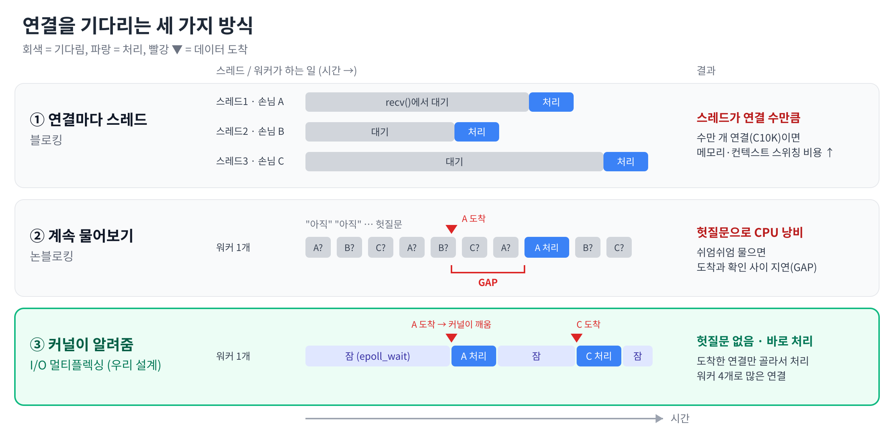
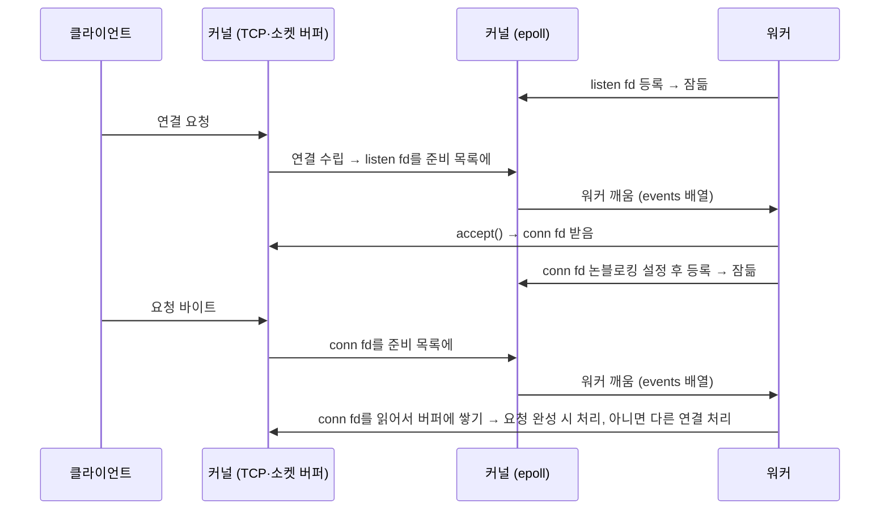
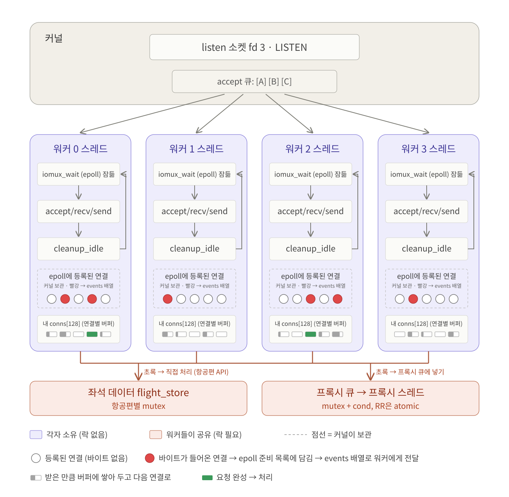
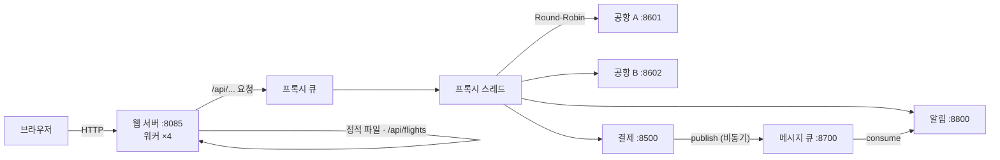
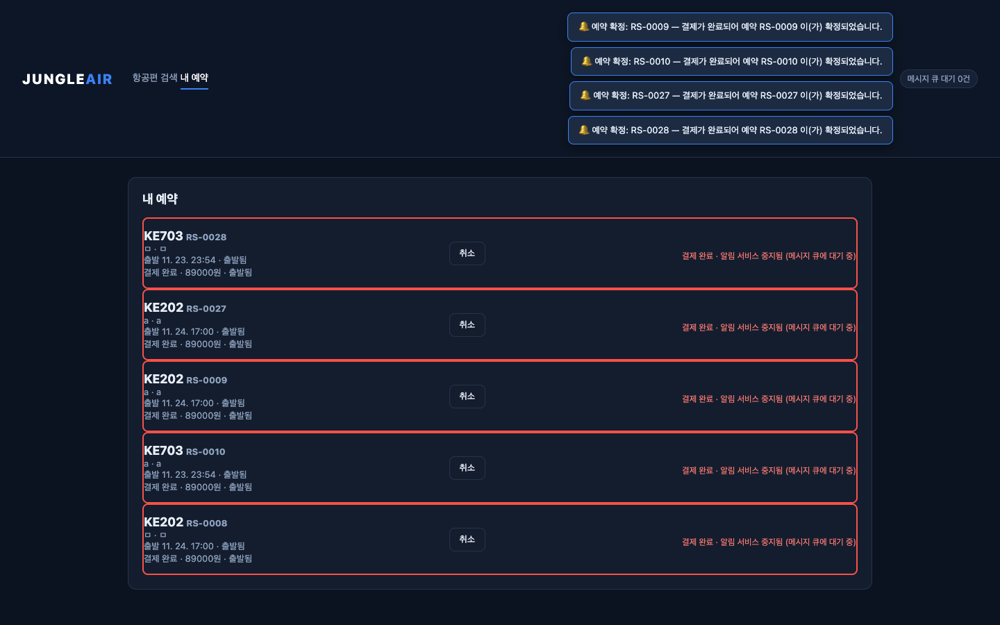
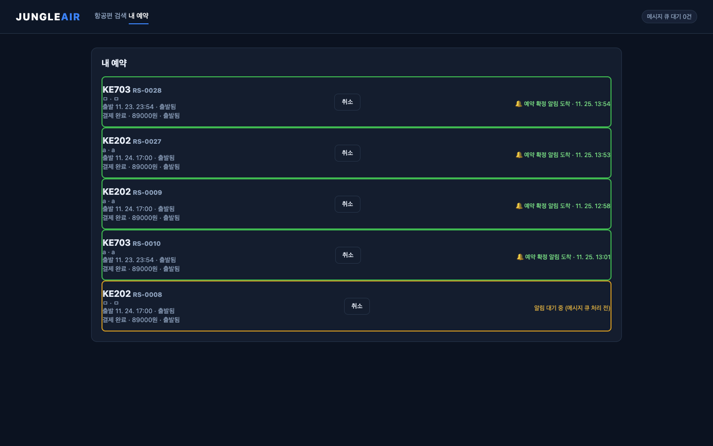

# C POSIX 웹 서버 — 항공편 예약 서비스 (1팀)

**팀:** 김은기 · 지영은 · 최무헌

## MOTO
실제 구현 및 동작 원리를 알자, 주위의 불편함을 개선하자 

## 한눈에 보기

발표 순서: 문제정의와 접근 방식 → 설계 및 시연 → 검증

- **서버 안:** 워커 스레드 4개가 각자 이벤트 루프(macOS `kqueue`, Linux `epoll`, 그 외 `poll`)를 돌려, 적은 스레드로 많은 연결을 처리합니다.
- **서버 뒤:** 웹 서버가 리버스 프록시로서, 다른 서비스가 답해야 하는 API 요청을 뒤의 서비스로 전달합니다. 결과가 바로 필요한 호출은 API(동기)로, 늦어도 되는 일은 메시지 큐(비동기)로 나눠, 알림 서비스가 멈춰도 결제는 멈추지 않게 했습니다.
- **검증:** 단위·기능·부하·메모리·엣지 케이스 테스트를 `make` 명령으로 다시 실행할 수 있습니다.

---

## 1. 문제정의와 접근 방식

저희는 '어떻게 하면 적은 스레드로 최대한 많은 요청을 처리할 수 있을까?'라는 질문에서 출발했습니다. 바이트가 네트워크로 오는 시간은 길지만, 바이트는 랜카드와 커널이 받으니까 그동안 CPU는 다른 요청을 처리할 수 있습니다. 여기서 해결의 실마리를 찾았습니다.

여러 연결을 처리하는 대표적인 방식 세 가지를 비교했습니다.

- **① 블로킹:** 그 연결의 요청이 다 들어오기 전까지 스레드가 연결 하나에 묶입니다. 그래서 연결 수만큼 스레드를 늘려야 하고, 연결이 수만 개면 메모리와 컨텍스트 스위칭 비용이 커집니다.
- **② 논블로킹:** 스레드는 배열의 연결을 하나씩 돌면서 바이트가 들어왔는지 커널에 계속 물어보고, 데이터가 들어온 연결만 처리합니다. 대부분 '아직 없음'인 확인에 CPU를 쓰고, 도착과 확인 사이에 지연이 생깁니다.
  


- **③ 멀티플렉싱 (선택):**
- 저희가 선택한 방식입니다. 논블로킹과 같은 점은 워커 하나가 여러 연결을 번갈아 처리한다는 것입니다(동시성). 차이점은 배열을 돌며 연결마다 직접 물어보는 대신, 커널이 바이트가 들어온 연결을 알려 준다는 것입니다. 그래서 워커는 할 일이 없으면 잠들어 CPU를 낭비하지 않고, 바이트가 오면 바로 깨어나 지연도 줄어듭니다.
- 단점은 연결당 버퍼와 상태를 따로 관리해야 해서 코드가 복잡합니다. 또 워커가 다른 서버의 응답을 기다리느라 멈추면, 그 워커가 맡은 다른 연결도 모두 함께 기다립니다. 그래서 다른 서버를 부르는 일은 프록시 스레드로 따로 분리했습니다.

자세한 문제 정의는 [docs/REQUIREMENTS.md](docs/REQUIREMENTS.md)에 있습니다.

## 2. 설계 ① 서버 안 — 멀티스레드 × I/O 멀티플렉싱

스레드는 연결 수와 상관없이 코어 수에 맞춰 워커 4개만 두었습니다.
- **메인 스레드:** listen 소켓을 만들고 워커와 프록시 스레드를 띄운 뒤, 종료할 때 워커가 끝나길 기다립니다.
- **워커:** 각자 자기 감시 목록(epoll/kqueue)을 갖고, listen 소켓도 직접 감시해 새 연결을 받습니다. 받은 연결은 그 워커가 맡고, 프록시로 갈 요청만 프록시 스레드에 넘깁니다.

아래는 워커 하나가 연결을 받고 요청을 처리하는 흐름입니다.



- **잠들었다가 깨어남:** 할 일이 없으면 잠들고, 새 연결이나 바이트가 오면 커널이 깨웁니다.
- **완성된 요청만 처리:** 바이트를 연결 버퍼에 이어 붙이고, 요청이 덜 왔으면 그 연결은 두고 다른 연결로 넘어갑니다.
- **동시성과 병렬성:** 워커 하나는 여러 연결을 번갈아 처리하고(동시성), 워커 4개는 코어 위에서 동시에 일합니다(병렬성).
- **keep-alive:** 응답 뒤에도 연결을 닫지 않고 다음 요청을 받습니다(최대 100회). 5초 동안 아무것도 오지 않으면 정리합니다.



| 제한 | 값 | 넘으면 |
|---|---|---|
| 워커당 동시 연결 | 128 (`MAX_CONNS`) | 새 연결을 받자마자 닫음 |
| URI 길이 | 2048 바이트 | 414 |
| 헤더 크기 | 8192 바이트 | 431 |
| 본문 크기 | 1 MiB | 413 |
| 유휴 연결 | 5초 | 연결 정리 |

이벤트 루프 동작 순서는 [`DESIGN.md` §2.2](docs/DESIGN.md#22-이벤트-루프--워커-안에서-일어나는-멀티플렉싱)에, `epoll`/`kqueue`/`poll`을 비교한 근거는 [notes/iomux.md](docs/notes/iomux.md)에 있습니다.

## 3. 설계 ② 서버 뒤 — 리버스 프록시와 메시지 큐



### 리버스 프록시

- 워커는 완성된 API 요청을 **프록시 큐에 넣고 바로 다른 연결로 돌아갑니다.** 뒤의 서비스를 기다리는 일은 프록시 스레드가 맡습니다.
- 프록시 스레드는 큐에서 하나씩 꺼내, 경로에 맞는 백엔드를 Round-Robin으로 고르고, 경로를 바꿔(`/api/payments/charge` → `/charge`) 전달한 뒤, 응답을 클라이언트에 보냅니다.
- 실패 처리: 연결 실패 502, 5초 안에 응답 없음 504, 프록시 큐가 256개로 차면 503.

| 경로 | 백엔드 | 역할 |
|---|---|---|
| `/api/airports/` | 공항 A `:8601`, 공항 B `:8602` | 항공편 상세의 공항 정보. 2대 Round-Robin. 한 대가 죽어도 그 칸만 안내 문구 |
| `/api/payments/` | 결제 `:8500` | 결제·환불, 중복 방지 키, 아웃박스 |
| `/api/notifications/` | 알림 `:8800` | 예약 확정 알림 조회 |
| `/api/mq/` | 메시지 큐 `:8700` | 대기 메시지 수 조회 (화면 배지) |

설정은 [`conf/backends.conf`](conf/backends.conf)의 `route = 경로|백엔드들|바꿀 경로` 줄입니다.

### 동기 API vs 메시지 큐

| 기능 | 방식 | 이유 |
|---|---|---|
| 공항 정보, 결제 | **API (동기)**: 응답을 기다림 | 결과를 화면에 바로 보여줘야 함 |
| 예약 확정 알림 | **메시지 큐 (비동기)** | 조금 늦어도 됨. 알림 서비스가 멈춰도 결제는 성공해야 함 |

- 결제 서비스는 결제를 저장한 뒤 알림 서비스를 직접 부르지 않고, `reservation.paid` 메시지를 메시지 큐에 넣고 바로 응답합니다(아웃박스 패턴: 큐가 죽어 있으면 보관했다가 다시 보냄).
- 알림 서비스는 1초마다 큐에서 메시지를 꺼내 알림을 만들고 처리 완료(ack)를 알립니다. 같은 메시지는 한 번만 알림이 됩니다.
- 그래서 알림 서비스나 메시지 큐가 멈춰도 결제는 성공하고, 다시 켜지면 밀린 알림이 처리됩니다.

### 왜 Reverse Proxy인가

| | Forward Proxy | Reverse Proxy (우리 선택) |
|---|---|---|
| 누구를 대신하나 | 클라이언트를 대신해 밖으로 요청 | 서버들을 대신해 요청을 받음 |
| 숨기는 대상 | 클라이언트 정체 | 백엔드 구성(IP·포트·수) |
| 부하 분산 | 해당 없음 | 여러 백엔드에 Round-Robin |

Forward Proxy는 구현하지 않았고 [`REQUIREMENTS.md` FR-08](docs/REQUIREMENTS.md)에서 범위 밖으로 정했습니다.

## 4. 시연 순서

명령 하나에 코드 블록 하나씩 두었습니다. 복사해서 그대로 붙여 넣으면 됩니다.

### 0. 데모 시작

```
make demo-up
```

브라우저(시크릿 창 권장): http://127.0.0.1:8085/flights.html

### 1. 라운드로빈 — 공항 서버 A, B가 번갈아 응답

항공편 상세를 두 번 열거나, 터미널에서:

```
for i in 1 2 3 4; do curl -s http://127.0.0.1:8085/api/airports/ICN; echo; done
```

### 2. 알림 서비스 끄기 → 결제는 성공, 메시지는 큐에 대기

```
make noti-down
```

결제 → '내 예약' 카드에 빨간 테두리. 큐에 대기 중인 메시지(`"ready": 1` 이상):

```
make mq-stats
```



### 3. 알림 서비스 켜기 → 밀린 알림 도착

```
make noti-up
```

2초 안에 같은 카드가 초록으로 바뀌고 토스트가 뜹니다. 큐 확인(`"ready": 0`):

```
make mq-stats
```



### 4. 부하 테스트 — 동시 100개 연결로 5000건

```
ab -n 5000 -c 100 http://127.0.0.1:8085/flights.html
```

`Requests per second`와 `Failed requests`를 확인합니다.

### 5. 잘못된 요청 거절

너무 긴 URL → 414

```
curl -s -o /dev/null -w '%{http_code}\n' "http://127.0.0.1:8085/$(python3 -c 'print("a"*3000)')"
```

1MiB 초과 본문 → 413

```
head -c 1100000 /dev/zero | curl -s -o /dev/null -w '%{http_code}\n' --data-binary @- http://127.0.0.1:8085/echo
```

### 6. 데모 종료

```
make demo-down
```

## 5. 검증

전체 회귀는 데모를 끈 상태에서 실행합니다(테스트가 같은 포트를 씁니다).

```
make demo-down
```

```
make verify-demo
```

| 과제 요구사항 | 명령 | 확인 내용 | 결과 |
|---|---|---|---|
| 단위: HTTP 파서 | `make test` | 요청 줄·헤더·본문 경계, `NEED_MORE`/`COMPLETE`/`ERROR` | 통과 |
| 단위: MIME 매핑·경로 보안 | `make test` (`test_static`, `test_mime`) | 확장자별 MIME, 모르는 확장자, 지정 폴더 밖 접근 차단, 404 | 통과 |
| 단위: 라우팅·프록시 전달 로직 | `make test` (`test_route`, `test_proxy`) | prefix 매칭, 경로 바꾸기, Round-Robin 순서, 일치하는 route 없음 | 통과 |
| 기능: 실제 HTTP 클라이언트 (curl) | `make integration`, `make integration-req` | 정적 파일, keep-alive, 프록시 RR·X-Forwarded-For·502·504 | 통과 |
| 기능: 동시 다중 클라이언트 | `make integration`, `make integration-concurrent` | 100개 동시 접속, 동시 curl 50개 전부 200, 느린 클라이언트가 다른 요청을 막지 않음 | 통과 |
| 기능: 브라우저 | 시연 순서 2~3 | 예약 → 결제 → 알림, 서비스 중지 시 빨간 테두리 | 수동 확인 |
| 기능: 서비스 장애 격리 | `make integration-airports`, `make integration-notifications` | 공항 B 종료 시 그 차례만 502, 알림·큐 장애에도 결제 201, 재시작 후 밀린 알림 처리 | 통과 |
| 부하 (`hey`, `/health`) | 아래 표 | 동시 수별 처리량 | 동시 100: 63,174 RPS, 에러 0 |
| 부하 (`ab`, 정적 `/flights.html`) | 시연 순서 4 | 동시 10 / 50 / 100, 각 5000건 | 6,470 / 6,346 / 7,551 RPS, 실패 0 |
| 부하 (`ab`, 프록시 `/api/airports/ICN`) | `ab -n 1000 -c 10 -s 10` | 프록시 스레드 → 공항 서버 A/B | 4,331 RPS, 평균 2.3ms, 실패 0 |
| 부하: 트래픽 급증·큐 상한 | `make review-cases` | 동시 100 × 1000 요청 Non-2xx 0, 프록시 큐가 차면 503 | 통과 |
| 메모리: 잘못된 접근 | ASan + UBSan 빌드로 `integration`, `edge-cases`, `integration-req`, `integration-airports` 실행 (Linux) | 버퍼 넘침, 해제 후 사용, 정의되지 않은 동작 | 오류 0 |
| 메모리: 누수 | `-fsanitize=leak` 빌드로 위 시나리오 실행 (Linux), `make leak` (Docker valgrind) | 정상 종료(SIGTERM) 후 누수 | 누수 0 |
| 메모리: 데이터 경합 | `make tsan` + `make integration-flight` | 좌석 경쟁: 락을 끈 before 모드에서만 경합 재현, 락을 건 after 모드 경합 0 | before 1건(의도된 재현), after 0 |
| 엣지: 비정상 메서드 / 잘못된 버전 / 깨진 요청 줄 | `make edge-cases` | 405 / 505 / 400 | 통과 |
| 엣지: 매우 긴 URI / 큰 본문 / 큰 헤더 | `make edge-cases` | 414 / 413 / 431 | 통과 |
| 엣지: 백엔드 없음 / 타임아웃 | `make edge-cases`, `make integration-req` | 502 / 504 | 통과 |
| 엣지: 갑작스러운 연결 종료 | `make edge-cases` | 불완전 요청 후 끊김, RST 후 서버 생존 | 통과 |
| 엣지: 불완전한 헤더 / 유휴 연결 | `make edge-cases` | 헤더를 덜 보내고 멈춘 연결, 아무것도 안 보내는 연결 → 5초 후 정리 | 통과 |
| 재시작: 같은 포트 | `make restart-test` | `SO_REUSEADDR`로 `Address already in use` 없음 | 통과 |

`make asan`, `make tsan`은 바이너리를 sanitizer 빌드로 다시 만듭니다. 검사 후에는 `make clean` 후 `make`로 일반 빌드로 되돌립니다.

### 부하 테스트 (macOS, `hey`, `/health`)

`hey -n 20000 -c <동시>`를 `WEB_WORKERS=1`과 `4`로 나눠 돌린 결과입니다. 단위는 ms.

| 동시 | 워커 | RPS | p50 | p95 | p99 | 성공/에러 |
|---|---|---|---|---|---|---|
| 10 | 1 | 59,542 | 0.10 | 0.30 | 0.50 | 20000 / 0 |
| 10 | 4 | 52,412 | 0.20 | 0.30 | 0.50 | 20000 / 0 |
| 100 | 1 | 52,818 | 1.80 | 2.90 | 3.70 | 20000 / 0 |
| 100 | 4 | 63,174 | 1.50 | 2.70 | 3.50 | 20000 / 0 |
| 1000 | 1 | 11,549 | 31.20 | 257.40 | 360.20 | 16155 / 3845 |
| 1000 | 4 | 4,734 | 62.10 | 835.50 | 2510.80 | 18097 / 1903 |

- 동시 10~100에서는 워커 수를 늘려도 큰 차이가 없습니다. `/health`는 일이 짧아 병렬화 이득이 적습니다.
- 동시 1000에서는 워커당 연결 상한(128)을 넘는 연결을 서버가 받자마자 닫고, 맥의 임시 포트 고갈도 함께 나옵니다. 서버 프로세스는 죽지 않았고, 부하 후 `/health`는 200이었습니다.

### 부하 테스트 (macOS, `ab`)

| 대상 | 동시 | 요청 수 | RPS | 평균 응답 (ms) | 실패 |
|---|---|---|---|---|---|
| 정적 `/flights.html` | 10 | 5000 | 6,470 | 1.55 | 0 |
| 정적 `/flights.html` | 50 | 5000 | 6,346 | 7.88 | 0 |
| 정적 `/flights.html` | 100 | 5000 | 7,551 | 13.24 | 0 |
| 프록시 `/api/airports/ICN` | 10 | 1000 | 4,331 | 2.31 | 0 |

- 같은 노트북에서 클라이언트(ab)와 서버를 함께 돌려 측정값이 실행마다 흔들립니다(동시 100에서 11,488 RPS가 나온 실행도 있음).
- 프록시 경로는 프록시 스레드 1개를 거쳐 Python 백엔드까지 다녀와 정적 파일보다 낮습니다.

상세 출력은 [records/VERIFICATION_LOG.md](docs/records/VERIFICATION_LOG.md)에 있습니다.

## 6. 한계와 개선

| 한계 | 영향 | 개선 방향 |
|---|---|---|
| 프록시 스레드 1개 | 느린 백엔드 하나가 큐의 뒤 요청을 막음 (head-of-line blocking) | 백엔드 서비스별 큐 + 프록시 스레드 여러 개 |
| 헬스 체크 없음 | 죽은 백엔드에도 차례가 돌아가 그 요청은 502 | 연결 실패 시 다른 백엔드로 재시도, 주기적 헬스 체크 |
| 인증·권한 없음 | 브라우저별 임시 ID로 예약 구분, 관리자 API 공개 | 로그인 서비스가 토큰 발급, 게이트웨이에서 검증 |
| TLS 없음 | 평문 통신 | 게이트웨이에서 TLS 종료 |
| 캐시 무효화 API 없음 | 로컬 CDN 캐시는 TTL 만료로만 정리 | 무효화 API |
| 느린 공격(slowloris) | 5초 유휴 정리로 일부만 방어 | 요청 완성 시간 상한, 연결당 속도 하한 |

---

## 문서 범위

| 문서 | 범위 |
|---|---|
| [STEP01_TCP_SERVER.md](docs/iterations/STEP01_TCP_SERVER.md) | TCP 소켓 서버 |
| [STEP02_HTTP_PARSER.md](docs/iterations/STEP02_HTTP_PARSER.md) | HTTP 요청 파싱 |
| [STEP03_HTTP_RESPONSE.md](docs/iterations/STEP03_HTTP_RESPONSE.md) | HTTP 응답 생성 및 전송 |
| [STEP04_STATIC_FILE.md](docs/iterations/STEP04_STATIC_FILE.md) | 정적 파일 서빙 |
| [STEP05_CONCURRENCY.md](docs/iterations/STEP05_CONCURRENCY.md) | 워커 풀 + 이벤트 루프, keep-alive, 동시성 검증 |
| [STEP06_FLIGHT_DEMO.md](docs/iterations/STEP06_FLIGHT_DEMO.md) | 항공편 예약·출발/도착 추적, 좌석 경쟁 before/after |
| [EXT01_DOMAIN_COMPLETION.md](docs/iterations/EXT01_DOMAIN_COMPLETION.md) | 영속 저장·락·시계 전이로 도메인 완성 (확장) |
| [EXT02_REQUIREMENTS_WRAPUP.md](docs/iterations/EXT02_REQUIREMENTS_WRAPUP.md) | 요구사항 확정, 헤더·로그·경계 케이스 (확장) |
| [EXT03_BACKEND_SERVICES.md](docs/iterations/EXT03_BACKEND_SERVICES.md) | mini-redis·mini-dbms 별도 프로세스 연결 (확장, 실험용) |
| [EXT04_PAYMENT_SERVICE.md](docs/iterations/EXT04_PAYMENT_SERVICE.md) | 결제 서비스 분리, 중복 방지 키·환불·화면 흐름 (확장) |
| [DECISIONS.md](docs/DECISIONS.md) | 구현 과정에서 실제로 확정한 결정 기록 |
| [notes/iomux.md](docs/notes/iomux.md) | I/O 멀티플렉싱·이벤트 루프를 고른 이유와 대안 비교 |
| [notes/runtime-internals.md](docs/notes/runtime-internals.md) | 런타임 동작·네트워크 개념 |
| [DESIGN.md](docs/DESIGN.md) | 아키텍처, 이벤트 루프 동작 순서, 실제 동작 원리 |
| [TEAM_RULES.md](docs/TEAM_RULES.md) | 팀이 확정한 규칙 |

## 구현된 기능

| 기능 | 진입점 | 검증 명령 |
|---|---|---|
| 워커 풀 + `iomux` 이벤트 루프(Linux epoll / macOS kqueue / 폴백 poll) + keep-alive(최대 100회) | `src/worker.c`, `src/iomux.c`, `src/connection.c` | `make integration`, `make load-test` |
| 항공편 예약 + 파일 영속 저장 | `src/flight_store.c`, `src/flight_api.c` | `make test-flight`, `make integration-flight`, `make integration-persist` |
| 출발/도착 자동 추적 + 지연 | `src/flight_clock.c`, `www/ops.html` | `make test-tracking`, `make integration-tracking` |
| Date/Server 헤더, `/health`, `/echo`, 접근 로그, `-p/-r/-c` | `src/http_response.c`, `src/config.c` | `make integration-req` |
| 리버스 프록시(게이트웨이 라우팅 + Round-Robin) | `src/proxy.c`, `conf/backends.conf` | `make integration-req` |
| 로컬 미니 CDN(TTL 캐시, `X-Cache: HIT/MISS`) | `src/cdn.c` | `make integration-req` |
| 공항 정보 서비스 2대(라우팅·RR·장애 격리) | `tests/backends/serve_airports.py` | `make integration-airports` |
| 결제 서비스(중복 방지 키·환불·아웃박스) | `tests/backends/serve_payments.py` | `make integration-payments` |
| 메시지 큐 + 예약 확정 알림(비동기) | `tests/backends/serve_mq.py`, `tests/backends/serve_notifications.py` | `make integration-notifications` |

실험용 백엔드(이전 주차 mini-redis·mini-dbms, `/api/cache/`·`/api/stocks/`·`/api/orders/`)는 데모 설정에서 분리해 `conf/backends.experimental.conf`와 `make integration-backends`(옆 레포 필요)로만 씁니다.

## 로컬에서 돌려보는 방법

빌드와 기본 실행(포트 8080):

```
make
```

```
./webserver
```

데모 전체(웹 서버 8085 + 결제 + 공항 A/B + 메시지 큐 + 알림):

```
make demo-up
```

브라우저: `http://127.0.0.1:8085/flights.html`(예약), `http://127.0.0.1:8080/ops.html`(운항 관제, 기본 실행 시)

검증 명령:

| 명령 | 내용 |
|---|---|
| `make test` | 단위 테스트 |
| `make integration` | keep-alive·slow client·100동시 |
| `make integration-flight` | 좌석 경쟁 HTTP 통합(before/after) |
| `make integration-persist` | 재시작 후 예약 유지 |
| `make integration-tracking` | 자동 출발/도착 |
| `make integration-req` | 헤더/health/echo/프록시/캐시 |
| `make integration-airports` | 공항 RR·장애 격리 |
| `make integration-payments` | 결제 충전·중복 방지 키·환불·독립 재시작 |
| `make integration-notifications` | 결제 → 메시지 큐 → 알림, 장애 시나리오 5개 |
| `make edge-cases` | 잘못된 요청·큰 본문·백엔드 없음·클라이언트 끊김·유휴 |
| `make review-cases` | 트래픽 급증·느린 클라이언트·프록시 큐 상한 |
| `make restart-test` | 같은 포트 재시작 시 `Address already in use` 없음 |
| `make load-test`, `make load-test-heavy` | 부하 |
| `make tsan`, `make asan`, `make leak` | 데이터 경합, 메모리 오류, 누수(Docker) |
| `make mutation` | 뮤테이션 테스트 |
| `make verify-demo` | 데모 구성 회귀(test, flight, airports, notifications, edge-cases) |

정리: `kill -TERM <pid>`(graceful shutdown, 종료 코드 0), `make reset-flights`(예약 데이터 초기화), `make demo-down`(데모 종료).

## 모듈과 디렉터리 구조

모듈별 책임과 의존 규칙은 [docs/DESIGN.md §4](docs/DESIGN.md#4-모듈--의존--소유권--계약)에 있습니다.

```text
src/ include/   main, tcpserver, worker, iomux, connection, config,
                flight_*, proxy, cdn, http_parser, http_response, static_handler
www/            flights.html/js, pay.html/js, ops.html/js, 정적 자산
conf/           tcpserver.conf(기본), backends.conf(데모 게이트웨이), backends.experimental.conf(실험용)
tests/          unit/, integration/, backends/(Python 백엔드 서비스)
docs/           REQUIREMENTS, DESIGN, DECISIONS, iterations/, agent/, records/, verify/, notes/, img/
```

## 문서 작성 원칙

- 구현하지 않은 기능을 완료한 것처럼 기록하지 않습니다.
- 실행하지 않은 테스트를 통과했다고 기록하지 않습니다.
- 합의하지 않은 설계를 확정된 결정으로 기록하지 않습니다.
- 새로 결정한 내용은 `DECISIONS.md`에 근거와 함께 기록합니다.

참고 문서: [REQUIREMENTS.md](docs/REQUIREMENTS.md) · [DESIGN.md](docs/DESIGN.md) · [TEST_MATRIX.md](docs/verify/VERIFICATION_MATRIX.md) · [VERIFICATION_LOG.md](docs/records/VERIFICATION_LOG.md)
