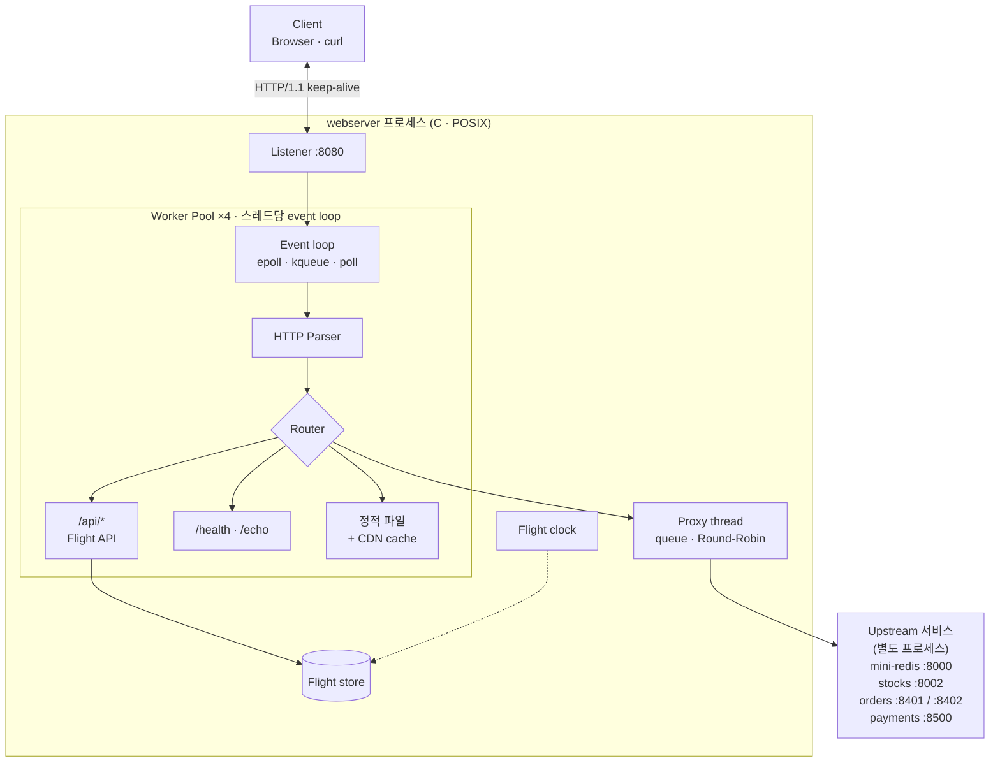
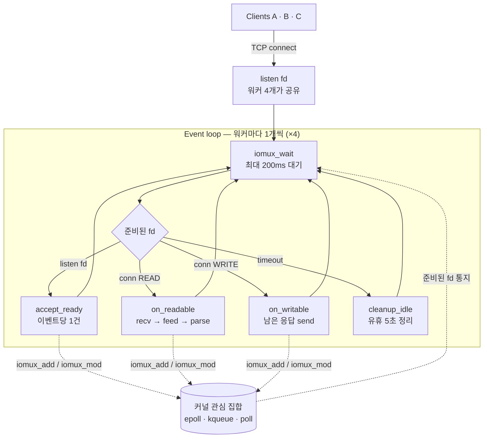

# Architecture Design

외부 라이브러리 없이 C11 + POSIX만으로 만든 웹서버의 **최종 설계**와, 그 설계가 **어떤 문제에서 출발해 어떻게 바뀌었는지**를 담습니다.

문서마다 맡은 일이 하나씩 있어서, 이 문서는 "무엇을 설계했나"만 쓰고 나머지는 링크로 넘깁니다.

| 알고 싶은 것 | 문서 |
|---|---|
| 왜 이 문제를 푸나 | [REQUIREMENTS.md](REQUIREMENTS.md) |
| 왜 이 기술인가, 대안은 | [DECISIONS.md](DECISIONS.md) (D번호) |
| 무엇으로 검증하나, 통과했나 | [verify/VERIFICATION_MATRIX.md](verify/VERIFICATION_MATRIX.md) |
| 요구사항이 어느 코드로 갔나 | [verify/TRACEABILITY.md](verify/TRACEABILITY.md) |
| 실제 실행 결과 | [records/VERIFICATION_LOG.md](records/VERIFICATION_LOG.md) |
| 개념 설명(커널·소켓) | [notes/runtime-internals.md](notes/runtime-internals.md), [notes/iomux.md](notes/iomux.md) |

## 1. 문제 정의

자세한 배경은 [REQUIREMENTS.md — 이 프로젝트가 푸는 중심 문제](REQUIREMENTS.md#이-프로젝트가-푸는-중심-문제)에 있습니다. 설계를 이끈 문제는 넷입니다.

1. **느린 클라이언트(slow client) 하나가 전체를 막는다.** 동시에 100개 이상을 받아야 한다. (FR-06)
2. **여러 요청이 같은 좌석을 동시에 고친다.** 초과 예약이 나면 안 된다. (FR-05)
3. **서비스가 한 프로세스에 묶이면** 배포·장애·확장이 같이 묶인다. 느린 업스트림이 서버 전체를 막아서도 안 된다. (FR-07, NFR-03)
4. **C에는 GC가 없다.** 메모리·fd를 누가 해제하는지 정하지 않으면 누수와 double-close가 쌓인다. (NFR-01, NFR-02)

제약: C11 + POSIX만, 외부 HTTP·이벤트 루프 라이브러리 금지, Linux·macOS 모두 빌드 ([REQUIREMENTS.md — 제약](REQUIREMENTS.md#기술-스택-및-환경-제약-constraints)).

## 2. 최종 설계

### 2.1 구성도 — 요청이 지나는 경로



### 2.2 이벤트 루프 — 워커 안에서 일어나는 멀티플렉싱

워커 4개가 각자 아래 루프를 하나씩 돌립니다. listen fd는 공유하고, accept한 연결은 그 워커가 끝까지 소유합니다.



- `on_readable()`: `recv()` → `connection_feed()` → `http_parser_parse()`. 요청이 완성되면 응답을 `send_buf`에 넣고 `iomux_mod(WRITE)`로 쓰기 관심으로 바꿉니다.
- `on_writable()`: 남은 응답을 `send()`. 다 보내면 다시 READ로.
- `cleanup_idle()`: 유휴 5초가 넘은 연결을 닫습니다. 200ms 타임아웃은 이벤트가 없어도 정리와 종료 플래그를 확인하기 위한 것입니다.

큐와 버퍼가 어디에 있는지:

| 큐/버퍼 | 위치 | 담기는 것 | 넣는 쪽 → 꺼내는 쪽 |
|---|---|---|---|
| `listen` 대기열 | 커널 | 완성된 연결 | 커널 → `accept()` |
| `epoll` 준비 목록 | 커널 | 준비된 fd | 커널 → `iomux_wait()` |
| `worker_ctx.conns[]` | 앱(워커별) | 연결 슬롯 | `accept_ready()` → `close_conn()` |
| 프록시 작업 큐 | 앱(공유) | 업스트림 작업 | 워커 → 프록시 스레드 |

## 3. 설계 결정 ↔ 문제 ↔ 근거 ↔ 검증

설계 결정 하나가 한 행입니다. 이유·대안은 D번호로, 검증 명령과 통과 여부는 매트릭스의 요구사항 행으로 넘깁니다.
이 표에는 상태(PASS 등)를 적지 않습니다. 상태는 매트릭스 한 곳에만 둡니다.

| 설계 결정 | 푸는 문제 | 근거·대안 | 검증 |
|---|---|---|---|
| 워커 스레드 4개 × 각자 event loop, 단일 프로세스 | 1 (FR-06) | [D5](decisions/STEP05_CONCURRENCY_DECISIONS.md), [대안 비교](DECISIONS.md#대안-비교) | [매트릭스 FR-06](verify/VERIFICATION_MATRIX.md) |
| `iomux`: epoll / kqueue / poll 폴백, 레벨 트리거 | 1 (FR-06), 제약 C-03 | [D9·D21](decisions/STEP05_CONCURRENCY_DECISIONS.md) | [매트릭스 FR-06, C-03](verify/VERIFICATION_MATRIX.md) |
| 이벤트당 accept 1건 | 1 (FR-06) | [D10](decisions/STEP05_CONCURRENCY_DECISIONS.md) | [매트릭스 FR-06](verify/VERIFICATION_MATRIX.md) |
| keep-alive 최대 100회, 유휴 5초 | 1 (NFR-03) | [D4(폐기→keep-alive)](decisions/STEP03_HTTP_RESPONSE_DECISIONS.md), D10 | [매트릭스 NFR-03](verify/VERIFICATION_MATRIX.md) |
| 항공편별 락 + 메타 락, 파일 쓰기는 락 밖 | 2 (FR-05) | [D6·D12](decisions/STEP06_FLIGHT_DEMO_DECISIONS.md) | [매트릭스 FR-06·도메인 영속 저장](verify/VERIFICATION_MATRIX.md) |
| prefix 라우팅 + Round-Robin을 프록시 모듈 하나로 | 3 (FR-07) | [D18](decisions/STEP06_FLIGHT_DEMO_DECISIONS.md) | [매트릭스 FR-07](verify/VERIFICATION_MATRIX.md) |
| 업스트림 호출은 전용 프록시 스레드 + 큐, `dup()`로 fd 소유권 이전 | 3 (NFR-03) | [D22](decisions/STEP05_CONCURRENCY_DECISIONS.md) | [매트릭스 FR-07](verify/VERIFICATION_MATRIX.md) |
| 캐시·DB·결제는 별도 프로세스, 예약·좌석은 C 서버 안 | 3 (FR-07) | [D27·D28](decisions/STEP06_FLIGHT_DEMO_DECISIONS.md) | [매트릭스 별도 백엔드·결제](verify/VERIFICATION_MATRIX.md) |
| 정적 파일: `realpath` 경계 검사, MIME, 미니 CDN(TTL) | FR-04 | [보안 정책](DECISIONS.md#보안-정책), [D17](decisions/STEP04_STATIC_FILE_DECISIONS.md) | [매트릭스 FR-04](verify/VERIFICATION_MATRIX.md) |
| 파서는 fd를 모르는 순수 함수, `consumed`로 요청 경계 확정 | FR-02 | [D3](decisions/STEP02_HTTP_PARSER_DECISIONS.md) | [매트릭스 FR-02](verify/VERIFICATION_MATRIX.md) |
| 리소스마다 해제 주체 하나 (§4) | 4 (NFR-01·02) | §4 | [매트릭스 NFR-01·02](verify/VERIFICATION_MATRIX.md) |

검증 원칙은 매트릭스를 따릅니다: [VERIFICATION_LOG.md](records/VERIFICATION_LOG.md)에 실행 기록이 있어야 PASS로 적고, 실패 기록은 지우지 않습니다.

## 4. 모듈 · 의존 · 소유권 · 계약

### 모듈 책임

| 모듈 | 책임 | 주요 의존 |
|---|---|---|
| `main` | 부트스트랩, 시그널, 워커 풀·프록시 스레드 기동 | config, tcpserver, worker, proxy, flight_store |
| `config` | `-p/-r/-c`와 설정 파일 파싱, 라우트 테이블 | 없음 |
| `tcpserver` | listen 소켓 생성·bind·listen | config |
| `iomux` | epoll/kqueue/poll 추상화 | 없음 |
| `worker` | 워커 event loop, accept, 유휴 정리, 접근 로그 | iomux, connection |
| `connection` | 연결 상태 머신(feed/flush), keep-alive | parser, response, static, flight_api, proxy, cdn |
| `http_parser` | HTTP/1.1 파싱, `consumed`로 경계 확정 | 없음(순수 함수) |
| `static_handler` | realpath 경계 검사, MIME, 파일 핸들 | http_response |
| `http_response` | 상태·헤더·본문 직렬화, 파일 청크 | 없음 |
| `flight_api` | 항공편 JSON API 라우팅·직렬화 | flight_store, flight_clock, http_response |
| `flight_store` | 예약·취소·영속 저장, 항공편별 락 | 없음 |
| `flight_clock` | real/sim 시계, 자동 출발·도착 | 없음 |
| `cdn` | 정적 자산 TTL 캐시, `X-Cache`/`ETag` | http_response |
| `proxy` | prefix 게이트웨이, Round-Robin, 전용 스레드 큐 | http_response |

### 의존 규칙

의존은 아래 방향으로만 흐릅니다. 아래 계층은 위 계층을 include하지 않습니다.

```text
Layer 0  config, iomux, flight_store, flight_clock, http_response, http_parser
Layer 1  tcpserver, worker
Layer 2  connection, static_handler, cdn, proxy, flight_api
Layer 3  main
```

- `http_parser`는 소켓 fd를 모르고 버퍼만 받습니다. 그래서 단위 테스트가 쉽습니다.
- `connection`은 핸들러들을 알지만, 핸들러는 `connection`을 모릅니다.
- 빌드는 `-MMD -MP`로 헤더 의존성을 추적합니다([D25](decisions/STEP05_CONCURRENCY_DECISIONS.md)).

### 소유권 — 해제 주체는 하나

- conn fd: accept한 워커가 끝까지 소유하고 `close_conn()`에서만 닫습니다.
- 프록시 큐: `dup()`로 복제한 fd는 큐(프록시 스레드)가 소유하고 닫습니다. 원본은 워커가 소유합니다.
- 정적 파일 fd: 응답이 파일을 스트리밍하는 동안 `connection`이 소유하고, 다 보내면 닫습니다.
- `flight_store_list(out, cap)`는 `out`에 쓰기만 하고 해제하지 않습니다.

### 계약 — 시그니처로 드러나지 않는 약속

- `http_parser`: `PARSE_COMPLETE`는 `consumed` 바이트를 확정합니다. `connection`은 버퍼를 그만큼 앞으로 당겨야 합니다.
- `flight_store_reserve()`: 잔여 좌석이 0이면 실패하고, 성공할 때만 예약 ID를 돌려줍니다. 락 안에서는 스냅샷만 만들고 파일 쓰기는 락 밖에서 합니다.
- `proxy`: prefix를 rewrite 경로로 바꿔 업스트림에 넘기고, 연결 실패는 502, 응답 지연은 504로 구분합니다.
- 결제 서비스: 프록시가 임의 헤더를 넘기지 않으므로 중복 방지 키는 본문의 `idempotency_key`로 받습니다([D28](decisions/STEP06_FLIGHT_DEMO_DECISIONS.md)).

## 5. 설계가 바뀐 과정 — 초안 → AI 문답 → 검증 루프 → 최종

§2의 최종 설계는 한 번에 나오지 않았습니다. 아래 순서로 고쳐 왔고, 단계마다 원본 기록을 링크합니다.

| 단계 | 무엇을 했나 | 원본 기록 |
|---|---|---|
| ① 초안 | STEP1~4 범위의 모듈 스텁과 호출 순서를 잡고 검토. 동시성은 별도 판정으로 미룸 | [records/reviews/DESIGN_REVIEW_2026-11-21.md](records/reviews/DESIGN_REVIEW_2026-11-21.md), [iterations/](iterations/) |
| ② 직접 학습 | 소켓 식별, 멀티플렉싱 개념을 먼저 공부 (AI 문답 아님) | [study/study_log.md](../study/study_log.md) |
| ③ AI 문답 | 설계 질문을 AI에 묻고, 실행으로 확인한 것만 채택·기각 | [agent/AI_QA_LOG.md](agent/AI_QA_LOG.md) |
| ④ 검증 루프 | 실행하다 드러난 결함을 고치고 같은 명령으로 재검증 | [verify/VERIFICATION_MATRIX.md — 검증에서 잡은 문제](verify/VERIFICATION_MATRIX.md#검증에서-잡은-문제), [records/VERIFICATION_LOG.md](records/VERIFICATION_LOG.md) |
| ⑤ 최종 설계 | §2, §3 | 이 문서 |

### ③ AI 문답에서 바뀐 것

| 질문 | 결론 | 설계에 남은 것 |
|---|---|---|
| 멀티프로세스 + 멀티플렉싱이 맞나 | 공유 좌석을 `fork`로 나누면 사본·IPC가 생김 → 기각 | 단일 프로세스 + 워커 스레드 (D5) |
| `poll`이면 충분한가 | 준비된 fd만 받는 epoll/kqueue가 연결 증가에 유리 | epoll/kqueue + poll 폴백 (D9·D21) |
| 한 이벤트에 accept를 여러 번 해도 되나 | 한 워커가 독점해 동시성 데모가 사라짐 | 이벤트당 1건 (D10) |
| HTTP 메시지 큐가 필요한가 | 요구사항에 없음, 워커↔프록시 작업 큐로 충분 → 기각 | 인메모리 작업 큐만 |

전체 질의와 근거는 [AI_QA_LOG.md](agent/AI_QA_LOG.md)에 있습니다.

### ④ 검증 루프에서 잡아 고친 것

실행 중 드러난 문제·원인·수정·재검증 명령은 [records/ERROR_FIX_HISTORY.md](records/ERROR_FIX_HISTORY.md)에 모아 둡니다.
이 과정에서 확정된 구조 변화는 §3 표와 `DECISIONS.md`에 남았습니다.

구현하지 않기로 한 것도 결정으로 남겼습니다: HTTP/2·TLS는 앞단 게이트웨이에서 종료(D26), chunked 요청 본문은 501(D3).

## 6. 한계와 다음 단계

의도적으로 합쳐 둔 곳입니다. 필요해지면 나눕니다.

- `flight_api.c`: JSON 파서·직렬화·라우팅·핸들러가 한 파일 → `json.c` / `flight_router.c` / `flight_handlers.c`로 나눌 수 있음.
- `proxy.c`: 라우트 매칭·RR·스레드 큐가 한 파일 → `router.c` / `backend_pool.c` / `proxy_thread.c`.
- 접근 로그가 `worker.c` 안에 있음 → `logger.c`.
- 크래시 격리가 없음: 워커가 스레드라 한 워커의 크래시가 프로세스 전체를 내림(D5의 대가).

아직 검증하지 않은 것(매트릭스 `NOT RUN`)과 남은 작업은 [verify/VERIFICATION_MATRIX.md](verify/VERIFICATION_MATRIX.md), [agent/DAILY_SCOPE.md](agent/DAILY_SCOPE.md)에 있습니다.
