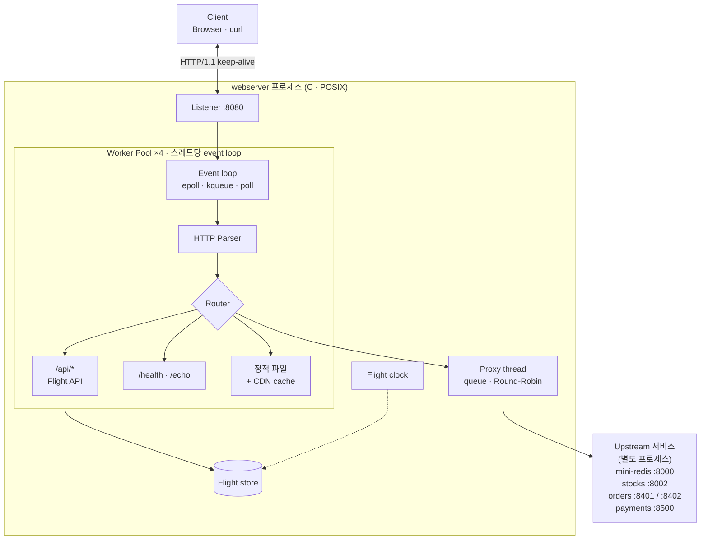
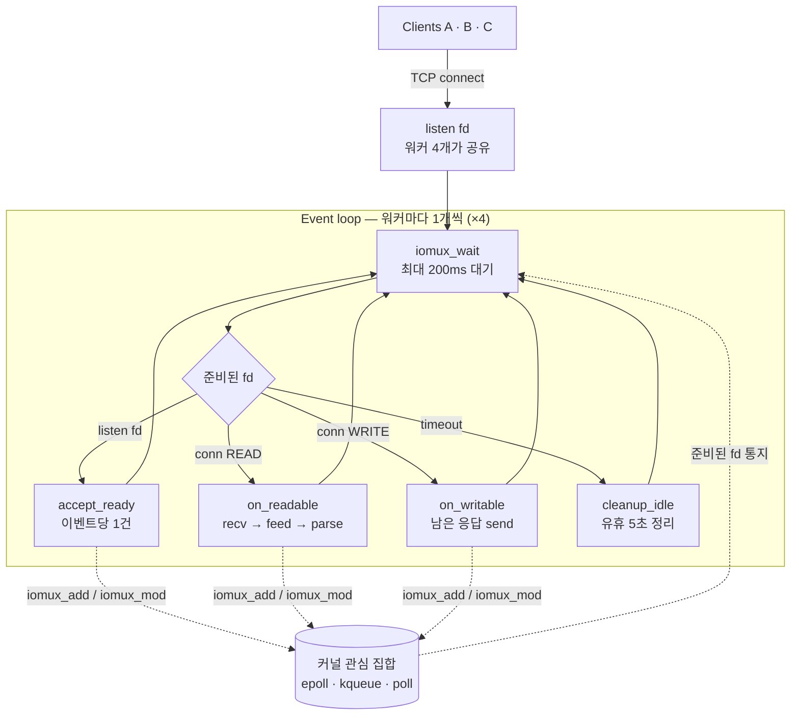

# Architecture Design

본 문서는 외부 라이브러리 없이 C11과 POSIX API만으로 구현된 웹 서버의 아키텍처,
모듈 책임, 그리고 모듈 사이의 의존성·소유권·계약을 다룹니다.

## 시스템 아키텍처 개요

단일 바이너리 안에서 워커(프로세스/스레드) N개가 공유 listen fd를 받고,
각자 `iomux`(epoll/kqueue/poll) 인스턴스로 이벤트를 처리합니다.
요청은 게이트웨이(정적 파일 / 항공편 API / 프록시 라우트 / 미니 CDN)로 분기됩니다.

### 전체 아키텍처



프록시 스레드는 업스트림 응답을 클라이언트에 직접 보냅니다. 이벤트 루프 안의 블로킹 호출을 없애서, 업스트림 지연이 워커와 `/health`를 막지 않게 했습니다.

### 데이터 흐름 (Data Flow)

```text
[Network]
   -> iomux (epoll/kqueue/poll)
   -> worker (accept 1건/이벤트)
   -> connection (feed: 비동기 recv + 버퍼)
   -> http_parser (메모리 버퍼만 읽음, FD 모름)
   -> route: static_handler | flight_api | cdn | proxy
   -> http_response (직렬화, 파일은 청크 스트림)
   -> connection (flush: 비동기 send, EAGAIN이면 다시 큐)
   -> [Network]
```

### 이벤트 루프 동작 원리

워커 풀(고정 4개) → 각 워커가 이벤트 루프를 돌림 → 루프가 멀티플렉싱(`iomux`)으로 커널 관심 집합을 감시합니다.



- `on_readable()`: `recv()` → `connection_feed()` → `http_parser_parse()`. `COMPLETE`면 응답을 `send_buf`에 넣고 `iomux_mod(WRITE)`으로 쓰기 관심 전환. `NEED_MORE`면 다음 `READ`를 기다림.
- `on_writable()`: `send()`로 남은 응답을 보냄. 다 보내면 연결 상태 정리.
- `cleanup_idle()`: 유휴 5초가 넘은 연결을 닫고, keep-alive 최대 100회도 여기서 확인.
- 200ms 타임아웃은 준비된 이벤트가 없어도 유휴 정리와 종료 플래그를 확인하기 위함.

큐의 위치:

| 큐/버퍼 | 위치 | 담기는 것 | 누가 넣고 누가 꺼내나 |
|---|---|---|---|
| `listen` 대기열 | 서버 커널 | 완성된 연결 | 커널이 넣고, `accept()`가 꺼냄 |
| 소켓 수신 버퍼 | 양쪽 커널 | 바이트 | 상대가 `write()`, 내가 `read()` |
| `epoll` 준비 목록 | 서버 커널 | 준비된 fd | 커널이 넣고, `iomux_wait()`가 꺼냄 |
| `worker_ctx.conns[]` | 서버 앱 | 연결 슬롯 | `accept_ready()`가 넣고, `close_conn()`이 뺌 |
| 프록시 작업 큐 | 서버 앱 | `/api` 작업 | 워커가 넣고, 프록시 스레드가 꺼냄 |

- `accept()`는 별도 스레드가 아니라 워커 안에서 실행되고, 이벤트당 한 번씩만 꺼냅니다(D10). 한 번에 여러 개를 꺼내면 한 워커가 독점하게 됩니다.
- 느린 연결은 `READ`가 늦게 준비될 뿐, 다른 fd 처리를 막지 않습니다.
- `/api/...`는 워커가 프록시 큐에 넣고, 전용 스레드가 백엔드와 통신합니다.
- 워커 4개가 각자 `iomux` 인스턴스를 가지고 `listen fd`는 공유합니다. conn fd는 accept한 워커가 끝까지 소유합니다(D5).
- 클라이언트에게는 연결 큐가 없습니다. 클라이언트는 `listen()`을 하지 않고 소켓마다 송신/수신 버퍼만 있습니다.

## 핵심 모듈 설계 (Module Responsibility)

| 모듈 | 책임 | 주요 의존 |
|---|---|---|
| `main` | 부트스트랩, 시그널, 워커 풀 기동 | config, tcpserver, worker, proxy, flight_store |
| `config` | `-p/-r/-c` CLI와 설정 파일 파싱, 라우트 테이블 보유 | 없음(최하위) |
| `tcpserver` | listen 소켓 생성/바인드/리슨, graceful close | config |
| `iomux` | OS별 멀티플렉싱 추상화(epoll/kqueue/poll) | 없음(최하위) |
| `worker` | 워커 루프, accept, 유휴 정리, 접근 로그 | iomux, connection, flight_store, flight_clock |
| `connection` | 연결 상태 머신, feed/flush, keep-alive 100회 | parser, response, static, flight_api, proxy, cdn |
| `http_parser` | HTTP/1.1 파싱. `consumed`로 요청 경계 확정 | 없음(순수 함수) |
| `static_handler` | realpath 경계 검사, MIME, 파일 핸들 | http_response |
| `http_response` | 상태/헤더/본문 직렬화, 파일 청크 | 없음 |
| `flight_api` | 항공편 JSON API 라우팅·직렬화 | flight_store, flight_clock, http_response |
| `flight_store` | 예약/취소/영속 저장, 항공편별 락 | 없음 |
| `flight_clock` | sim/real 시계, 배속, 지연 상태 | 없음 |
| `cdn` | 정적 자산 TTL 캐시, `X-Cache`/`ETag` | http_response |
| `proxy` | 경로 기반 게이트웨이, Round-Robin, 전용 스레드 큐 | http_response |

`common.h` / `common.c`는 처음에만 잡아둔 빈 자리였고 실제 공유 코드가 없어 제거했습니다.
억지로 공용 헤더를 두면 모듈 간 결합만 생기므로, 공유가 실제로 필요해진 시점에 다시 둡니다.

## 의존성 규칙 (Dependency Rule)

의존은 한 방향으로만 흐릅니다. 아래쪽 계층은 위쪽 계층을 include하지 않습니다.

```text
Layer 0  config, iomux, flight_store, flight_clock, http_response, http_parser
Layer 1  tcpserver, worker
Layer 2  connection, static_handler, cdn, proxy, flight_api
Layer 3  main
```

- `http_parser`는 소켓 FD를 모릅니다. 버퍼만 받아 파싱하므로 단위 테스트가 쉽습니다.
- `connection`은 여러 핸들러를 알지만, 핸들러는 `connection`을 모릅니다.
- 빌드는 `-MMD -MP`로 헤더 의존성을 추적합니다. `flight_t`에 뮤텍스를 넣었을 때
  의존성이 없어 객체가 안 바뀌어 KE999가 404가 난 적이 있어 이 규칙을 지킵니다.

## 소유권 · 의존 · 계약 (Ownership / Dependency / Contract)

C에는 GC도 RAII도 없으므로, "누가 해제하는가"를 코드와 주석으로 고정해야 합니다.

### 소유권 (Ownership)

리소스(메모리, FD, 버퍼)의 해제 책임이 있는 주체가 정확히 하나여야 합니다.

- 프록시 큐: `dup()`로 복제한 fd를 큐가 소유하고, 소비자가 `close()`합니다.
  워커는 원본 fd를 계속 소유합니다. 둘 다 같은 fd를 닫으면 double-close,
  아무도 닫지 않으면 fd 누수입니다.
- `http_response_build_*()`가 반환하는 버퍼는 호출자가 소유하고, flush 후 `free()`합니다.
- `flight_store_list(out, cap)`는 `out`을 쓰기만 하고 해제하지 않습니다. 배열 소유권은 호출자에게 있습니다.

### 의존 (Dependency)

A가 B의 헤더/타입/함수를 필요로 하면 A는 B에 의존합니다.
문제는 순환 의존입니다. `A.h`가 `B.h`를, `B.h`가 다시 `A.h`를 include하면
전방 선언과 구조체 레이아웃이 꼬입니다. 위 계층 규칙으로 이를 막습니다.

### 계약 (Contract)

모듈 경계에서 지켜야 하는 약속입니다. 시그니처만으로는 설명되지 않는 전제·후조건을 뜻합니다.

- `http_parser`: 입력은 연속 버퍼, `PARSE_COMPLETE`는 `consumed` 바이트를 확정한다.
  `connection`은 반드시 버퍼를 `consumed`만큼 앞으로 보내야 한다.
  이걸 안 지키면 keep-alive에서 다음 요청이 이전 요청 버퍼에 섞였습니다.
- `flight_store_reserve()`: 잔여 좌석이 0이면 실패하고, 성공 시에만 예약 ID를 반환한다.
  락 안에서는 스냅샷만 만들고 파일 쓰기는 락 밖에서 한다.
- `proxy`: rewrite 경로로 prefix를 대체해 백엔드에 전달하고, 실패를 502/504로 구분한다.

이 세 가지(소유권·의존·계약)가 문서화돼야 "파일을 나눴다"가 아니라
"모듈이 분리됐다"고 말할 수 있습니다.

## 파일 I/O는 논블로킹인가

소켓도 파일 디스크립터이므로 `O_NONBLOCK`을 걸면 `recv()`가 데이터 없을 때
`EAGAIN`을 돌려줍니다. 우리 서버의 네트워크 I/O는 이 방식입니다.

반면 일반 파일(디스크)은 다릅니다. `O_NONBLOCK`을 걸어도 대부분의 POSIX 구현은
정규 파일을 항상 "준비됨"으로 보고, `poll()`이 바로 리턴합니다. 실제 디스크
읽기는 페이지 캐시에서 빨리 끝나지만 캐시 미스에서는 여전히 블록할 수 있습니다.
진짜 비동기 파일 I/O는 POSIX AIO, Linux `io_uring`, Windows IOCP 같은 별도
기구가 필요합니다. 이 프로젝트는 C11/POSIX 외부 라이브러리 금지와 이식성 때문에
`static_handler`의 파일 읽기를 작은 청크로 나눠 동기 호출하고, 소켓 쓰기만
논블로킹으로 처리합니다. 즉 "네트워크 I/O는 non-blocking, 파일 I/O는 청크 동기"입니다.

## 오류를 만날 때마다 레이어를 얹은 구조 (STEP1 → STEP6, FR-05~07)

| 레이어 | 실제로 드러난 문제 | 그래서 얹은 것 |
|---|---|---|
| L0 기반 (STEP1~4) | 정적 파일 경로 탈출, 바이너리 손상, MIME 누락 | `realpath` 경계 검사, 청크 전송, `http_parser` / `static_handler` / `http_response` 분리 |
| L1 동시성 (STEP5) | 단일 accept 루프가 100요청을 직렬 처리 → before 모드에서도 초과 예약이 안 나옴 | `worker` + `iomux`, 공유 listen fd, 이벤트당 accept 1건 |
| L1 연결 | keep-alive에서 `req.consumed`를 안 지워 recv_buf에 다음 요청이 섞임 | `connection_feed()` 버퍼 정리, 최대 100회, 유휴 5초 |
| L2 도메인 (STEP6) | `split_fields()`가 구분자 뒤 포인터를 안 늘려 저장 파일이 0건으로 로드됨 | 필드 파서 수정, `data/flights.txt` 영속 저장 |
| L2 락 | `store_load()`의 `memset`이 이미 초기화한 뮤텍스를 지움 | 락 초기화 순서 변경 → 항공편별 락 + 메타 락 |
| L2 락 | 락을 든 상태에서 파일 쓰기 → 디스크 I/O가 예약을 막음 | 스냅샷을 만든 뒤 락 밖에서 `rename()` 기록 |
| 빌드 | `flight_t`에 뮤텍스 추가 후 헤더 의존성이 없어 객체가 안 바뀜 → 구조체 레이아웃 불일치로 KE999가 404 | `-MMD -MP` 헤더 의존성 추가 |
| L3 게이트웨이 (FR-07) | `trim()`이 앞 공백을 포인터만 옮겨 prefix가 `" /api/orders/"`가 됨 → 모든 라우트 404 | `memmove`로 실제 버퍼를 당김 |
| L3 게이트웨이 | 프록시의 blocking recv가 워커 전체를 멈춤 → 느린 백엔드가 `/health`까지 막음 | 프록시 전용 스레드 + 큐, `dup()`로 소유권 이전 |
| L4 캐시·관측 | `X-Cache`만 있고 `Cache-Control`/`ETag`가 없어 캐시 정책 판단 불가 | 캐시 헤더 추가, `Date`/`Server`, 접근 로그(`[wN]`, IP, 지연) |
| L4 검증 | valgrind가 `epoll_pwait(events)` OOB 검출(배열 64, 요청 max 256) | 이벤트 배열 256으로 확대, `min(max, cap)` 클램프 |
| 이식성 | Linux glibc에서 `usleep` 미선언 → `-Werror` 빌드 실패 | `nanosleep()`으로 교체 |
| L5 백엔드 | 단일 오리진에 모든 도메인을 두면 독립 배포·리소스 제한 불가 | `conf/backends.conf` 라우트로 mini-redis·mini-dbms 별도 프로세스 연결 |

마지막으로 구현하지 않은 것도 결정으로 남겼습니다.

- HTTP/2는 C 파서를 다시 만들지 않고 게이트웨이에서 종료합니다(D26).
- 항공편 도메인은 C 안에 두고, 캐시·DB·프론트만 별도 서비스/산출물로 연결합니다(D27).

## 외부 결제 서비스

결제는 `tests/backends/serve_payments.py`로 별도 프로세스(8500)에서 동작합니다.
게이트웨이는 `/api/payments/`를 `/`로 rewrite해 전달하고, 결제 서비스는 자기
파일 DB를 가집니다. 중복 방지 키는 요청 본문의 `idempotency_key`를 사용합니다.
프록시가 임의 헤더를 전달하지 않기 때문입니다. 재시작 후에도 상태가 남습니다.

## 아직 분리하지 않은 부분 (정직한 한계)

최대한 나눴지만 아래는 의도적으로 합쳐 두었습니다. 필요해지면 그때 분리합니다.

- `flight_api.c`(789줄): 최소 JSON 파서·직렬화·라우팅·핸들러가 한 파일.
  `json.c` / `flight_router.c` / `flight_handlers.c`로 나눌 수 있습니다.
- `proxy.c`(362줄): 게이트웨이 라우트 매칭 + RR + 전용 스레드 큐가 함께 있습니다.
  `router.c` / `backend_pool.c` / `proxy_thread.c`로 나눌 수 있습니다.
- 접근 로그는 `worker.c` 안에 있습니다. `logger.c`로 빼면 포맷 변경이 쉬워집니다.

즉 "파일 단위 분리"는 대부분 끝났고, "책임 단위 분리"는 위 세 곳이 남았습니다.

---

## 현행 구조 메모 (as-built)

코드가 지금 어떻게 도는지 설명하는 절입니다. 제약에 맞지 않거나 코드가 바뀌면 여기를 먼저 고칩니다.

### 요청 처리 흐름 (`connection.c`)

1. `recv` → `connection_feed()`：`http_parser`로 요청 경계 확정(`consumed`).
2. `config_match_route()`로 프록시 라우트를 먼저 확인.
   - 매칭되면 `proxy_handle()`가 백엔드로 전달하고 직접 소켓에 응답 후 연결 종료.
3. 내장 엔드포인트 `/health`, `/echo` 확인.
4. `/api/...`이면 `flight_api_build()` → `flight_store` 조회/변경.
5. 그 외는 `static_handler_resolve()` → 경로 보안(`realpath`) → CDN 조회 → 파일/캐시 응답.
6. 접근 로그: `[wN] [client_ip] "METHOD URI" status bytes ms`.

### 미니 CDN(로컬 TTL 캐시)을 둔 이유

`src/cdn.c`는 정적 자산 응답에 TTL·hit/miss·무효화·`X-Cache` 헤더를 적용하는 서버 내부 캐시다. 실제 엣지 네트워크가 아니라, 캐시 정책과 헤더 동작을 로컬 실행으로 검증하기 위한 계층이다.

### 현행 구조에서 잘 붙은 부분

- 단일 프로세스 + 워커 N개, 각자 iomux 인스턴스 소유(`epoll`/`kqueue`/`poll`) → fd 핸드오프 큐 없음.
- 이벤트당 accept 1건 덕분에 100동시 요청에서 좌석 경쟁이 실제로 재현됨.
- before(의도적 레이스)/after(뮤텍스) 분리, UI에는 데모 컨트롤 없음.
- 영속 저장은 임시 파일 → `rename` 원자적 교체.
- 구조 관련 확정 사항과 남은 작업은 [agent/DAILY_SCOPE.md](agent/DAILY_SCOPE.md)의 "아키텍처 완료·남은 일" 절을 본다.

### 실제 동작 원리 (커널·소켓)

HTTP 스펙이 아니라 이 서버에서 실제로 일어나는 일을 적는다.

1. **TCP 소켓은 IP+포트만으로 식별되지 않는다** — 실제로는 `<src IP, src port, dst IP, dst port>` 4튜플로 구분한다. 그래서 같은 서버 `IP:포트`를 쓰는 여러 `conn fd`를 커널이 구분할 수 있다. (`src/tcpserver.c`, `src/worker.c`)
2. **커널 수신은 2단계** — Wait for Data(도착까지 기다림) → Copy Data(커널 수신 버퍼 → 유저 버퍼로 복사).
3. **`listen fd`와 `conn fd`는 다르다** — `listen fd`는 연결 요청을 받는 지점, `conn fd`는 성립된 연결 위의 데이터 경로.
4. **레벨 트리거(LT) / 엣지 트리거(ET)** — LT는 "읽을 데이터가 있다" 상태가 유지되는 동안 계속 통지하고, ET는 0에서 양수로 변하는 시점만 통지한다. 우리는 `EPOLLET` 없이 LT를 쓴다.
5. **accept 분산** — 워커가 `listen fd`를 공유하고 `iomux_wait`가 깨우면 한 번만 `accept()`하고, 나머지는 `EAGAIN`으로 스킵한다(D10).
6. **`dup()`로 소유권 이전** — 프록시 전용 스레드가 연결을 처리할 때 `dup()`으로 소켓을 복제해 워커 루프가 백엔드를 기다리지 않게 한다.
7. **유휴 연결 정리** — 마지막 활동 후 5초가 넘으면 닫는다. keep-alive 최대 100회도 여기서 확인한다.
