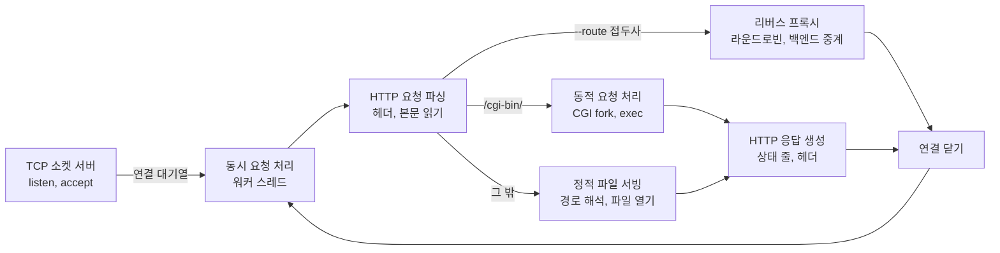

# 설계 문서 안내

과제 요구사항을 CS:APP 3판의 예제 코드에서 출발해 단계별로 구현합니다. 단계마다 폴더 하나에 같은 세 문서를 둡니다.

- `design.md`: 범위, 흐름, 설계 결정과 근거
- `functions.md`: 함수별 입력과 출력
- `test-cases.md`: 검증 절차와 기대 결과

## 요청 하나의 흐름

완성된 서버(`httpd`)에서 요청 하나가 지나가는 모듈 순서입니다. 각 상자가 한 단계입니다.

## 단계와 진행 상태

단계가 끝나면 이 표의 상태 칸만 고칩니다.

| 순서 | 단계 | 교재 | 상태 | 비고 |
| --- | --- | --- | --- | --- |
| 1 | [TCP 소켓 서버](./tcp-socket-server/design.md) | 11.4 | 완료 | 순차 에코 서버. `SIGPIPE` 무시, `accept()` 오류 계속 처리를 보완함 |
| 2 | [HTTP 요청 파싱](./http-request-parsing/design.md) | 11.5.3 | 완료 | 단위 테스트만 먼저 실행 가능. 기능 테스트는 4단계 `httpd` 이후 |
| 3 | [HTTP 응답 생성](./http-response/design.md) | 11.5.3 | 완료 | 2단계와 같음 |
| 4 | [정적 파일 서빙](./static-file-serving/design.md) | 11.5.2 | 완료 | `httpd`의 `main`과 연결 처리, 전체 빌드 설계가 이 문서에 있음 |
| 5 | [동적 요청 처리](./dynamic-request/design.md) | 11.5.4 | 완료 | CGI. 스레드 풀에서 안전하도록 출력을 파이프로 받은 뒤 상태 코드를 정함 |
| 6 | [동시 요청 처리](./concurrency/design.md) | 12.5.5 | 완료 | 워커 8개 스레드 풀과 안전한 종료. keep-alive와 lingering close는 제외 |
| 7 | [리버스 프록시](./reverse-proxy/design.md) | | 완료 | 경로 접두사 라우팅, 라운드로빈, 502/504. 1차 범위 밖 항목은 설계 문서의 [1차 구현 범위](./reverse-proxy/design.md#1차-구현-범위) |

## 읽는 순서

처음 볼 때는 각 단계의 `design.md`만 순서대로 읽으면 전체 흐름을 이해할 수 있습니다. 함수 시그니처와 반환값은 `functions.md`에, 동작 확인 방법은 `test-cases.md`에 있습니다.
