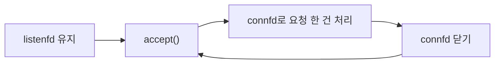

# 순차 연결 수락

[설계 목차](../design.md) · 1.5에서 사용한 연결 처리

프록시와 예약 모드에서 `main()`은 예매 페이지를 보낸 뒤 다음 TCP 연결에서 좌석 조회 요청을 받는다. 기본 실습 모드는 연결 한 건을 처리한 뒤 종료한다. [main.c](../../src/main.c)

- 첫 범위에서는 `Connection: close`를 유지한다. 매 요청은 새 연결에서 처리하고, 접속을 받는 `listenfd`는 서버가 종료할 때 닫는다.
- 요청 처리 중 해당 클라이언트가 끊기면 이번 연결을 정리하고 다음 수락으로 돌아간다.
- 이 단계에서는 두 번째 접속이 가능해진다. 첫 연결에서 클라이언트가 바이트를 보내지 않거나 서버가 쓰기에서 대기하면 다음 연결도 기다린다. 다른 연결에 먼저 응답하는 것은 [워커 풀](workers.md), 활성 연결의 대기 기한은 [안전한 종료](shutdown.md)에서 다룬다.

두 클라이언트가 차례로 성공하고 중간에 한 클라이언트가 끊겨도 다음 요청이 처리되면 완료다.
