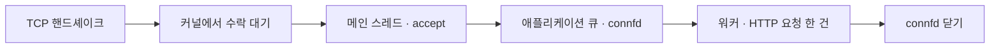

# 연결 수락과 전달

[설계 목차](../design.md) · [워커 풀](workers.md)

커널은 TCP 연결을 대기시키고, `accept()`가 돌아올 때 애플리케이션에서 쓸 통신용 FD를 넘긴다. 프록시 모드의 애플리케이션 큐에는 이 FD 번호가 들어간다.

기본 실습 모드는 [main.c](../../src/main.c)에서 연결 한 건을 처리한 뒤 종료한다. 프록시와 예약 모드는 [workers.c](../../src/workers.c)의 수락 루프를 사용한다. 프록시는 워커 4개가 연결 처리를 나눠 맡고, 예약 모드는 워커 한 개로 요청을 순차 처리한다. 각 HTTP 응답은 `Connection: close`를 사용한다.

접속과 종료 알림을 동시에 기다리는 방법은 [종료 설계](shutdown.md)에 있다.
