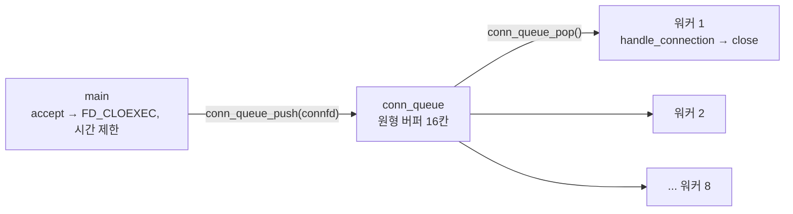

# 동시 요청 처리 설계

과제의 동시 요청 처리 항목을 CS:APP 3판 12.5.5의 미리 만든 스레드 풀(prethreaded server)로 구현할 때의 흐름과 결정입니다. 순차 서버였던 `httpd`의 연결 처리(`handle_connection()`)는 그대로 두고, 누가 그것을 부르는지만 바꿉니다.

- 함수별 입력과 출력: [functions.md](./functions.md)
- 검증 절차: [test-cases.md](./test-cases.md)

## 범위

| 포함 | 제외 |
| --- | --- |
| 워커 스레드 8개와 연결 대기열 | keep-alive. 응답마다 계속 연결을 닫습니다 |
| `SIGINT`, `SIGTERM`의 안전한 종료 | lingering close([미룬 결정 B](../reviews/stage-1-4-deferred-decisions.md#b-오류-응답-직후-close의-rst)) |
| 워커가 CGI를 fork해도 디스크립터가 새지 않게 `FD_CLOEXEC` | 연결 전체의 마감 시각(미룬 결정 A2), 워커 수의 CLI 인자 |

keep-alive를 넣으면 다음 요청을 기다리는 동안 워커가 연결에 묶여, 8명이 연결만 열어 두면 풀이 막힙니다. 이 단계는 동시 처리만 다루고 keep-alive는 lingering close와 함께 다음에 설계합니다.

## 모델 선택: 스레드 풀

| 근거 | 비교 대상 |
| --- | --- |
| 기존 RIO 기반 막히는 읽기 코드를 그대로 씁니다 | 이벤트 루프(파서를 상태 기계로 다시 짜야 함) |
| 연결마다 생성 비용이 없고 스레드 수가 정해져 자원이 일정합니다 | 연결마다 프로세스나 스레드 |
| 주소 공간을 공유해 다음 단계의 라운드로빈 카운터를 나눠 쓰기 쉽습니다 | 연결마다 프로세스 |

약점은 느린 연결 8개가 워커 8개를 모두 붙잡으면 나머지가 대기열에서 기다린다는 것입니다. 그래서 4단계의 [연결 시간 제한](../static-file-serving/design.md#연결-시간-제한)(read/write마다 5초)을 그대로 둡니다. 시간 제한은 이제 서버 전체가 아니라 워커 하나가 멈추는 최대 시간입니다.

## 구조



- main은 생산자, 워커는 소비자입니다. 둘이 만나는 곳은 대기열 하나뿐입니다.
- 대기열이 비면 워커가 `not_empty`에서, 가득 차면 main이 `not_full`에서 잠듭니다. main이 잠든 동안 새 연결은 커널의 listen backlog에 쌓입니다.
- 연결 소켓의 소유권은 `push`에서 워커로 넘어가고, 워커가 응답 뒤 닫습니다.
- 6단계 기준으로 워커끼리 공유하는 쓰기 가능한 상태는 대기열뿐입니다(7단계 리버스 프록시에서 라우트별 라운드로빈 인덱스 `proxy_route.next`와 `lock`이 추가됩니다). 정적 루트(`root`)와 라우트 목록은 워커를 만들기 전에 정해지고 바뀌지 않습니다. 요청 로그의 `printf()`는 stdio가 스트림마다 잠그므로 줄이 섞이지 않습니다.

교재의 `sbuf`는 세마포어 세 개로 만들지만, 이 구현은 뮤텍스 하나와 조건 변수 두 개를 씁니다. 종료할 때 "닫혔음"이라는 조건을 함께 기다려야 하는데, 세마포어로는 잠든 워커를 모두 깨우기 어렵고 조건 변수는 `pthread_cond_broadcast()` 한 줄로 됩니다.

## 안전한 종료

`SIGINT`나 `SIGTERM`을 받으면 새 연결은 받지 않고, 이미 받은 연결은 끝까지 응답한 뒤 종료 코드 0으로 끝납니다.

```text
신호 → 처리기가 stop = 1
     → main의 accept()가 EINTR로 깨어나 반복문을 나옴
     → close(listenfd)               새 연결 거절
     → conn_queue_close()            잠든 워커를 모두 깨움
     → 워커는 남은 연결을 처리하고, 대기열이 비면 pop이 -1이라 끝남
     → main이 워커 8개를 join, 대기열 정리, return 0
```

| 결정 | 내용 | 근거 |
| --- | --- | --- |
| `SA_RESTART` 없이 등록 | `SIGINT`, `SIGTERM`은 `sigaction()`으로 직접 등록합니다 | 교재 `Signal()`은 `SA_RESTART`를 붙여 `accept()`가 깨어나지 않고 다시 막힙니다 |
| 신호는 main만 받음 | 두 신호를 막은 채 워커를 만들고(마스크가 물려짐) main에서만 풉니다 | 프로세스로 온 신호는 막지 않은 아무 스레드에게나 갑니다. 워커가 받으면 main의 `accept()`가 깨어나지 않습니다 |
| 처리기는 플래그만 | `volatile sig_atomic_t stop = 1` | 처리기 안에서는 async-signal-safe가 아닌 함수를 부를 수 없습니다 |
| 남은 연결은 처리 | 닫힌 대기열도 빌 때까지 꺼냅니다 | 이미 `accept()`한 손님은 응답을 기다리고 있습니다. 시간 제한이 있어 종료가 무한히 늦어지지 않습니다 |

`stop` 검사와 `accept()` 진입 사이에 신호가 오면 `accept()`가 다음 연결까지 막힙니다. 이 틈을 없애려면 self-pipe와 `poll()`이 필요해 두었고, 신호를 한 번 더 보내면 끝납니다. 코드에 `shortcut:`으로 표시했습니다.

## CGI와 함께 쓸 때

워커가 CGI를 fork하므로 서버가 여는 모든 디스크립터에 `FD_CLOEXEC`를 붙입니다. 이유와 나머지 대책은 [동적 요청 처리의 스레드 풀 문제](../dynamic-request/design.md#스레드-풀에서-생기는-문제와-대책)에 있습니다.

| 디스크립터 | 위치 | 방법 |
| --- | --- | --- |
| 리스닝 소켓 | `main` | `Open_listenfd()` 직후 `fcntl()` |
| 연결 소켓 | `main` | `accept()` 직후 `fcntl()` |
| 정적 파일 | `static_serve()` | `open(..., O_CLOEXEC)` |
| CGI 파이프, 임시 파일 | `cgi.c` | 만든 직후 `fcntl()` |
| 업스트림 백엔드 소켓 (7단계) | `proxy.c` (`proxy_connect()`) | `socket()` 직후 `fcntl()` |

## 설계 결정

| 결정 | 내용 | 근거 |
| --- | --- | --- |
| 워커 8개, 대기열 16칸 | 상수 `NWORKERS`, `CONN_QUEUE_CAP` | 과제 규모에서 고정값으로 충분합니다. 바꿀 일이 생기면 CLI 인자로 올립니다 |
| 대기열은 구조체 안의 고정 배열 | `malloc` 없이 `int fds[16]` | 해제할 것이 없어 종료 경로가 단순합니다 |
| 요청 처리 경로는 그대로 | `handle_connection()`의 읽기, 파싱, 응답 코드는 바꾸지 않습니다 | 지역 변수와 `rio_t`만 쓰므로 이미 스레드마다 독립입니다 |

## 파일 구성

| 파일 | 내용 |
| --- | --- |
| `src/conn_queue.h`, `.c` | 연결 대기열. `http` 라이브러리에 들어갑니다 |
| `src/httpd.c` | `main`(신호, 워커 생성, `accept` 반복, 종료), `worker` |
| `tests/test_conn_queue.c` | 단위 테스트 `test_conn_queue` |
