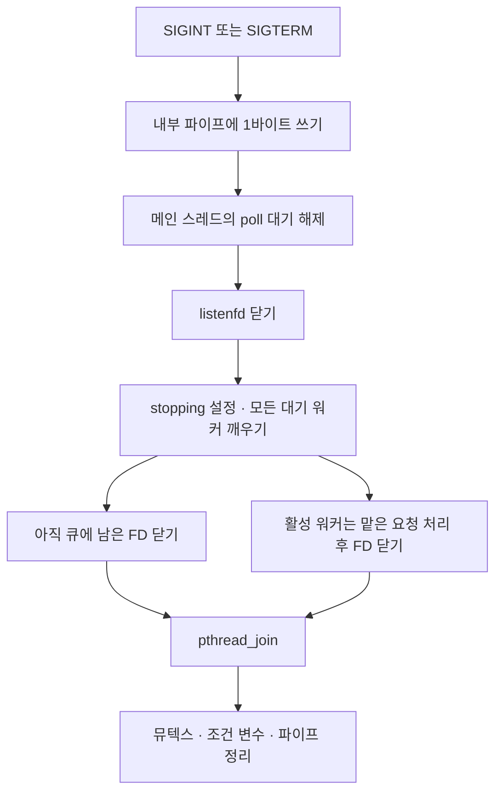

# 안전한 서버 종료

[설계 목차](../design.md) · [직접 확인](check.md)

접속이 없거나 워커가 작업 큐에서 대기 중이어도 `SIGINT` 또는 `SIGTERM`으로 종료 절차를 시작한다.

1. `serve_connections()`가 워커 생성 전에 종료 신호를 차단한다. 워커는 이 마스크를 상속하고 메인 스레드만 수락 루프 전에 차단을 해제한다.
2. `request_shutdown()`은 비블로킹 파이프에 표시를 남긴다. `accept_connections()`는 `poll()`로 접속 소켓과 파이프 읽기 FD를 함께 지켜본다. 둘 다 준비됐으면 종료를 우선한다.
3. `stop_workers()`는 큐 잠금 아래 종료 상태를 기록하고 `pthread_cond_broadcast()`를 호출한다. 큐에 남은 FD는 메인이 닫고, 이미 처리 중인 FD는 각 워커가 [I/O 기한](timeouts.md)을 지켜 처리하고 닫는다.
4. 메인이 `pthread_join()`으로 모든 워커가 끝난 것을 확인하고 조건 변수와 뮤텍스를 해제한다. 종료 신호를 다시 차단한 뒤 파이프를 닫는다.

부분적으로 스레드 생성에 실패한 경우에도 이미 생성한 워커를 깨우고 합류한다. 신호 핸들러는 파이프에 쓰는 일만 맡으며 큐는 일반 실행 흐름이 정리한다. [workers.c](../../src/workers.c) · [큐와 FD 소유권](workers.md)
