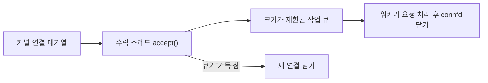

# 워커 풀과 작업 큐

[설계 목차](../design.md) · 1.6 검토안

하나의 요청이 백엔드 응답을 기다리는 동안 다른 연결의 정적 요청을 처리한다. 같은 좌석에 들어온 여러 예약의 충돌은 [예약 백엔드](../dynamic/booking.md)에서 처리한다.

| 모델 | 이 프로젝트에서 고려할 점 |
| --- | --- |
| `fork()` | 연결마다 프로세스를 나눌 수 있다. 부모·자식 FD와 종료한 자식을 정리해야 한다. |
| 고정 `pthread` 워커 풀 | 기존 블로킹 요청 처리 함수를 재사용할 수 있다. 공유 큐, FD 소유권, 워커 종료를 관리해야 한다. |
| `poll()` 등 I/O 멀티플렉싱 | 소수 스레드로 여러 연결을 관리할 수 있다. 부분 읽기·쓰기와 백엔드 연결 상태를 연결마다 보관해야 한다. |

첫 구현은 고정 워커 풀을 제안한다. 워커 4개와 큐 8칸은 테스트를 위한 예시다.

커널의 `listen(backlog)` 대기열에는 수락 전 연결이 기다린다. 애플리케이션의 작업 큐는 수락한 `connfd`를 보관한다.

| 시점 | FD 소유자 | 책임 |
| --- | --- | --- |
| `accept()` 직후 | 수락 스레드 | 큐에 넣어 넘기거나 큐가 찼으면 닫는다. |
| 큐에서 대기 | 작업 큐 | 워커에게 넘기고, 서버 종료 시 남은 연결을 정리한다. |
| 작업 처리 중 | 해당 워커 | 요청 처리 성공·실패에 관계없이 한 번 닫는다. |

큐를 수정하는 동안만 뮤텍스를 잡고, 작업이 없을 때는 조건 변수로 대기한다. HTTP 읽기·쓰기와 백엔드 응답 대기 중에는 큐 잠금을 풀어 둔다. 첫 과부하 정책으로 큐가 찼을 때 새 연결을 닫는 방식을 검토한다. `503`을 보내기로 하면 수락 스레드가 쓰기에서 오래 대기하지 않도록 책임과 전송 기한을 먼저 정한다.
