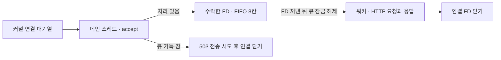

# 워커 풀과 작업 큐

[설계 목차](../design.md) · [직접 확인](check.md)

## 목적과 실행 모드

한 요청이 백엔드 응답을 기다리는 동안 다른 워커가 별도 연결의 정적 요청에 응답한다. 과제의 동시성 모델은 **POSIX pthread 워커 풀**이다.

| 실행 모드 | 워커 | 작업 큐 | 동작 |
| --- | --- | --- | --- |
| 기본 실습 모드 | 메인에서 직접 처리 | 없음 | 연결 한 건 처리 후 종료 |
| 리버스 프록시 | 4 | FIFO 8칸 | HTTP 클라이언트 연결을 동시에 처리 |
| 예약 백엔드 | 1 | FIFO 8칸 | 좌석 조회·예약을 순서대로 처리 |

예약 백엔드에 워커를 한 개 두므로 좌석 상태의 확인과 변경 사이에 다른 예약이 끼어들지 않는다. 프록시에 워커를 여러 개 두어도 백엔드의 좌석 배열을 여러 스레드가 함께 읽거나 쓰지 않는다. [예약 API](../dynamic/booking.md)

## 구현의 기준

| 함수 | 책임 |
| --- | --- |
| `enqueue()` | 뮤텍스를 잡고 `(head + count) % QUEUE_CAPACITY` 위치에 FD를 넣는다. 성공하면 `count`를 늘리고 `pthread_cond_signal()`로 대기 워커에게 알린다. |
| `run_worker()` | 큐가 비고 종료가 시작되지 않은 동안 조건 변수로 기다린다. 깨어나면 조건을 다시 확인한다. 큐 맨 앞 FD를 꺼낸 직후 잠금을 풀고 `handle_http_client()`를 호출한다. |
| `reject_overload()` | 새 연결에 `503 Service Unavailable`과 `Retry-After: 1`을 비블로킹으로 한 번 전송해 보고 닫는다. 수락 스레드는 쓰기 가능 상태를 기다리지 않는다. |

수락된 FD는 **메인 스레드 → 작업 큐 → 워커** 순으로 소유권이 넘어간다. 큐가 가득 찼으면 메인이 닫고, 처리 중에는 워커가 닫고, 종료 시 아직 큐에 남은 FD는 메인이 닫는다. FIFO는 FD를 꺼내는 순서를 정한다. 요청 처리 시간이 다르면 응답 순서도 달라진다.

느리거나 끊긴 연결에는 완전한 `503`이 전달되지 않을 수 있다. 이 과부하 경로는 예약 백엔드로 요청을 보내기 전에 실행된다. 코드 진입점은 [workers.c](../../src/workers.c)의 `serve_connections()`다. [I/O 기한](timeouts.md) · [종료 흐름](shutdown.md)
