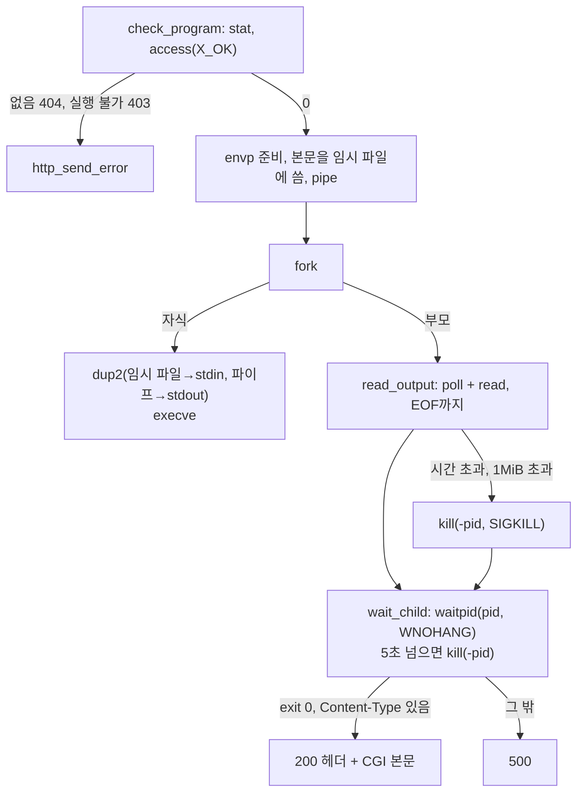

# 동적 요청 처리 설계

과제의 동적 요청 처리 항목을 CS:APP 3판 11.5.4의 CGI로 구현할 때의 흐름과 결정입니다. 교재 Tiny의 `serve_dynamic()`은 반복형 서버를 가정하므로, [동시 요청 처리](../concurrency/design.md)의 스레드 풀 위에서 안전하도록 고쳤습니다.

- 함수별 입력과 출력: [functions.md](./functions.md)
- 검증 절차: [test-cases.md](./test-cases.md)

## 범위

| 포함 | 제외 |
| --- | --- |
| `/cgi-bin/`으로 시작하는 URI를 CGI 프로그램으로 실행 | FastCGI, 스크립트 해석기 지정 |
| GET의 쿼리 문자열, POST의 본문 전달 | `PATH_INFO`, `SERVER_NAME` 등 RFC 3875의 나머지 환경 변수 |
| 출력의 `Content-Type` 헤더 해석 | `Status:`, `Location:` 등 다른 CGI 헤더. 무시합니다 |
| 404, 403, 500 판정과 실행 시간 제한 | 출력 스트리밍. 출력을 다 받은 뒤 보냅니다 |

## 요청 분기

연결 처리(`handle_connection()`)는 본문까지 읽은 뒤 URI로 정적과 동적을 가릅니다.

| URI | 허용 메서드 | 처리 |
| --- | --- | --- |
| `/cgi-bin/`으로 시작 | GET, POST | `cgi_serve()` |
| 그 밖 | GET | `static_serve()` |

허용되지 않은 메서드는 501입니다. 경로는 정적 파일과 같은 `static_resolve_path()`로 만들어 `..` 차단과 `?` 제거를 그대로 씁니다. 따라서 `/cgi-bin/adder?3&4`는 `<root>/cgi-bin/adder`를 실행합니다.

`?` 앞이 `/`로 끝나는 CGI 요청(`/cgi-bin/`, `/cgi-bin/dir/`)은 `static_resolve_path()`를 부르기 전에 403으로 거부합니다. 이 함수는 `/`로 끝나면 `index.html`을 붙이므로, 그대로 두면 디렉터리 요청이 `<root>/cgi-bin/index.html`을 실행하려 합니다. 디렉터리는 실행할 프로그램이 아니므로, `index.html`을 붙이지 않았을 때 `check_program()`이 내릴 결과와 같은 403을 보냅니다.

## CGI 실행 흐름

## CGI에 넘기는 것과 받는 것

| 방향 | 내용 |
| --- | --- |
| 환경 변수 | `REQUEST_METHOD`, `QUERY_STRING`(URI의 `?` 뒤, 없으면 빈 문자열), `CONTENT_LENGTH`(본문 바이트 수, 없으면 0) |
| 표준 입력 | 요청 본문. 본문이 없으면 빈 입력 |
| 표준 출력 | 헤더 줄들, 빈 줄, 본문. 헤더에 비어 있지 않은 `Content-Type`이 있어야 합니다(RFC 3875 6.3.1). 값에 `\r`이 섞이면 응답 헤더가 깨지므로 없는 것으로 봅니다. 값이 256바이트(`CGI_MAX_CONTENT_TYPE`) 이상이어도 없는 것으로 봅니다 |
| 표준 오류 | 서버의 표준 오류를 그대로 물려받습니다. CGI의 오류 메시지는 서버 로그에 섞입니다 |

CGI가 출력한 헤더 중 `Content-Type`만 응답에 옮기고, 상태 줄과 `Content-Length`, `Connection`은 서버가 [응답 생성](../http-response/design.md)의 `http_send_head()`로 붙입니다. 헤더 형식을 한 곳에서만 만들기 위해서입니다.

`http_send_head()`는 헤더를 `MAXLINE`(8192바이트) 버퍼에 만들고, 넘치면 아무것도 보내지 않고 -1을 반환합니다. 이 실패는 송신 실패와 구별되지 않으므로 `cgi_serve()`가 500으로 바꿔 보낼 수 없고, 응답 없이 연결이 닫힙니다. 그래서 `Content-Type` 값의 길이를 `cgi_parse_output()`에서 미리 제한해 형식 오류(500)로 처리합니다. 256바이트는 RFC 6838의 타입과 하위 타입 상한(각 127자)에 `; charset=utf-8` 같은 매개변수가 들어갈 여유를 둔 값입니다.

## 스레드 풀에서 생기는 문제와 대책

워커 하나가 `fork()`하면 자식에는 그 스레드 하나만 복제되고, 메모리와 디스크립터 표는 통째로 복사됩니다. 교재 Tiny를 그대로 쓰면 다음 세 가지가 터집니다.

| 문제 | 장면 | 대책 |
| --- | --- | --- |
| 주인 없는 잠금 | 다른 워커가 `malloc` 잠금을 쥔 순간 fork하면 자식의 `setenv()`가 영원히 기다림 | `envp`, `argv`를 fork 전에 부모가 `snprintf()`로 만들고, 자식은 async-signal-safe 함수(`dup2`, `setpgid`, `sigprocmask`, `signal`, `execve`, `_exit`)만 부릅니다 |
| exec를 지나 남는 디스크립터 | CGI가 다른 손님의 연결 소켓을 쥐고 있어 그 손님은 CGI가 끝날 때까지 FIN을 못 받음 | 연결 소켓, 리스닝 소켓, 정적 파일, 파이프, 임시 파일에 모두 `FD_CLOEXEC`를 붙입니다 |
| 200을 먼저 보냄 | Tiny는 fork 전에 200을 보내므로 CGI가 죽어도 되돌릴 수 없음 | 출력을 파이프로 다 받고 종료 상태를 본 뒤 200과 500 중 고릅니다 |

`dup2()`로 만든 표준 입출력에는 `FD_CLOEXEC`가 붙지 않으므로 CGI는 stdin, stdout을 잃지 않습니다.

`pipe()`, `accept()`, `mkstemp()`는 POSIX 2008에 `O_CLOEXEC`를 받는 판(`pipe2`, `accept4`)이 없어서 만든 직후 `fcntl()`로 표시합니다. 그 사이에 다른 워커가 fork하면 디스크립터가 샐 수 있지만, 피해는 그 CGI가 끝날 때(최대 시간 제한)까지 EOF나 FIN이 늦어지는 것이라 두었습니다. 코드에 `shortcut:`으로 표시했습니다.

## 설계 결정

| 결정 | 내용 | 근거 |
| --- | --- | --- |
| 본문은 임시 파일로 | `mkstemp()`로 만든 파일에 본문을 쓰고 이름을 지운 뒤(`unlink`) 처음으로 되감아 stdin에 연결합니다. 본문이 없으면 `/dev/null` | 파이프로 넣으면, CGI가 본문을 다 읽기 전에 출력을 파이프 용량(리눅스 64KiB)보다 많이 쓸 때 서버는 쓰기에서, CGI는 출력 쓰기에서 서로를 기다립니다. 본문은 이미 최대 1MiB로 메모리에 다 받아 둔 상태라 파일에 쓰면 막히지 않습니다 |
| 출력을 다 받은 뒤 응답 | 최대 1MiB(`CGI_MAX_OUTPUT`)를 버퍼에 모읍니다. 넘으면 CGI를 죽이고 500 | 상태 코드를 종료 상태로 정하려면 출력을 먼저 받아야 합니다. 상한이 없으면 CGI 하나가 메모리를 끝없이 씁니다 |
| 출력 시간 제한 | `poll()`로 5초(`CGI_TIMEOUT_SEC`) 동안 출력이 없으면 프로세스 그룹째 `SIGKILL`, 500 | 끝나지 않는 CGI가 워커를 영원히 붙잡지 않게 합니다. 연결 시간 제한과 같은 값, 같은 "호출마다" 방식입니다 |
| 종료 대기 시간 제한 | EOF 뒤에도 `waitpid(WNOHANG)`을 10ms 간격으로 최대 5초 부르고, 그래도 안 끝나면 그룹째 `SIGKILL`, 500 | 표준 출력을 닫고 계속 도는 CGI가 있으면 막히는 `waitpid()`가 워커를 붙잡고, 종료 때 `join`도 끝나지 않습니다 |
| CGI를 새 프로세스 그룹으로 | 자식과 부모가 모두 `setpgid()`(교재 8.5의 방식), 시간 초과 때 `kill(-pid, SIGKILL)` | 셸 스크립트 CGI가 만든 손자 프로세스(`sleep` 등)가 살아남아 파이프나 소켓을 쥐고 있지 않게 합니다. 단위 테스트 D08이 이 문제를 잡았습니다 |
| 자기 자식만 회수 | `waitpid(pid, ...)` | `wait(NULL)`이나 `waitpid(-1, ...)`는 다른 워커의 CGI를 가로챕니다 |
| 신호 상태 되돌리기 | 자식이 exec 전에 신호 마스크를 비우고 `SIGPIPE`를 기본 동작으로 | 워커가 막아 둔 `SIGINT`, `SIGTERM`과 서버가 무시하는 `SIGPIPE`는 exec 뒤에도 남습니다 |
| 실행 가능 검사 | `stat()`이 실패하면 errno로 404/403/400/500, 일반 파일이 아니거나 `access(X_OK)` 실패면 403 | 교재 Tiny와 같은 기준입니다. exec 자체가 실패하면 자식이 127로 끝나 500입니다 |

## 파일 구성

| 파일 | 내용 |
| --- | --- |
| `src/cgi.h`, `src/cgi.c` | `cgi_parse_output()`, `cgi_serve()`. `http` 라이브러리에 들어갑니다 |
| `src/static_file.h`, `.c` | errno를 상태 코드로 바꾸는 함수를 `static_errno_status()`로 공개해 CGI 검사와 함께 씁니다 |
| `src/httpd.c` | 요청 분기 |
| `tests/test_cgi.c` | 단위 테스트 `test_cgi` |

## 접두사 검사와 경로 정규화

`/cgi-bin/` 판정은 URI 문자열의 접두사로 합니다. 그런데 `//cgi-bin/adder`나 `/./cgi-bin/adder`도 같은 파일을 가리키므로, 이대로면 접두사 검사를 피해 정적 파일로 처리되고 CGI 프로그램의 소스가 200으로 나갑니다. 그래서 `static_resolve_path()`가 `..`에 더해 `.` 조각과 빈 조각(`//`)도 403으로 거부합니다. 한 파일을 가리키는 URI가 하나뿐이면 접두사 검사가 정확해집니다.
