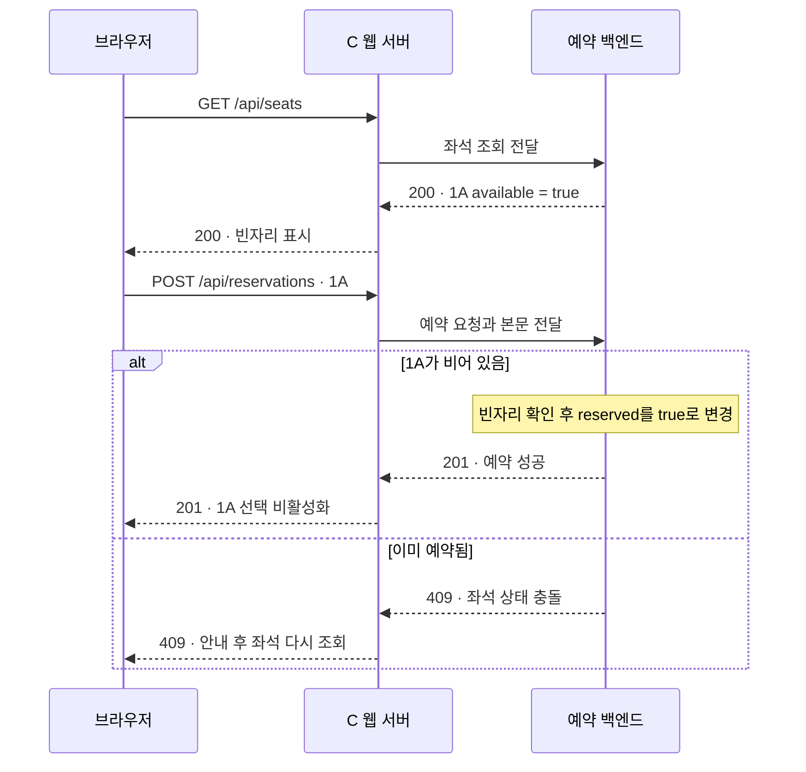

# 좌석 조회·예약 API

[설계 목차](../design.md) · 1.5 구현 계약 · [직접 확인](check.md)

## 범위와 책임

첫 범위는 `KTX101` 한 편과 좌석 여섯 개다. `1B`와 `2C`가 기본 예약 상태다. 예약 백엔드는 좌석 상태를 프로세스 메모리에 보관하고, 재시작하면 초기화한다. 상태 배열과 처리 함수는 [booking.c](../../src/booking.c)에 있다.

## API 계약

| 요청 | 입력 | 정상 응답 | 오류 |
| --- | --- | --- | --- |
| `GET /api/seats` | 본문 없이 조회 | `200`, 열차 ID와 전체 좌석 상태 | 알 수 없는 경로 `404` |
| `POST /api/reservations` | `Content-Type: application/json`, `trainId`와 `seatId` | `201`, 예약된 열차와 좌석 | 잘못된 입력 `400`, 없는 열차·좌석 `404`, 이미 예약된 좌석 `409`, 지원하지 않는 본문 형식 `415` |

조회 응답 예시. 실제 응답에는 여섯 좌석을 담는다.

```json
{"trainId":"KTX101","seats":[{"id":"1A","available":true},{"id":"1B","available":false}]}
```

예약 요청과 성공 응답 예시다. 오류 응답에는 사유를 구분할 수 있는 `error` 필드를 둔다.

```text
요청   {"trainId":"KTX101","seatId":"1A"}
응답   {"trainId":"KTX101","seatId":"1A","status":"reserved"}
```

예약 본문은 두 필드가 각각 한 번씩 나오는 JSON 객체다. 필드 순서와 JSON 공백을 허용한다. 값은 1~31자의 ASCII 영문자·숫자·`_`·`-`이며 문자열 이스케이프와 추가 필드는 이 계약의 입력 범위에 들지 않는다.

| 응답 | 오류 값 |
| --- | --- |
| `400` | `invalid_reservation` |
| `404` | `route_not_found`, `train_not_found`, `seat_not_found` |
| `405` | `method_not_allowed`, `Allow`에 해당 API의 허용 메서드를 표시 |
| `409` | `seat_already_reserved` |
| `415` | `unsupported_media_type` |
| `500` | `response_too_large` |

HTTP 형식 오류와 GET·POST 이외의 메서드는 공통 파서에서 먼저 처리한다. 위의 `405` JSON은 두 지원 메서드 가운데 해당 경로에서 허용하지 않은 메서드에 해당한다.

## 상태 변경과 화면 연결



첫 조회에서 빈자리로 보였어도, 그사이에 다른 요청이 예약을 마칠 수 있다. 성공 뒤 다시 조회하면 `1A`의 `available`은 `false`다.

1. 브라우저는 페이지가 열리면 좌석 상태를 조회하고, 사용자가 예매를 확정하면 예약 요청을 보낸다.
2. 백엔드는 예약 요청의 입력을 검증한 뒤, **빈자리 확인과 예약 상태 변경을 한 작업으로 처리**한다. 조회 때 빈자리였어도 예약 시점에 선점됐으면 `409`를 반환한다.
3. 화면은 `201`이면 선택 내역을 갱신하고, `409`면 안내를 표시한 뒤 좌석 상태를 다시 조회한다.

백엔드는 연결을 하나씩 순서대로 처리한다. 현재는 이 실행 방식이 좌석 확인과 상태 변경 사이에 다른 요청이 들어오는 것을 막는다. 향후 백엔드에 동시 처리를 추가하면 조회와 예약이 같은 상태를 안전하게 읽고 쓰도록 보호한다. 실행·검증은 [직접 확인](check.md), 사용자 요청부터 백엔드까지의 전달은 [리버스 프록시](proxy.md)를 따른다.
