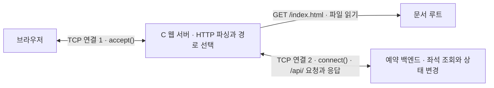

# 리버스 프록시

[설계 목차](../design.md) · 1.5 구현 구조 · [직접 확인](check.md)

웹 서버는 정적 파일을 읽고, 설정한 경로의 요청은 별도 예약 백엔드에 전달한다. HTTP 요청 분기는 [http.c](../../src/http.c)의 `dispatch_request()`, 중계는 [proxy.c](../../src/proxy.c)의 `proxy_request()`가 담당한다.

C 웹 서버는 브라우저 접속을 `accept()`로 받고, `/api/` 요청을 전달할 때는 새 소켓에서 `connect()`를 호출해 백엔드에 접속한다. 두 TCP 연결의 FD는 각각 관리한다. 예약 상태가 어떻게 바뀌는지는 [좌석 조회·예약 흐름](booking.md)을 참조한다.

## 전달 순서

1. 기존 HTTP 파싱 단계가 요청 형식과 크기를 검사한다. 웹 서버는 기본값 `/api/`로 시작하는 요청 대상을 CLI에 설정한 백엔드 IPv4 주소·포트로 전달한다. 접두사는 실행할 때 바꿀 수 있다.
2. 백엔드 TCP 연결에서 메서드, 쿼리를 포함한 원래 요청 대상, 필요할 때 `Content-Type`, 본문을 전송한다. `Host`는 설정된 대상 주소와 포트로 만들고, 본문의 바이트 수를 `Content-Length`로 전송한다. 백엔드에도 `Connection: close`를 사용한다.
3. 백엔드 응답의 상태 줄과 헤더를 확인하고, `Content-Length`만큼 본문을 읽는다. 헤더와 본문의 크기에 각각 상한을 둔다.
4. 받은 상태 코드, `Content-Type`, `Allow`가 있다면 그 값, 본문을 클라이언트에게 전달한다. 클라이언트 연결은 맡은 워커가 닫고, 백엔드 연결은 프록시 함수가 닫는다.

## 실패 처리

| 상황 | 응답 또는 처리 |
| --- | --- |
| 백엔드 연결 실패 또는 잘못된 응답 | `502` |
| 백엔드 연결·요청 전송·응답 수신에 쓰는 전체 3초 기한 초과 | `504` |
| 클라이언트 응답을 시작한 뒤 쓰기 실패 | 클라이언트 연결 정리 |
| 예약 POST 전달 후 응답을 받지 못함 | 프록시는 자동으로 재시도하지 않는다. 백엔드에서 예약이 이미 반영됐을 수 있다. |

## 지원 범위

- 프록시는 접두사 하나를 백엔드 한 대에 연결하며 URI를 다시 쓰지 않는다. 기본 예약 백엔드는 `/api/seats`와 `/api/reservations`를 처리한다.
- 본문이 있는 응답은 HTTP/1.1과 `Content-Type`, 단일 `Content-Length`를 사용한다. 헤더는 최대 4 KiB, 본문은 최대 8 KiB다. `204 No Content`는 본문과 `Content-Length` 없이 전달한다.
- 조건부 조회의 `304`, chunked 전송, 로드 밸런싱은 현재 범위 밖이다. 지원 범위 밖의 백엔드 응답은 `502`로 처리한다.
- 중계 기한은 백엔드 소켓 하나의 비블로킹 I/O와 `poll()`로 적용한다. 여러 클라이언트 연결의 동시 처리는 [워커 풀](../concurrency/workers.md)에서 맡는다.
