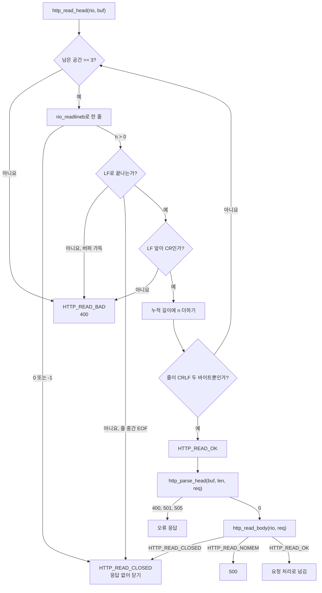

# HTTP 요청 파싱 설계

과제의 HTTP 요청 파싱 항목을 CS:APP 3판 11.5.3의 요청 형식과 10.5절의 RIO로 구현할 때의 흐름과 결정입니다. 연결 하나를 처리하는 전체 순서는 [정적 파일 서빙 설계의 연결 처리 흐름](../static-file-serving/design.md#연결-처리-흐름)에 있습니다.

- 함수별 입력과 출력: [functions.md](./functions.md)
- 검증 절차: [test-cases.md](./test-cases.md)
- 이전 단계: [TCP 소켓 서버 설계](../tcp-socket-server/design.md)

## 범위

| 포함 | 제외 |
| --- | --- |
| 요청 줄(메서드, URI, 버전) 파싱 | 동적 요청 처리(CGI). POST 본문은 읽어 두기만 합니다 |
| `Host`, `Content-Length`, `Connection` 헤더 파싱 | keep-alive 연결 유지. 이 단계는 응답마다 연결을 닫습니다 |
| `Content-Length`만큼 본문 읽기 | `Transfer-Encoding: chunked`(헤더가 있으면 501), absolute-form URI(프록시 단계) |
| 형식 오류를 400, 501, 505로 판정 | 퍼센트 디코딩 |

## 요청 형식

교재 11.5.3의 요청은 요청 줄, 0개 이상의 헤더, 빈 줄, 본문 순서입니다. 경계는 다음 기준으로 찾습니다.

| 경계 | 판단 기준 |
| --- | --- |
| 한 줄의 끝 | `\r\n` |
| 헤더 블록의 끝 | `"\r\n"` 두 바이트만 있는 줄(빈 줄) |
| 본문의 끝 | `Content-Length` 값만큼 읽었을 때. 헤더가 없으면 본문 길이는 0 |

## 설계 결정

| 결정 | 내용 | 근거 |
| --- | --- | --- |
| 읽기와 파싱 분리 | `http_read_head()`가 빈 줄까지의 바이트를 버퍼에 모으고, `http_parse_head()`가 그 버퍼만 보고 파싱합니다 | 품질 요구사항의 파서 단위 테스트. 파싱 함수는 소켓 없이 문자열로 시험합니다 |
| 같은 `rio_t`로 본문 읽기 | 헤더를 읽은 `rio_t`로 `rio_readnb()`를 호출해 본문을 읽습니다 | `rio_readlineb()`는 한 번에 최대 8192바이트를 가져오므로 본문 앞부분이 이미 `rio_t` 버퍼에 들어와 있을 수 있습니다. 새 `rio_t`나 `read()`로 읽으면 그 바이트를 잃고 멈춥니다 |
| 본문은 줄이 아니라 바이트 수 | 본문에는 `rio_readlineb()`를 쓰지 않습니다 | 본문 끝에 `\r\n`이 없으면 다음 요청의 바이트까지 한 줄로 읽습니다 |
| 메서드와 관계없이 본문 읽기 | `Content-Length`가 있으면 GET에서도 읽습니다 | 요청 경계를 메서드별로 다르게 다루지 않습니다 |
| 헤더 이름 비교 | 이름 길이를 확인한 뒤 `strncasecmp()`로 비교하고 값의 앞뒤 공백을 잘라 냅니다 | 헤더 이름은 대소문자를 구분하지 않습니다(`Content-Length`와 `Content-length`) |
| 줄 끝 | `\n` 앞에 `\r`이 없는 줄은 400입니다 | 교재가 정한 줄 끝 형식입니다. `curl`과 `telnet`은 `\r\n`을 보냅니다 |
| 크기 상한 | 헤더 블록 전체 `MAXLINE`(8192)바이트, 본문 `HTTP_MAX_BODY`(1MiB) | 엣지 케이스의 매우 긴 URI와 큰 본문. 초과하면 400입니다 |
| 래퍼 사용 금지 | 요청 경로에서는 `Rio_readlineb` 같은 대문자 래퍼 대신 원래 함수의 반환값을 봅니다 | 래퍼는 실패하면 서버 프로세스 전체를 끝냅니다 |

오류 코드는 교재 그림 11.25에 있는 코드와 요구사항의 500만 씁니다. 크기 초과에도 400을 씁니다.

메서드는 대소문자를 구분하는 토큰입니다(RFC 9110 9.1). `get`은 형식이 맞는 모르는 메서드이므로 파싱은 성공하고 [연결 처리](../static-file-serving/design.md#연결-처리-흐름)가 501을 보냅니다. 토큰 문자가 아닌 바이트가 섞인 `G(T`만 400입니다.

## 판정 규칙

| 상황 | 결과 |
| --- | --- |
| 빈 줄 전에 EOF(줄 중간의 EOF 포함) 또는 읽기 오류 | 응답 없이 연결을 닫습니다. 클라이언트가 이미 떠났기 때문입니다 |
| 줄 끝 `\n` 앞에 `\r`이 없음, 헤더 블록이 버퍼(`MAXLINE`, 끝 NUL 포함)에 들어가지 않음 | 400 |
| 요청 줄이 공백 하나씩으로 나뉜 토큰 세 개가 아님, URI가 `/`로 시작하지 않음 | 400 |
| 메서드에 토큰 문자(영문자, 숫자, ``!#$%&'*+-.^_`\|~``)가 아닌 바이트가 있음, 메서드 15바이트, 버전 15바이트, `Connection` 값 31바이트 초과 | 400 |
| 버전이 `HTTP/1.0`, `HTTP/1.1`이 아님 | `HTTP/`로 시작하면 505, 아니면 400 |
| 헤더 줄에 `:`이 없음, 헤더 이름이 비어 있음(`: 값`) | 400 |
| 헤더 블록 안에 NUL 바이트가 있음 | 400. NUL 뒤가 문자열 필드에서 잘려 나가기 때문입니다 |
| `Content-Length`가 10진수 숫자만으로 이루어지지 않음, 1MiB 초과, 여러 번 오면서 값이 서로 다름 | 400. 본문 경계를 정할 수 없습니다(RFC 9112 6.3) |
| `Transfer-Encoding` 헤더가 있음 | 501. chunked를 구현하지 않았으므로 본문 경계를 알 수 없습니다 |
| 본문을 다 읽기 전에 EOF 또는 읽기 오류 | 응답 없이 연결을 닫습니다 |
| 본문 버퍼 `malloc()` 실패 | 500 |

`Host`와 `Connection`은 값만 저장합니다. 이 단계는 응답마다 `Connection: close`를 보내고 연결을 닫으므로 두 값으로 동작을 바꾸지 않습니다. 순차 서버에서 연결을 유지하면 그 클라이언트가 다음 요청을 보내지 않는 동안 다른 클라이언트가 모두 기다리기 때문입니다([TCP 소켓 서버 테스트 T08](../tcp-socket-server/test-cases.md#순차-처리)). keep-alive는 동시성 단계에서 다룹니다.

## 읽기 흐름



## 파일 구성

```text
src/
├── http_request.h   http_request 구조체, 상수, 함수 원형과 주석
└── http_request.c   읽기와 파싱
tests/
└── test_http_request.c   http_parse_head 단위 테스트
```

## 자료구조

```c
#define HTTP_MAX_BODY (1024 * 1024)

typedef struct {
    char method[16];
    char uri[MAXLINE];
    char version[16];
    char host[MAXLINE];       /* 없으면 빈 문자열 */
    char connection[32];      /* 없으면 빈 문자열 */
    size_t content_length;    /* 없으면 0 */
    char *body;               /* content_length > 0이면 malloc, 아니면 NULL */
} http_request;
```

연결 처리 함수는 `http_request req = {0};`로 초기화합니다. 그래야 헤더 단계에서 실패해 `body`를 한 번도 채우지 않은 경우에도 `http_request_free()`가 `NULL`을 해제하고 끝납니다.

`uri`와 `host`를 `MAXLINE`으로 잡은 이유는 헤더 블록 전체가 `MAXLINE`보다 작으므로 어느 값도 그보다 길 수 없기 때문입니다. `method`, `version`, `connection`은 버퍼보다 긴 값이 오면 400입니다. 구조체가 16KiB를 넘으므로 연결 처리 함수의 지역 변수 하나로 둡니다.
