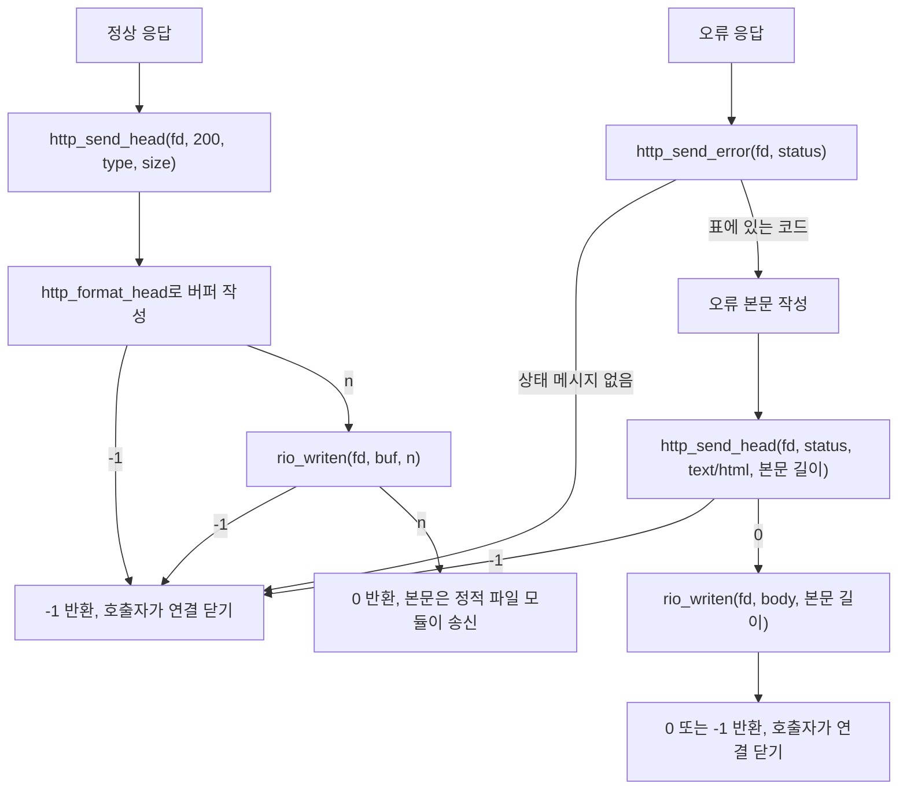

# HTTP 응답 생성 설계

과제의 HTTP 응답 생성 항목을 CS:APP 3판 11.5.3의 응답 형식으로 구현할 때의 흐름과 결정입니다. 이 모듈은 응답 줄과 헤더를 만들어 보내고, 오류 응답 전체를 만들어 보냅니다. 정상 응답의 본문은 [정적 파일 서빙](../static-file-serving/design.md)이 보냅니다.

- 함수별 입력과 출력: [functions.md](./functions.md)
- 검증 절차: [test-cases.md](./test-cases.md)

## 응답 형식

모든 응답은 다음 모양입니다.

```text
HTTP/1.1 404 Not found\r\n
Content-Type: text/html\r\n
Content-Length: 49\r\n
Connection: close\r\n
\r\n
<html><body><h1>404 Not found</h1></body></html>\n
```

본문 49바이트의 계산은 [functions.md의 오류 본문](./functions.md#오류-본문)에 있습니다.

## 설계 결정

| 결정 | 내용 | 근거 |
| --- | --- | --- |
| 응답 줄의 버전 | 항상 `HTTP/1.1`을 씁니다 | 서버는 자기가 따르는 버전을 응답 줄에 적습니다. 요구사항 예시도 `HTTP/1.1 200 OK`입니다 |
| `Connection: close`를 항상 명시 | 모든 응답에 넣고, 보낸 뒤 연결을 닫습니다 | HTTP/1.1은 지속 연결이 기본이므로 명시하지 않으면 클라이언트는 연결이 유지된다고 봅니다. 이 단계는 [응답마다 연결을 닫습니다](../http-request-parsing/design.md#판정-규칙) |
| `Content-Length`를 항상 명시 | 오류 응답을 포함한 모든 응답에 넣습니다 | 본문의 끝을 바이트 수로 알립니다. 글자 수가 아니라 바이트 수입니다 |
| 헤더와 본문 분리 | `http_send_head()`는 헤더까지만 보냅니다 | 파일 본문은 크기가 크고 이진 데이터이므로 문자열 버퍼에 담지 않고 정적 파일 모듈이 나눠 보냅니다 |
| 형식 함수와 송신 함수 분리 | `http_format_head()`는 버퍼에 쓰기만 하고, `http_send_head()`가 그것을 `rio_writen()`으로 보냅니다 | 응답 바이트를 소켓 없이 단위 테스트합니다 |
| 버퍼 작성 | `snprintf()` 한 번으로 헤더 전체를 쓰고 반환값으로 잘림을 확인합니다 | 교재 `clienterror()`의 `sprintf(buf, "%s...", buf)`는 원본과 대상이 겹쳐 정의되지 않은 동작입니다 |
| 송신 오류 | 래퍼 `Rio_writen` 대신 `rio_writen()`의 반환값을 봅니다 | 클라이언트가 먼저 끊으면 `EPIPE`가 옵니다. `SIGPIPE`는 서버 시작 시 무시합니다([TCP 소켓 서버의 보완](../tcp-socket-server/design.md#보완한-지점)) |

## 상태 코드

교재 그림 11.25의 코드 중 이 단계가 쓰는 코드와, 요구사항의 500입니다.

| 코드 | 상태 메시지 | 쓰는 상황 | 정하는 곳 |
| --- | --- | --- | --- |
| 200 | OK | 파일을 찾아 보냄 | [정적 파일 서빙](../static-file-serving/design.md#상태-코드-판정) |
| 400 | Bad request | 요청 형식 오류, 크기 초과 | [요청 파싱](../http-request-parsing/design.md#판정-규칙), [정적 파일 서빙](../static-file-serving/design.md#상태-코드-판정) |
| 403 | Forbidden | `..` 경로, 일반 파일이 아님, 읽기 권한 없음 | [정적 파일 서빙](../static-file-serving/design.md#상태-코드-판정) |
| 404 | Not found | 파일 없음 | [정적 파일 서빙](../static-file-serving/design.md#상태-코드-판정) |
| 500 | Internal server error | 헤더를 보내기 전의 서버 내부 실패 | [요청 파싱](../http-request-parsing/design.md#판정-규칙)(본문 할당 실패), [정적 파일 서빙](../static-file-serving/design.md#상태-코드-판정) |
| 501 | Not implemented | GET이 아닌 메서드 | [연결 처리 흐름](../static-file-serving/design.md#연결-처리-흐름) |
| 505 | HTTP version not supported | `HTTP/1.0`, `HTTP/1.1`이 아닌 버전 | [요청 파싱](../http-request-parsing/design.md#판정-규칙) |

상태 메시지는 교재 그림 11.25의 표기를 따릅니다. 500은 그림에 없으므로 같은 표기 방식으로 `Internal server error`라고 씁니다.

## 헤더를 보낸 뒤의 실패

응답 줄은 한 번 보내면 바꿀 수 없습니다. 그래서 실패할 수 있는 검사(파일 열기, 크기 확인)는 모두 `http_send_head()` 전에 끝냅니다. 헤더를 보낸 뒤 본문을 보내다 실패하면 상태 코드를 바꾸지 않고 연결을 닫습니다. 클라이언트는 `Content-Length`보다 적은 바이트를 받고 연결 종료를 보므로 응답이 불완전함을 알 수 있습니다.

## 송신 흐름



## 파일 구성

```text
src/
├── http_response.h   함수 원형과 주석
└── http_response.c   상태 메시지, 헤더 작성과 송신, 오류 응답
tests/
└── test_http_response.c   형식 함수와 오류 응답 단위 테스트
```
