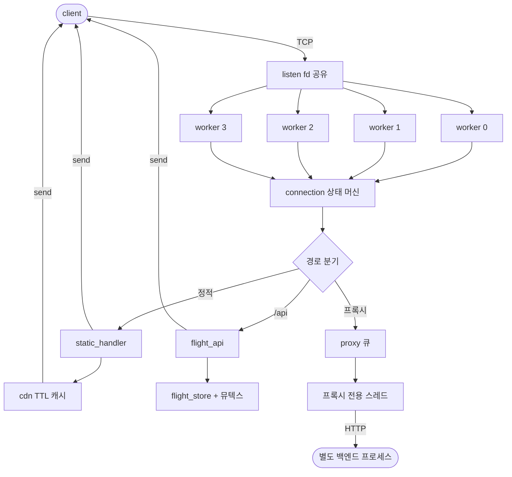
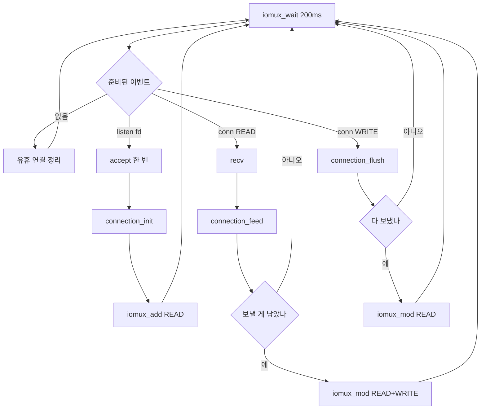
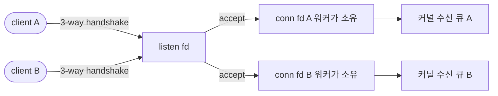
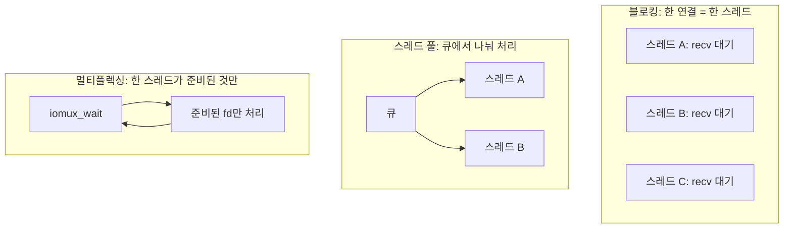
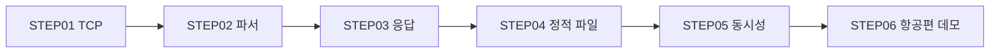

# 아키텍처 그림 (Obsidian 붙여넣기용)

이 파일은 옵시디언에 그대로 붙여넣으면 되는 mermaid 그림 모음이야.
코드 기준은 `eungi-dev`(로컬 최신)야.

---

## 1. 전체 아키텍처

---

## 2. 워커 하나의 이벤트 루프

---

## 3. 커널 입장: 연결이 들어오는 길

---

## 4. 왜 멀티플렉싱인가 (3가지 방식 비교)

---

## 5. STEP별로 무엇이 추가됐나

| STEP | 추가된 파일 | 추가된 것 |
|---|---|---|
| 01 | `tcpserver.c` | `socket`/`bind`/`listen`/`accept` |
| 02 | `http_parser.c` | 요청줄·헤더·본문 파싱, `req.consumed` |
| 03 | `http_response.c` | 상태줄+헤더 직렬화, 청크 전송 |
| 04 | `static_handler.c` | 경로 탈출 차단, MIME, 404/403/500 |
| 05 | `iomux.c`, `worker.c` | 워커별 이벤트 루프, keep-alive, 유휴 정리 |
| 06 | `flight_store.c`, `flight_api.c`, `proxy.c`, `cdn.c` | 좌석 예약, 프록시 게이트웨이, TTL 캐시 |

---

## 6. 코드에서 그림 대신 볼 위치

| 무엇을 보려면 | 파일 |
|---|---|
| 연결 상태 머신 | `src/connection.c` |
| 이벤트 루프 | `src/worker.c` |
| epoll/kqueue/poll 선택 | `src/iomux.c` |
| 설정 로드 | `src/config.c` |
| 정적 파일 경로 검증 | `src/static_handler.c` |
| 좌석 동시성 | `src/flight_store.c` |
| 프록시 큐 | `src/proxy.c` |
