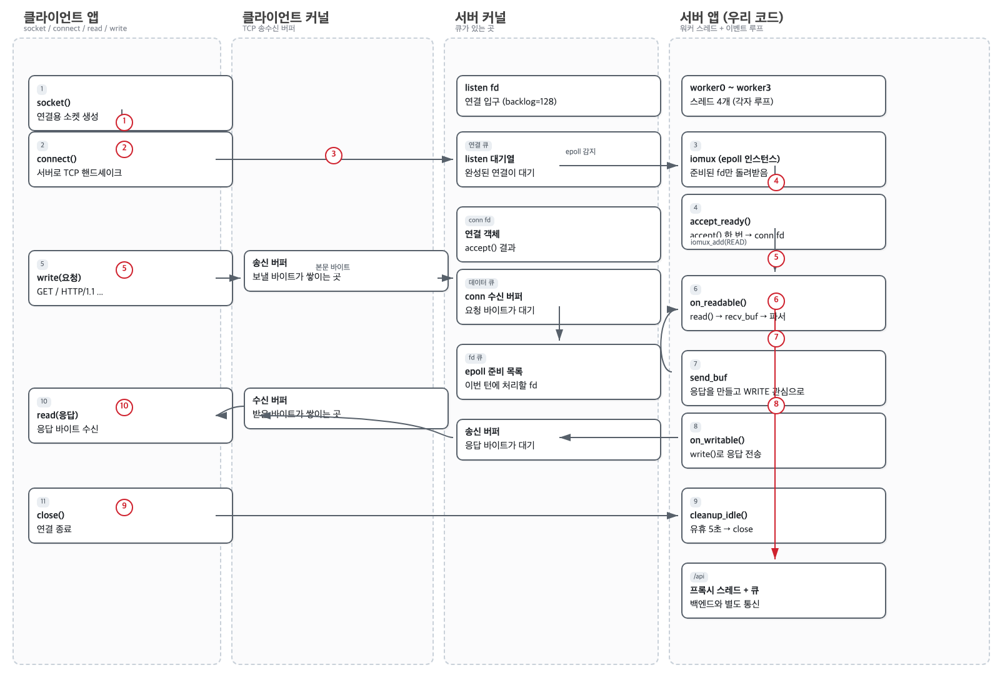

# 이벤트 루프가 돌아가는 순서

우리 서버는 워커 스레드 N개(기본 4)가 각자 `iomux`(epoll/kqueue/poll) 루프를 돌리는 구조입니다.



## 용어부터

- 멀티플렉싱: 한 스레드가 여러 fd를 동시에 감시하는 방식. `select`/`poll`/`epoll`이 있음.
- `poll`: 관심 fd 목록을 매번 전부 스캔. fd가 많으면 O(n).
- `epoll`: 리눅스에서 준비된 fd만 돌려줌. fd가 많아도 준비된 것만 받으므로 O(준비 수).
- 이벤트 루프: `wait → 준비된 fd 처리 → 다시 wait`를 반복.

## 구조

```text
client A ──TCP──┐
client B ──TCP──┼──> listen fd (워커 4개가 공유)
client C ──TCP──┘
                     │
        ┌────────────┴─────────────┐
        │ worker0 epoll_wait()      │   worker1/2/3 같은 구조
        └────────────┬─────────────┘
                     │ 준비된 fd 목록
   ┌─────────────────┼──────────────────┐
   │ listen fd 준비   │ conn fd 준비      │
   │ accept_ready()  │ READ / WRITE      │
   └─────────────────┴──────────────────┘
```

## 워커 한 바퀴

`src/worker.c` 기준으로 이렇게 돕니다.

```text
while (실행 중) {
    n = iomux_wait(mux, events, MAX_EVENTS, timeout)   // 준비된 fd 대기
    for (준비된 이벤트) {
        if (listen fd) accept_ready()                  // 연결 1건 accept
        if (READ)      on_readable()                   // recv → 파서
        if (WRITE)     on_writable()                   // send 남은 것
    }
    cleanup_idle()                                     // 유휴 5초 정리
}
```

- `on_readable()`: `recv` → `connection_feed()` → `http_parser_parse()`.
  - `COMPLETE`면 응답을 `send_buf`에 넣고 `iomux_mod(WRITE)`로 쓰기 관심 전환.
  - `NEED_MORE`면 다음 `READ`를 기다림.
- `on_writable()`: `send()`로 남은 응답을 보냄. 다 보내면 연결 상태를 정리.
- `cleanup_idle()`: 마지막 활동 후 유휴 시간이 넘은 연결은 닫음. keep-alive 최대 100회도 여기서 확인.

## 타임라인 예시

느린 클라이언트 A와 빠른 클라이언트 B가 같은 워커에 있다고 가정.

```text
worker0 시간축
 | accept A | read A(일부) |      | read B | parse B | write B |      | read A(나머지) | parse A | write A |
           A는 천천히 보냄      B는 완료
```

A가 본문을 다 보내지 않아도 워커는 A를 기다리지 않고 B를 처리합니다. 이게 “블로킹하지 않는” 부분입니다.

## 왜 이 조합인가

- 스레드를 조금 두고(4개) 여러 연결을 감시 → 스레드 생성/컨텍스트 스위치 비용을 줄임.
- `epoll`은 준비된 fd만 돌려주므로, 연결이 수백 개여도 매번 전체를 훑지 않음.
- 느린 연결은 `READ`가 늦게 준비되는 것뿐이고, 다른 연결 처리를 막지 않음.
- 유휴 연결은 시간으로 정리해서 fd를 점유하지 않음.

## 프록시 요청은 별도

`/api/...`로 들어온 요청은 워커가 바로 백엔드와 통신하지 않습니다.

```text
worker: 프록시 요청 → 큐에 넣고 즉시 다음 이벤트 처리
proxy thread: 큐에서 꺼냄 → dup(client fd) → 백엔드 연결 → 중계
```

그래서 백엔드가 느려도 워커 루프는 멈추지 않습니다.

## 소켓 함수 여정 (클라이언트 ↔ 서버)

### 클라이언트가 쓰는 함수

```text
socket() → connect(서버IP:포트) → write(요청) → read(응답) → close()
```

### 서버가 쓰는 함수

```text
socket() → setsockopt(SO_REUSEADDR) → bind() → listen()      # listen fd
accept()                                                   # conn fd
read() → 파싱 → write()                                    # 연결 처리
close()                                                    # 정리
```

### 한 요청이 지나가는 순서

```text
client A                          server (한 프로세스, 워커 4개)
  │ socket()                         │ main: socket→setsockopt→bind→listen
  │ connect() ──────────────────────►│ listen fd를 각 워커 iomux에 등록
  │                                  │
  │ write("GET / HTTP/1.1...") ────►│ iomux_wait: listen fd 준비
  │                                  │ accept_ready(): accept() → conn A fd
  │                                  │ iomux_add(conn A, READ)
  │                                  │ iomux_wait: conn A READ 준비
  │                                  │ on_readable(): read() → recv_buf
  │                                  │ http_parser_parse() → COMPLETE
  │                                  │ 응답을 send_buf에 만들고 iomux_mod(WRITE)
  │ ◄────────────────────────────────│ iomux_wait: conn A WRITE 준비
  │ read()로 응답 수신               │ on_writable(): write()
  │ close() ────────────────────────►│ READ(EOF) 또는 유휴 5초
  │                                  │ close_conn(): iomux_del() → close()
```

### 연결 큐와 요청 큐는 다른 것

- 연결 큐: 서버 커널의 `listen` 대기열(backlog). `listen(fd, 128)`의 128이 상한. 완성된 연결이 쌓이고 `accept()`가 꺼냄.
- 요청 큐: 연결이 맺어진 뒤의 바이트. 소켓 수신 버퍼에 쌓이고 `read()`로 가져와 파서가 요청으로 바꿈.
- 우리 앱에는 별도 “요청 큐”가 없음. 수신 버퍼와 `epoll` 준비 목록이 그 역할을 하고, `/api/...` 작업만 명시적 큐를 씁니다.

| 큐/버퍼 | 위치 | 담기는 것 | 누가 넣고 누가 꺼내나 |
|---|---|---|---|
| `listen` 대기열 | 서버 커널 | 완성된 연결 | 커널이 넣고, `accept()`가 꺼냄 |
| 소켓 수신 버퍼 | 양쪽 커널 | 바이트 | 상대가 `write()`, 내가 `read()` |
| `epoll` 준비 목록 | 서버 커널 | 준비된 fd | 커널이 넣고, `iomux_wait()`가 꺼냄 |
| `worker_ctx.conns[]` | 서버 앱 | 연결 슬롯 | `accept_ready()`가 넣고, `close_conn()`이 뺌 |
| 프록시 작업 큐 | 서버 앱 | `/api` 작업 | 워커가 넣고, 프록시 스레드가 꺼냄 |

### 클라이언트에게 연결 큐는 있나

없습니다. 클라이언트는 연결을 여는 쪽이라 `listen()`을 하지 않습니다. 클라이언트 소켓에는 송신/수신 버퍼만 있고, 연결 큐는 서버 커널에만 존재합니다. 클라이언트가 여러 연결을 만들면 소켓이 여러 개 생길 뿐, 큐는 아닙니다.

### 계층별 큐 도식

```text
[클라이언트 앱]      [클라이언트 커널]      [서버 커널]                 [서버 앱]
 socket()            송신/수신 버퍼
 connect() ──SYN──────────────────────────► listen 대기열(backlog)
                                              │ accept()
                                              ▼
                                            conn fd 수신 버퍼 ◄── iomux_add(READ)
                                              │ iomux_wait() 준비 목록
                                              ▼
                                          read() → recv_buf → 파서
                                              │
                                          send_buf → write()
                                              ▼
                                            송신 버퍼 ──────────────► 클라이언트 수신 버퍼
```

### 느린 클라이언트가 끼어들 때

```text
worker0
 | accept A | read A(일부만 도착) |        | read B | parse B | write B |        | read A(나머지) | parse A | write A |
                      A는 NEED_MORE → A는 READ 관심을 유지하고 루프는 계속
```

A가 본문을 다 보내지 않아도 워커는 A 때문에 멈추지 않습니다. B의 fd가 준비되는 순간 B를 먼저 처리합니다.

### 스레드가 어떻게 실행을 잡는가

- 워커 4개가 각자 `iomux` 인스턴스를 가집니다. `listen fd`는 4개 워커가 공유합니다.
- 누구의 `iomux_wait()`가 listen fd를 먼저 받아도 `accept()`는 한 번만 하고, 나머지는 `EAGAIN`으로 스킵합니다.
- `accept()`로 나온 conn fd는 그 워커의 `iomux`에 등록되고, 그 워커가 끝까지 소유합니다(D5).
- 메인 스레드는 `worker_pool_start()`로 워커를 띄우고, 종료 시 `worker_pool_join()`으로 기다립니다.

## 코드 위치

- `src/worker.c`: `worker_loop()`, `accept_ready()`, `on_readable()`, `on_writable()`, `cleanup_idle()`
- `src/iomux.c`: `iomux_create/add/mod/del/wait()` (epoll/kqueue/poll)
- `src/connection.c`: `connection_feed()`, `connection_flush()`
- `src/proxy.c`: `proxy_thread_main()`, 작업 큐
