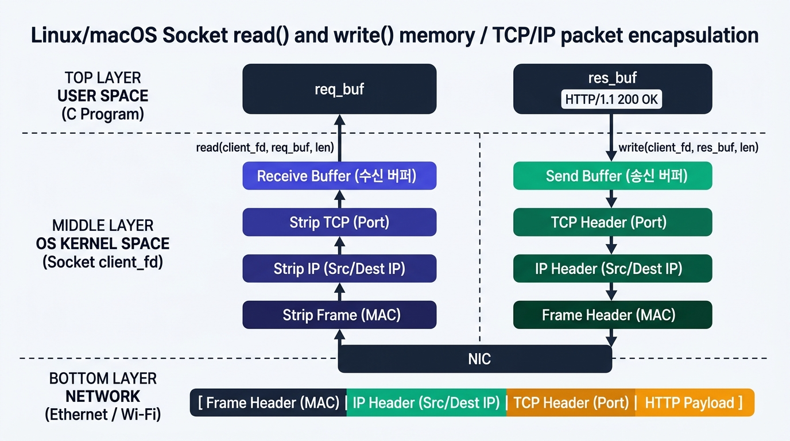

# I/O 멀티플렉싱 — 왜 이 방식을 골랐는가

FR-06(동시 요청 처리)와 NFR-03(타임아웃·연결 수명)을 푸는 핵심 선택입니다.
이 문서는 "왜 블로킹 `read`를 버렸는가", "왜 `select`가 아니라 `epoll`/`kqueue`인가",
"왜 `poll`을 폴백으로 남겼는가"를 원문 자료와 함께 다룹니다.

## 0. 설명용 전체 흐름

순서대로 읽으려면 이 절부터 보면 됩니다.

1. **연결이 어떻게 생기나.** 클라이언트가 리스닝 소켓으로 연결 요청을 하면 연결이 성립되고, 서버는 그 연결 전용 소켓을 하나 만든다. 이후 데이터는 그 소켓 위에서 오간다. **리스닝 소켓은 하나인데 받는 연결은 여러 개**다. 연결 전용 소켓은 한 연결이 혼자 쓰지만, 리스닝 소켓은 모든 클라이언트가 같이 쓰는 지점이다.
2. **순차 처리의 문제.** 한 스레드가 요청을 처음부터 끝까지 도맡으면, 다른 연결은 그 시간 동안 아무 일도 못한다.
3. **두 가지 해결 방향.**
   - 스레드를 늘려 코어별로 진짜 병렬 처리. 대가는 메모리와 컨텍스트 스위치.
   - 한 스레드가 여러 연결을 돌아가며 처리. 이것이 이벤트 루프.
4. **이벤트 루프에서 I/O 기다리는 방법.**
   - 블로킹 I/O — 응답이 올 때까지 스레드가 잠들고 다른 연결이 막힌다.
   - 논블로킹 I/O — 안 오면 `EAGAIN`으로 즉시 반환. 다른 일을 할 수 있지만 계속 확인해야 해 CPU를 소모한다.
   - I/O 멀티플렉싱 — 관심 있는 여러 연결을 커널에 등록해 두고, 커널이 준비된 연결만 골라 알려준다. 전체를 훑지 않아도 되고, 앱은 잠들어 기다릴 수 있다.
5. **우리의 선택.** 스레드 4개로 CPU 일을 병렬화하고, 각 스레드가 멀티플렉싱으로 연결을 돌린다.

```text
클라이언트 ──connect──► listen fd ──accept──► 연결 전용 소켓
                                                      │
             ┌────────────────────────────────────────┘
             ▼
      워커(고정 4개)가 여러 소켓을 감시 등록
             │
             ├─ 데이터 없음 → 잠듦
             └─ 준비된 소켓 → 깨어나서 처리 → 다시 잠듦
```

소켓 위에서 데이터가 오가는 실제 경로는 이렇습니다. `read()`는 커널 수신 버퍼에서 앱 버퍼로, `write()`는 그 반대로 복사합니다. 앱은 NIC를 직접 만지지 않습니다.



### 단계별로 보면

| 시간 | 무슨 일 | 워커 |
|---|---|---|
| t0 | 시작. 관심 집합 = `listen fd` | 잠듦 |
| t1 | A가 `connect()`. 커널이 listen fd 준비라고 알림 | 깨어남 → `accept()` 한 번 → conn A 생성 → 관심에 추가 |
| t2 | B가 `connect()` | 깨어남 → `accept()` 한 번 → conn B 추가 |
| t3 | A가 `write("GET /")`. 커널이 conn A READ 준비라고 알림 | 깨어남 → `recv()` → 파싱 → 응답을 버퍼에 만들고 WRITE 관심 추가 |
| t4 | 소켓 쓰기가 가능해짐. 커널이 conn A WRITE 준비라고 알림 | 깨어남 → `send()` |
| t5 | 준비된 것 없음 | 그대로 잠듦(타임아웃 200ms) |

### 그림과 코드 대응

| 그림의 단계 | 코드 |
|---|---|
| 잠들기 | `iomux_wait(mux, events, MAX_EVENTS, 200)` — `src/worker.c` |
| 깨어나기 | 같은 함수가 준비된 이벤트 배열을 돌려줌 |
| `accept()` | `accept_ready()` — `src/worker.c` |
| `recv`/파싱 | `on_readable()` → `connection_feed()` |
| `send()` | `on_writable()` → `connection_flush()` |
| 관심 추가·수정 | `iomux_add()`, `iomux_mod()` — `src/iomux.c` |

## 웹서버의 성격이 결정했다

멀티플렉싱을 고른 이유는 기술 자체가 좋아서가 아니라, 웹서버라는 업무의 성격이 그것을 요구하기 때문입니다.

웹서버가 가진 성격은 네 가지입니다.

- 동시 연결이 많다. 브라우저는 도메인당 여섯 개 정도를 병렬로 열고, keep-alive로 같은 연결을 계속 씁니다. 사용자 수가 늘면 연결 수는 선형으로 늘어납니다.
- 요청 하나의 일은 짧다. 정적 파일 요청은 "파일을 읽고 응답을 쓰는 것"이 전부입니다. 긴 계산을 하지 않습니다.
- 대부분의 시간은 유휴다. 클라이언트가 다음 요청을 보내기까지 소켓에 데이터가 없습니다. 연결은 살아 있는데 할 일은 없는 상태가 길습니다.
- 느린 클라이언트가 있다. 모바일 네트워크처럼 데이터를 천천히 보내는 클라이언트가 섞여 있습니다.

이 성격에서 블로킹 모델의 대가가 드러납니다. 연결당 스레드나 프로세스를 두면, 유휴 시간 동안 그 스레드는 자원을 점유한 채 아무 일도 하지 않습니다. 느린 클라이언트는 자기 스레드를 오래 붙잡습니다. 연결이 1000개면 스레드도 1000개가 필요해집니다.

멀티플렉싱은 이 구조를 뒤집습니다. 스레드 수는 고정해 두고, 스레드는 "지금 준비된 연결"만 처리합니다. 유휴 연결은 커널의 소켓 버퍼에 있을 뿐 스레드를 차지하지 않습니다. 느린 클라이언트는 `READ` 이벤트가 늦게 도착할 뿐, 다른 연결 처리를 막지 않습니다. 그래서 연결 수가 늘어나도 스레드 수는 늘리지 않아도 됩니다.

## 왜 `epoll`인가 (그리고 `kqueue`, `poll`)

멀티플렉싱이 필요하다고 해서 `epoll`인 것은 아닙니다. `select`/`poll`/`epoll` 중에 고르는 문제입니다.

웹서버는 동시 연결이 많다는 점이 선택을 결정합니다.

- `select`/`poll`은 관심 fd 전체를 매 호출마다 커널에 넘기고, 커널도 전체를 훑습니다. 연결이 1000개면 훑을 때마다 1000개를 봅니다. 그중 실제로 준비된 것은 몇 개뿐이어도 마찬가지입니다.
- `epoll`은 관심 집합을 커널에 등록해 두고, 준비된 fd만 돌려받습니다. 연결이 늘어나도 훑는 범위는 준비된 수에만 비례합니다.

그래서 "동시 연결이 많고 그중 활성은 적다"는 웹서버의 성격이 `epoll`을 골라야 할 이유가 됩니다. `epoll`이 Linux 전용이므로 macOS에서는 `kqueue`를, 그 외에서는 POSIX 표준 `poll`을 폴백으로 씁니다.

반대 성격의 서버에서는 멀티플렉싱이 오히려 불리합니다. 요청마다 긴 CPU 계산이 필요하거나, 연결 수가 적고 동시성보다 단순함이 중요하거나, 공유 상태가 많아 스레드 동기화가 병목이 되는 경우에는 블로킹 + 스레드가 더 단순하고 빠릅니다. 우리 프로젝트가 좌석 경쟁 데모를 스레드 + 뮤텍스로 푼 것은 그런 이유에서입니다.

## 문제 정의 — 왜 멀티플렉싱인가

[SoftPrayog의 select/poll/epoll 글](https://www.softprayog.in/programming/io-multiplexing-select-poll-epoll-in-linux)의 도입부를 옮깁니다.

> I/O multiplexing is the ability to perform I/O operations on multiple file descriptors.
> Input operations like read, accept and calls for receiving messages block when there is no incoming data.
> So, if an input call is made and it blocks, we may miss data from other file descriptors.

문제는 "한 fd가 블록하면 다른 fd의 데이터를 놓친다"입니다. 이걸 피하려고 생긴 것이 멀티플렉싱입니다.
같은 글에서 동작을 이렇게 설명합니다.

> A process blocks on an I/O multiplexing call. When this call returns, the process is provided a set of file descriptors which are ready for I/O. And, the process can do I/O on these file descriptors before it goes for the next iteration of the I/O multiplexing call.

프로세스는 멀티플렉싱 호출에서 블록하고, 반환되면 "지금 I/O 가능한 fd 집합"을 받습니다.
그 집합에 대해서만 I/O를 하고 다시 같은 호출로 넘어갑니다.

이 구조가 우리 서버의 그것입니다. 다만 글의 예제는 단일 스레드고, 우리는 워커 스레드 N개가 각자 이 루프를 돌립니다.

| 글의 예제 | 우리 서버 |
|---|---|
| 프로세스 1개, 스레드 1개 | 프로세스 1개, 워커 스레드 N개(기본 4) |
| `poll()` 직접 호출 | `iomux_wait()`(내부에서 `epoll`/`kqueue`/`poll`) |
| 연결 목록을 매 호출마다 전달 | 관심 집합은 커널에 등록, 준비된 것만 수신 |
| 항공편 출발/도착 시각 저장 | 같은 도메인 + 좌석 예약 경쟁 |

## 원래 선택지 — `select`, `poll`, `epoll`

### `select`

```c
int select(int nfds, fd_set *readfds, fd_set *writefds,
           fd_set *exceptfds, struct timeval *timeout);
```

- 읽기·쓰기·예외 세 개의 fd 집합을 감시합니다.
- 반환되면 세 집합이 "준비된 fd만"으로 바뀌므로, 호출 측이 매번 다시 확인해야 합니다.
- `FD_SETSIZE`(1024) 미만의 fd만 감시할 수 있습니다.

### `poll`

```c
struct pollfd { int fd; short events; short revents; };
int poll(struct pollfd *fds, nfds_t nfds, int timeout);
```

- 관심 fd만 배열로 넘깁니다. 1024 제한이 없습니다.
- `events`에 요청하고 `revents`로 결과를 받습니다. `events`는 호출 후에도 그대로 남습니다.
- `fd`가 음수면 그 원소는 무시됩니다.
- 주요 이벤트: `POLLIN`, `POLLPRI`, `POLLOUT`, `POLLRDHUP`, `POLLERR`, `POLLHUP`, `POLLNVAL`.
- POSIX 표준이라 Linux와 macOS 모두에서 같은 코드가 동작합니다.

### `epoll`

```c
int epoll_create(int size);      /* size는 폐기된 인자, 0보다 커야 함 */
int epoll_create1(int flags);    /* flags는 0 또는 EPOLL_CLOEXEC */
int epoll_ctl(int epfd, int op, int fd, struct epoll_event *event);
int epoll_wait(int epfd, struct epoll_event *events, int maxevents, int timeout);
```

- `epoll_create1()`이 인스턴스를 만들고 `epoll_ctl()`로 관심 fd를 추가·수정·삭제합니다.
- `epoll_wait()`는 준비된 이벤트를 `events[]`에 최대 `maxevents`개 채워 반환합니다.
- 반환값은 준비된 fd 수, 타임아웃이면 0, 오류면 `-1`.
- Linux 전용입니다.

### 표로 비교

| API | 관심 fd 전달 방식 | 훑는 범위 | 이식성 |
|---|---|---|---|
| `select` | `fd_set` 3개를 매 호출마다 전달 | 0부터 `fdmax`까지 전부 | POSIX |
| `poll` | `struct pollfd` 배열을 매 호출마다 전달 | 관심 fd 전체 | POSIX |
| `epoll` | `epoll_ctl()`로 커널에 등록 | 준비된 fd만 | Linux 전용 |
| `kqueue` | `kevent()`로 커널에 등록 | 준비된 fd만 | macOS/BSD 전용 |

## `poll`이 `select`보다 나은 점

원문이 `poll vs. select`에서 정리한 세 가지입니다.

1. `select`는 `FD_SETSIZE`(1024) 미만만 감시할 수 있고, `poll`은 제한이 없습니다.
2. `select`는 fd 집합을 사용해서 준비된 fd를 알려면 0부터 `fdmax`까지 전부 확인해야 합니다. `poll`은 관심 fd만 담은 `pollfd` 배열을 넘기므로 더 간결합니다.
3. `select`는 fd 집합 인자를 변경하므로 매 반복마다 집합을 다시 초기화해야 합니다. `poll`은 입력 `events`를 그대로 두고 결과는 `revents`로 돌려주므로 그럴 필요가 없습니다.

## `epoll` vs `poll`

원문이 정리한 세 가지입니다.

1. `poll`은 배열에서 닫힌 fd를 지우기 어렵습니다. 음수로 만들어 무시시키는 방법이 있는데, fd 번호가 0이면 안 됩니다. `epoll`은 `epoll_ctl(ADD/DEL)`로 추가·제거가 명확해서 인터페이스가 더 깨끗합니다.
2. `epoll`이 더 빠르고 많은 fd로 확장됩니다.
3. `poll`은 POSIX 표준, `epoll`은 Linux 전용입니다.

## 레벨 트리거와 엣지 트리거

원문은 이렇게 말합니다.

> By default, epoll is level-triggered (LT). It can be made edge-triggered by specifying the EPOLLET flag.
> Edge-triggered means an event is considered when data availability (bytes) on a file descriptor changes from zero to some positive value.
> Level-triggered, simply, means that there is data available on a file descriptor to be read.
> Level-triggered, is simpler and is easy to use.

- 레벨 트리거(LT): "읽을 데이터가 있다" 상태가 유지되는 동안 계속 통지. 덜 읽어도 다음 호출에서 다시 알려줍니다.
- 엣지 트리거(ET): 데이터가 0에서 양수로 변하는 시점에만 통지. 그 반복에서 다 읽지 않으면 다음 통지를 기다려야 합니다.

우리는 `EPOLLET`를 쓰지 않습니다. 기본인 레벨 트리거입니다. 원문도 "단순하고 쓰기 쉽다"고 해서 예제에 LT를 씁니다.

## 왜 우리는 `epoll`/`kqueue` + `poll` 폴백인가

결정은 D5, D9, D21입니다(`docs/decisions/STEP05_CONCURRENCY_DECISIONS.md`).

- `epoll`(Linux) / `kqueue`(macOS)을 기본, `poll`을 폴백으로 둡니다.
- 이유는 원문의 두 번째·세 번째 결론을 같이 만족시키기 위해서입니다.
  - "더 빠르고 많은 fd로 확장된다" → `epoll`/`kqueue`
  - "POSIX 표준" → `poll`
- 셋을 같은 `iomux` 인터페이스 뒤에 숨겨서, 플랫폼이 바뀌어도 워커 코드는 안 바뀝니다.
- 대가는 `#ifdef` 분기 증가입니다. 관심 fd가 적은 규모에서는 `poll`만으로 충분합니다.

즉 "`poll`이 안 돼서 `epoll`을 쓴다"가 아니라, "확장성과 이식성을 같이 잡는다"는 선택입니다.
데모 규모(동시 100)에서는 `poll`도 통합니다. `epoll`은 연결이 수백~수만으로 늘 때 차이가 납니다.

## 우리 코드에서 동작

`src/iomux.c`가 백엔드 분기를 담당합니다.

```c
#if defined(__linux__)          -> epoll_create1 / epoll_ctl / epoll_wait
#elif defined(__APPLE__) ...    -> kqueue / kevent
#else                           -> poll
#endif
```

- `iomux_create()`: 워커마다 1개. `epoll`은 `epoll_create1(0)`, `kqueue`는 `kqueue()`, `poll`은 fd 배열.
- `iomux_add/mod/del()`: 관심 fd 등록·변경·제거. `epoll`은 `epoll_ctl(ADD/MOD/DEL)`, `kqueue`는 `EV_ADD/EV_DELETE`, `poll`은 배열 상태만 유지.
- `iomux_wait()`: 준비된 이벤트를 `out[]`에 최대 `max`개 채워 반환. 0이면 타임아웃.
- 컨텍스트 포인터: `kqueue`는 `udata`에서 포인터가 그대로 돌아오고, `epoll`은 `ev.data.fd`로 받아 `entries[]`에서 역조회합니다. 인터페이스는 같습니다.
- 등록하는 이벤트는 `EPOLLIN`/`EPOLLOUT`과 `EPOLLRDHUP`/`EPOLLHUP`/`EPOLLERR`뿐이고 `EPOLLET`는 없습니다. 즉 레벨 트리거.

`src/worker.c`가 그것을 쓰는 곳입니다.

```text
while (실행 중) {
    iomux_wait(mux, events, 256, 200ms)   // 준비된 fd 대기
    for (준비된 이벤트) { accept / on_readable / on_writable }
    cleanup_idle()                        // 유휴 5초 정리
}
```

200ms 타임아웃은 준비된 fd가 없어도 주기적으로 유휴 연결을 정리하고 종료 플래그를 확인하기 위함입니다.

## 지금 이 환경에서 도는 백엔드

- 이 문서를 만든 macOS 호스트에서는 `kqueue`가 기본입니다(`iomux.c`를 전처리하면 `kevent`만 남습니다).
- Linux에서 빌드하면 `epoll`이 선택됩니다.
- 그 외 POSIX 환경에서는 `poll` 폴백이 돕니다.

그래서 "`epoll`을 구현했다"보다 "`epoll`/`kqueue`를 추상화하고 `poll`을 폴백으로 뒀다"가 정확합니다.

## 예제 — `flight-time-server`

원문의 예제는 항공편 번호·출발/도착 구분·날짜·시각을 트리에 저장하고 `poll`로 여러 클라이언트를 감시하는
`flight-time-server.c`입니다. 메시지 타입은 `STORE_FLIGHT`, `FLIGHT_TIME_STORED`, `FLIGHT_TIME`,
`FLIGHT_TIME_RESULT`, `FLIGHT_NOT_FOUND`, `ERROR_IN_INPUT`이고, 포트는 4358입니다.

STEP6의 항공편 출발/도착 추적 아이디어는 여기서 나왔습니다. 다만 예제는 단일 프로세스·단일 스레드 `poll` 루프입니다.
우리는 여기에 워커 N개와 공유 좌석 락을 얹었습니다. "아이디어는 같고 구조는 다르다"고 적어 둡니다.

### 글의 `epoll` 사용법과 우리 코드 비교

글에서 `epoll`은 이렇게 씁니다.

```c
efd = epoll_create1(0);
ev.events = EPOLLIN;  ev.data.fd = listener;
epoll_ctl(efd, EPOLL_CTL_ADD, listener, &ev);
while (1) {
    nfds = epoll_wait(efd, ep_event, MAX_EVENTS, -1);
    for (i = 0; i < nfds; i++) {
        if (ep_event[i].events & EPOLLIN) {
            if (ep_event[i].data.fd == listener) {          // 새 연결
                fd_new = accept(listener, ...);
                ev.events = EPOLLIN; ev.data.fd = fd_new;
                epoll_ctl(efd, EPOLL_CTL_ADD, fd_new, &ev); // 새 fd 등록
            } else {                                          // 기존 연결
                numbytes = recv(ep_event[i].data.fd, ...);
                if (numbytes == 0) {                          // 상대가 닫음
                    epoll_ctl(efd, EPOLL_CTL_DEL, ep_event[i].data.fd, &ev);
                    close(ep_event[i].data.fd);
                }
            }
        }
    }
}
```

우리 코드와 같은 점, 다른 점을 표로 정리합니다.

| 항목 | 글의 예제 | 우리 코드 |
|---|---|---|
| 인스턴스 생성 | `epoll_create1(0)` | `iomux_create()` → `epoll_create1(0)` |
| 관심 등록 | `epoll_ctl(ADD)` | `iomux_add()` → `epoll_ctl(ADD)` |
| 대기 | `epoll_wait(..., -1)` 무한 | `iomux_wait(..., 200ms)` — 유휴 정리 주기 |
| 이벤트 데이터 | `ev.data.fd` | `ev.data.fd` + `entries[]`에서 컨텍스트 역조회 |
| 트리거 | 기본(LT) | 기본(LT), `EPOLLET` 미사용 |
| 관심 이벤트 | `EPOLLIN`만 | `EPOLLIN`/`EPOLLOUT` — 쓰기 일부 실패 대비 |
| 연결 종료 | `epoll_ctl(DEL)` → `close()` | `iomux_del()` → `close()` (같은 순서) |
| 부분 읽기 | `struct message` 한 번 `recv` | `recv_buf`에 누적 후 파서 |
| 멀티스레드 | 없음 | 워커 N개, 워커별 `iomux` |

두 가지 차이가 중요합니다.

- 글은 `EPOLLIN`만 등록하고 `send`를 블로킹으로 합니다. 그래서 `EPOLLOUT`이 필요 없습니다. 우리는 소켓을 논블로킹으로 쓰므로, 쓰기가 일부만 성공하면 `EPOLLOUT`을 등록해 나머지를 나중에 보냅니다.
- 글은 `epoll_wait`에 `-1`을 줘서 무한 대기합니다. 우리는 200ms를 줘서 준비된 이벤트가 없어도 유휴 연결을 정리하고 종료 플래그를 확인합니다.

글의 예제가 더 짧고 읽기 쉽습니다. 대신 유휴 정리와 부분 쓰기를 할 수 없습니다. 우리 구조는 그 두 가지를 추가한 형태입니다.

## 멀티플렉싱을 고르는 경우와 고르지 않는 경우

[Chris Kanich 강의](https://www.youtube.com/watch?v=85T_ZaT8EUI)가 프로세스·스레드·I/O 멀티플렉싱을 별개의 동시성 모델로 비교합니다. 그 기준으로 정리하면:

멀티플렉싱이 유리한 경우

- 한 스레드가 여러 연결을 같이 다뤄야 할 때.
- 연결 수는 많지만 동시에 활성인 연결은 적을 때.
- 스레드 생성·컨텍스트 스위치·뮤텍스 동기화 오버헤드를 피하고 싶을 때.

멀티스레드 블로킹이 나은 경우

- 요청마다 CPU 작업이 길어서 스레드가 계속 일해야 할 때.
- 연결 수가 적고 동시성보다 코드가 단순한 게 중요할 때.
- 공유 상태가 많아 뮤텍스가 병목이 될 때.

우리는 두 가지를 섞었습니다. 연결 처리는 멀티플렉싱, 공유 상태(좌석)는 스레드 + 뮤텍스입니다.

## 왜 멀티프로세스가 아니라 스레드인가

가장 중요한 공유 상태는 `flight_store`의 좌석 배열이다. 좌석 경쟁은 세마포어가 아니라 `pthread_mutex` 한 개로 관리한다. 이 공유 상태를 여러 프로세스로 찢으면 문제가 생긴다.

| 대안 | 문제 |
|---|---|
| 멀티프로세스 | `fork()`가 메모리를 복사해 좌석 배열이 워커마다 따로 생김 → 공유 메모리·IPC가 새로 필요 |
| 메시지 큐로 동기화 | 같은 프로그램 안에서 상태만 공유하면 되는데 비용만 커짐 |
| fd 핸드오프 | 워커 사이에 소켓을 넘기는 구조가 필요해지는데, 우린 accept한 워커가 연결을 끝까지 소유 |

그래서 "연결 처리 = 멀티플렉싱"과 "공유 상태 = 스레드 + 뮤텍스"를 분리했다. 연결이 병목이면 멀티플렉싱으로 많은 fd를 돌리고, 상태 경쟁이 병목이면 뮤텍스로 정확히 처리한다.

반대로 멀티프로세스가 낫다는 근거도 있다. 워커 하나가 죽어도 서비스가 계속되어야 하거나, 프로세스별 재기동·메모리 격리가 필요할 때다. 지금 규모에서는 그 요구가 없으므로 미뤘다. 검토 기준은 `tests/integration/review_cases.sh` TC4에 적었다.

## 검증

- `make test`, `make integration`, `make edge-cases` — 수신 버퍼 동적 확장, 경로 탈출, Content-Length 숫자 검증, 큰 본문(8KB 정상 / 1MB+1 거부), 비정상 요청 후 생존.
- macOS에서는 `kqueue`, Linux에서는 `epoll`이 선택되는지 `tests/linux_check.sh`로 확인.
- 동시 100×1000 요청은 `make load-test-heavy`. 수치는 [../records/VERIFICATION_LOG.md](../records/VERIFICATION_LOG.md)를 기준으로 본다.

## 참고 자료

- Karunesh Johri, [I/O multiplexing: select, poll and epoll in Linux](https://www.softprayog.in/programming/io-multiplexing-select-poll-epoll-in-linux) — 이 문서의 주 자료
- [SoftPrayog — I/O multiplexing: select, poll and epoll in Linux (영상)](https://youtu.be/dEHZb9JsmOU) — 같은 내용의 강의. `flight-time-server` 예제 포함
- [Chris Kanich — what's the difference between processes, threads, and io multiplexing?](https://www.youtube.com/watch?v=85T_ZaT8EUI) — 동시성 모델 비교
- 관련 문서: [../DESIGN.md](../DESIGN.md)(루프 동작 순서·큐 위치), [../decisions/STEP05_CONCURRENCY_DECISIONS.md](../decisions/STEP05_CONCURRENCY_DECISIONS.md)(D5/D9/D10/D21)
