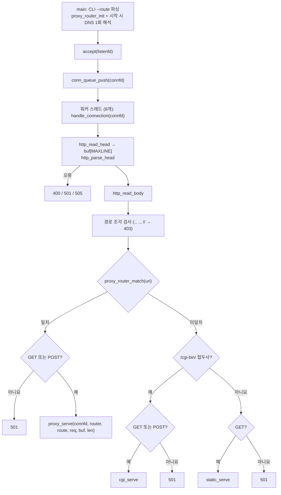
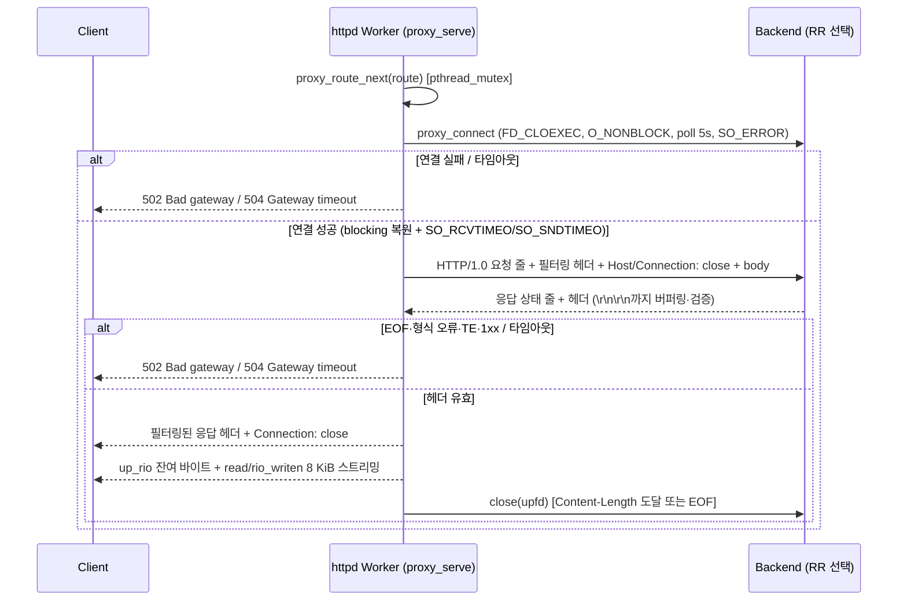

# 7단계 리버스 프록시 (Reverse Proxy) 설계 문서

* **Author:** choimoohun
* **Date:** 2026-11-25
* **Status:** Final (Ready for Review)

## The Problem

현재 6단계까지 완성된 `httpd`는 정적 파일 서빙과 `/cgi-bin/` CGI 실행을 워커 8개 스레드 풀로 동시 처리합니다. 그러나 요청을 처리하는 실행 주체가 모두 `httpd` 프로세스 자신 또는 그 자식 프로세스뿐이므로, 별도 포트로 떠 있는 내부 애플리케이션 서버(백엔드 1~N대)로 요청을 분산하거나 앞단 관문 역할을 할 수 없습니다.

1. **과제 필수 요구사항 미충족:** 과제 명세(`docs/웹 서버 만들기.md`)는 정적·동적 요청 처리와 동시성 위에 Forward Proxy 또는 Reverse Proxy(경로 또는 호스트 기반 라우팅, 가능하면 단순 라운드로빈 로드 밸런싱, 백엔드 무응답·타임아웃 엣지 케이스 처리)를 필수로 요구합니다.
2. **백엔드 장애·지연 격리 부재:** 백엔드 서버가 죽어 있거나 응답을 멈췄을 때 클라이언트에 원인을 구분해 알리는 표준 게이트웨이 오류(`502 Bad gateway`, `504 Gateway timeout`)와, 느린 백엔드 연결이 8개 워커 스레드 풀 전체를 무기한 붙잡지 않게 하는 시간 제한 경계가 없습니다.
3. **기존 1~6단계 경계의 프록시 충돌 요소:** 현재 `httpd`는 `accept()`에서 파일 디스크립터 한도(`EMFILE`/`ENFILE`)에 닿으면 서버 프로세스를 즉시 종료하고, 요청 파서는 `Host`·`Connection`·`Content-Length` 외의 요청 헤더를 버리며(`Connection` 값도 31바이트 제한), `OPTIONS *` 요청을 501 대신 400으로 처리합니다. 백엔드 연결 소켓이 추가되면 동시 CGI `fork()`로 소켓이 새는 문제도 함께 막아야 합니다.

## Overview

기존 6단계 스레드 풀 웹 서버(`httpd`, 워커 8개, 연결 대기열 16칸, 블로킹 RIO, C17 / `_POSIX_C_SOURCE=200809L`) 위에 **URI 경로 접두사 기반 리버스 프록시**를 추가합니다.

- 운영자는 기존 실행 명령(`./httpd <port> <root>`)을 그대로 유지한 채, 필요한 만큼 `--route <접두사>=<호스트:포트>[,<호스트:포트>...]` 인자를 붙여 라우팅 규칙을 지정합니다.
- 요청 URI가 등록된 접두사와 일치하면 `httpd`가 해당 라우트의 백엔드 목록에서 라운드로빈으로 하나를 골라 요청을 전달하고 응답을 클라이언트에 돌려줍니다. 일치하지 않는 요청은 기존 `/cgi-bin/` CGI와 정적 파일 서빙으로 그대로 넘어갑니다.
- 프록시↔백엔드 구간과 클라이언트↔프록시 구간 모두 `Connection: close`를 유지해 커넥션 풀과 청크 디코더 없이 단순한 동작 경계를 유지합니다. 백엔드 연결 실패·비정상 응답은 즉시 `502`, 연결·송수신 시간 초과는 즉시 `504`를 반환합니다.

## 1차 구현 범위

이 단계는 프록시 핵심만 구현합니다. 아래 항목은 프록시 동작에 꼭 필요하지 않아 후속 PR로 미룹니다. 본문에서 후속 항목을 다루는 곳(변경 표의 `http_request.*` 행, Detailed Implementation 3·4·10·16·20번)에는 "(후속)"을 붙였습니다.

| 항목 | 상태 | 이유 |
| --- | --- | --- |
| `proxy.h/.c`, `--route`, 라운드로빈, `502`/`504`, `static_has_bad_segments()`, `test_proxy` | 포함 | 과제 필수(라우팅, 로드 밸런싱, 백엔드 타임아웃) |
| 요청 헤더 이름 `tchar` 검사 | 포함(프록시 안에서만) | `Transfer-Encoding : chunked`처럼 이름 뒤 공백으로 파서를 피한 줄이 백엔드에 전달되는 요청 밀반입을 막습니다. `proxy_format_request_head()`가 `-1`을 반환하고 `httpd`는 `400`을 보냅니다 |
| `connection[256]` 확장, `OPTIONS *` → `501`, 중복 `Host` `400` | 후속 | 프록시는 클라이언트 `Host`를 버리고 다시 쓰므로 영향이 없습니다. 긴 `Connection` 값은 지금처럼 `400` |
| `accept()` `EMFILE`/`ENFILE` 백오프 | 후속 | 6단계부터 있던 동작이며 프록시와 무관. 구현할 때 `continue`만 넣으면 대기 연결이 커널 큐에 남아 `accept()`가 즉시 다시 실패하며 CPU 100%로 돎. 짧은 `nanosleep` 뒤 재시도 |
| 메서드 검사를 본문 읽기 앞으로 이동 | 후속 | 기존 분기 순서를 유지합니다. 프록시 경로도 본문을 읽은 뒤 `GET`/`POST`를 검사합니다 |

## Goals

* **URI 경로 접두사 라우팅과 기존 기능 보존:** 최장 세그먼트 경계 일치로 프록시 경로를 판별하고, 매칭되지 않은 요청은 기존 `/cgi-bin/` 및 정적 파일 서빙과 1~6단계 테스트를 변경 없이 통과시킵니다.
* **하위 호환 CLI 구성:** 기존 `./httpd <port> <root>` 실행을 유지하면서 반복 가능한 `--route` 인자로 복수 라우트와 복수 백엔드를 지정하고, 잘못된 인자나 해석 불가능한 백엔드 주소는 시작 시점에 오류를 출력하고 0이 아닌 종료 코드(`1`)로 종료합니다.
* **스레드 안전한 단순 라운드로빈:** 라우트별 백엔드 목록을 8개 워커 스레드에서 경쟁 상태 없이 순환 분배합니다.
* **명확한 게이트웨이 오류와 시간 제한:** 프록시 경로의 `GET`·`POST` 요청(그 외 메서드는 `501`)에 대해 백엔드 연결 거부·비정상 응답은 `502`, 연결·송수신 시간 초과는 `504`로 즉시 응답합니다(자동 재시도 없음).
* **5~6단계 경계 안전성 확보:** 원본 요청 헤더 전달과 hop-by-hop 헤더 제거, 백엔드 소켓 `FD_CLOEXEC`, `http_status_text()`의 `502`/`504` 추가를 함께 반영합니다(`EMFILE` 방어와 `OPTIONS *` 정리는 후속).
* **단위·통합 자동 검증 및 문서 동기화:** 표준 C17/POSIX CTest(`test_proxy`)로 라우팅·헤더 필터링·라운드로빈·루프백 `200`/`502`/`504` 경로를 자동 검증하고, [AGENTS.md](../../AGENTS.md) 규칙에 따라 관련 설계 문서를 동기화합니다.

## Non-Goals

* **C10K 튜닝 및 이벤트 루프 전환:** 6단계의 워커 8개 블로킹 스레드 풀을 `poll`/`epoll` 이벤트 루프로 교체하지 않습니다. 과제 품질 항목의 `ab`/`wrk`/`hey` 처리량 측정은 7단계 서버 기능이 아닌 별도 검증 단계로 분리합니다.
* **클라이언트·백엔드 keep-alive 및 커넥션 풀:** 양쪽 구간 모두 `Connection: close`를 유지하며 유휴 소켓 재사용을 구현하지 않습니다.
* **Forward Proxy 및 응답 캐싱:** `absolute-form`(`http://host/path`)·`authority-form`(`CONNECT`) 중계와 캐시 저장소는 제외합니다.
* **`Transfer-Encoding: chunked` 디코딩:** 클라이언트 요청의 `Transfer-Encoding`은 기존 `501`을 유지하고, 백엔드의 비규격 `Transfer-Encoding` 응답은 `502`로 거부합니다.
* **장애 우회 재시도, 헬스 체크, 가중치 로드 밸런싱:** 선택한 백엔드가 실패하면 다음 백엔드로 재시도하지 않고 즉시 `502`/`504`를 반환합니다.
* **설정 파일 파서, `Host` 헤더 라우팅, TLS/WebSockets, `GET`/`POST` 외 메서드:** 1차 범위에서 제외합니다(단, 규칙 문자열 파서는 추후 설정 파일 확장이 가능하도록 분리합니다).

## Technical Plan

### 1. 전체 요청 흐름과 컴포넌트 구조

[`src/httpd.c`](../../src/httpd.c)는 프로세스 초기화·종료와 연결 분배만 맡는 얇은 진입점으로 유지하고, 리버스 프록시의 라우팅·헤더 변환·업스트림 연결·응답 중계는 정적 라이브러리 `http` 안의 신규 모듈 `src/proxy.h` / `src/proxy.c`에 격리합니다.

### 2. CLI 구성과 라우터 데이터 모델 (`src/proxy.h`, `src/proxy.c`)

- **CLI 문법 (기존 실행과 하위 호환):**
  `./httpd <port> <root> [--route <prefix>=<host:port>[,<host:port>...]]...`
  - [`CMakeLists.txt`](../../CMakeLists.txt)가 `CMAKE_C_EXTENSIONS OFF`와 `_POSIX_C_SOURCE=200809L`을 강제하므로 GNU 확장 `getopt_long()`을 쓰지 않고 `argv[3..argc-1]`에 대해 단순 `strcmp(argv[i], "--route") == 0` 루프를 돕니다.
  - `--route`가 하나도 없으면 라우트 0개로 동작해 1~6단계와 동일합니다.
  - 잘못된 플래그, 빠진 인자, 잘못된 `<prefix>`(`'/'` 미시작, 중복), 잘못된 `<host:port>`(포트 범위 `1..65535` 이탈), 용량 초과, 시작 시 `getaddrinfo()` 실패는 모두 `stderr`에 원인을 출력하고 `exit(1)`로 즉시 종료합니다(기존 사용법 오류의 `exit(0)`도 `exit(1)`로 정리).
- **고정 크기 구조체 (zero-malloc, [`src/conn_queue.h`](../../src/conn_queue.h)와 동일 패턴):**
  - `PROXY_MAX_ROUTES = 16`, `PROXY_MAX_BACKENDS = 16`, `PROXY_DEFAULT_TIMEOUT_MS = 5000`.
  - `proxy_backend`: 원본 `host`·`port` 문자열(로그 및 `Host:` 헤더 생성용), 시작 시 `getaddrinfo(AF_UNSPEC, SOCK_STREAM, AI_NUMERICSERV)`로 1회 해석한 `struct sockaddr_storage addr`, `socklen_t addrlen`, `family`, `socktype`, `protocol`. IPv4(`127.0.0.1:8001`), 호스트명(`localhost:8001`), 대괄호 IPv6(`[::1]:8001`)를 `strrchr(':')` 기반으로 파싱합니다.
  - `proxy_route`: 정규화된 `prefix`(루트 `'/'`를 제외한 끝 `'/'` 제거), `prefix_len`, `backends[PROXY_MAX_BACKENDS]`, `nbackends`, `next`, 라우트별 `pthread_mutex_t lock`.
  - `proxy_router`: `routes[PROXY_MAX_ROUTES]`, `nroutes`, `int timeout_ms`. 초기화 후 라우트 배열은 읽기 전용이며, 워커가 쓰는 공유 상태는 각 `proxy_route.lock`으로 보호되는 `next` 인덱스뿐입니다.
- **최장 세그먼트 경계 일치 (`proxy_router_match`):**
  - 모든 라우트를 검사해 가장 긴 `prefix_len`을 선택합니다(CLI 등록 순서에 무관).
  - `prefix`가 `"/"`이면 모든 `'/'`-시작 URI에 일치하고, 그 외에는 `strncmp(uri, prefix, plen) == 0`이면서 `uri[plen]`이 `'\0'`, `'/'`, `'?'` 중 하나일 때만 일치합니다(따라서 `/api`는 `/api`, `/api/`, `/api/users?a=1`, `/api?x=1`에 일치하고 `/apiv2`에는 일치하지 않음).
  - 매칭된 URI는 접두사를 제거하지 않고 원본 `req->uri` 그대로 백엔드에 전달합니다.

### 3. 업스트림 연결 (`proxy_connect`) — `csapp.c:open_clientfd` 미사용

[`src/csapp.c`](../../src/csapp.c)의 `open_clientfd()`는 무제한 블로킹 `connect()`(~127초), `FD_CLOEXEC` 누락, `errno` 덮어쓰기 문제가 있으므로 사용하지 않습니다. POSIX.1-2008 전용 헬퍼 `proxy_connect(const proxy_backend *b, int timeout_ms, int *err_status)`를 다음 순서로 구현합니다. `_POSIX_C_SOURCE=200809L`과 `CMAKE_C_EXTENSIONS OFF`에서는 `SOCK_CLOEXEC`, `SOCK_NONBLOCK`, `accept4()`가 컴파일되지 않으므로 `socket()` 뒤에 `fcntl()`로 플래그를 따로 붙입니다.

1. `socket(b->family, b->socktype, b->protocol)` 호출 직후 `fcntl(fd, F_SETFD, FD_CLOEXEC)`으로 동시 CGI `fork()` 누수를 차단합니다(Stage 6의 `accept()`와 동일한 `shortcut:` 틈을 주석에 명시).
2. `fcntl(fd, F_GETFL)` → `fcntl(fd, F_SETFL, fl | O_NONBLOCK)`으로 논블로킹 전환 후 `connect(fd, (const struct sockaddr *)&b->addr, b->addrlen)`을 호출합니다.
3. 즉시 `0`이 아니면 `errno == EINPROGRESS`일 때 `clock_gettime(CLOCK_MONOTONIC, ...)` 기준 마감 시각까지 `poll(&pfd, 1, rem_ms)`(`POLLOUT`)를 반복합니다(`EINTR` 시 남은 시간 재계산).
4. `poll() == 0`이면 `close(fd)`, `*err_status = 504` 반환. `poll() > 0`이면 `getsockopt(fd, SOL_SOCKET, SO_ERROR, &so_err, &len)`을 확인해 `so_err == ETIMEDOUT`이면 `504`, 그 외 0이 아니면 `502`를 반환합니다.
5. 연결 성공 시 `fcntl(fd, F_SETFL, fl & ~O_NONBLOCK)`으로 블로킹 모드를 복원하고(미복원 시 RIO가 `EAGAIN`으로 즉시 실패), `SO_RCVTIMEO`와 `SO_SNDTIMEO`를 `timeout_ms`로 설정합니다.

### 4. 요청·응답 중계와 hop-by-hop 필터링

- **공통 hop-by-hop 제거 규칙 (RFC 9110 §7.6.1):**
  - 정적 제거 목록: `Connection`, `Keep-Alive`, `Proxy-Authenticate`, `Proxy-Authorization`, `Proxy-Connection`, `TE`, `Trailer`, `Transfer-Encoding`, `Upgrade` (요청 방향에는 `Expect` 추가해 백엔드의 `100 Continue` 방지).
  - 동적 제거 목록: 원본 헤더 블록 내 **모든** `Connection:` 줄에서 쉼표·공백으로 구분된 토큰 이름을 수집해 대소문자 무시 비교로 함께 제거합니다.
- **요청 헤더 재작성 (`proxy_format_request_head`):**
  - `http_request`에 힙 헤더 배열을 추가하지 않고 `handle_connection()`의 스택 버퍼 `(raw_head, raw_len)`을 그대로 입력받습니다.
  - 요청 줄은 `<req->method> <req->uri> HTTP/1.0\r\n`으로 작성합니다(`HTTP/1.0`으로 내려 HTTP/1.1 백엔드가 `Transfer-Encoding: chunked`나 `100 Continue`를 보내지 않게 방지).
  - 원본 헤더 줄들에서 hop-by-hop 헤더, 기존 `Host`, 기존 `Content-Length`를 제외한 나머지 end-to-end 헤더(`Content-Type`, `Authorization`, `Cookie`, `Accept`, `User-Agent`, `X-*` 등)를 복사하고, `Host: <b->host>:<b->port>\r\n`(IPv6는 `[<b->host>]:<b->port>`), `Connection: close\r\n`, 그리고 `req->content_length > 0 || POST`일 때 단일 `Content-Length: %zu\r\n`(같은 값의 중복 `Content-Length`는 하나로 합침)과 빈 줄 `\r\n`을 붙여 출력합니다.
  - 출력 버퍼 크기는 `MAXLINE + 1024`로 잡아 클라이언트 헤더가 8 KiB에 가까워도 주입 헤더 때문에 잘리지 않게 합니다(초과 시 `-1`을 반환하고 `proxy_serve()`가 `400`을 보냅니다).
  - 헤더 전송 후 `req->content_length > 0`이면 `rio_writen(upfd, req->body, req->content_length)`로 본문을 전송합니다(쓰기 실패 시 `errno`가 `EAGAIN`/`EWOULDBLOCK`이면 `504`, `EPIPE`/`ECONNRESET` 등 기타는 `502`).
- **응답 헤더 버퍼링·검증과 본문 스트리밍 (2단계 전환):**
  1. **헤더 단계 (`http_read_head` + `proxy_filter_response_head`):** `rio_readinitb(&up_rio, upfd)` 뒤 기존 `http_read_head()`로 백엔드 응답 헤더를 빈 줄 `\r\n\r\n`까지 최대 `MAXLINE`바이트 읽습니다. 이 함수는 EOF와 읽기 오류를 모두 `HTTP_READ_CLOSED`로 돌려주고 `rio_read()`는 EOF에서 `errno`를 지우지 않으므로, 호출 전 `errno = 0`으로 두어 조기 EOF(`errno == 0` → `502`)와 시간 초과(`EAGAIN`/`EWOULDBLOCK` → `504`)를 구분합니다.
     - 상태 줄은 `HTTP/1.0` 또는 `HTTP/1.1` + 3자리 상태 코드(`200..599`)를 요구합니다(`1xx` 또는 구문 오류는 `502`).
     - 헤더 중 `Transfer-Encoding`이 존재하거나, `Content-Length` 형식이 잘못됐거나, 서로 다른 값의 중복 `Content-Length`가 있으면 `502`를 반환합니다.
     - 정적·동적 hop-by-hop 헤더를 제거하고 `Connection: close\r\n`을 덧붙여 클라이언트에 한 번에 송신합니다.
  2. **본문 스트리밍 단계:**
     - 응답 상태가 `204` 또는 `304`이면 본문 0바이트로 즉시 종료합니다.
     - 먼저 `up_rio.rio_bufptr`에 미리 읽혀 있던 `up_rio.rio_cnt`바이트를 클라이언트 소켓에 쓰고(`Content-Length`가 있으면 남은 길이 한도 내에서만), 이어서 `read(upfd, chunk, 8192)` → `rio_writen(connfd, chunk, n)` 루프로 스트리밍합니다(`rio_readnb` 미사용).
     - `Content-Length`가 있는 응답은 정확히 `N`바이트 전송이 끝나면 EOF를 기다리지 않고 `upfd`를 즉시 닫습니다(`Connection: close`를 무시하는 백엔드에서의 5초 멈춤 방지).
     - 헤더를 클라이언트에 보낸 뒤 백엔드 오류·타임아웃이나 클라이언트 끊김(`EPIPE`)이 발생하면 `502`/`504`를 덧쓰지 않고 `stderr`에 중단 로그를 남긴 뒤 양쪽 소켓을 닫습니다.

### 5. 기존 모듈 변경과 경계 안전장치

| 대상 파일 | 변경 내용 | 이유 |
| --- | --- | --- |
| `src/proxy.h`, `src/proxy.c` (신규) | 라우터, CLI 규칙 파서, `proxy_connect`, 헤더 변환·필터, `proxy_serve` | `libhttp`에 포함해 단위·루프백 테스트 가능하게 격리 |
| `src/http_request.h`, `src/http_request.c` (후속) | `connection[256]` 확장, `OPTIONS *`만 허용(`GET *`는 `400`), 헤더명 `tchar` 검사·중복 `Host` `400` 거부 | 다중 토큰 `Connection:` 수용, 미룬 결정 C 해소. 1차 구현에서는 헤더명 검사만 `proxy.c`에서 합니다 |
| `src/http_response.h`, `src/http_response.c` | `http_status_text()`에 `502` (`"Bad gateway"`), `504` (`"Gateway timeout"`) 추가 | `http_send_error()` 재사용, 기존 문장형 표기 일관성 유지 |
| `src/static_file.h`, `src/static_file.c` | 경로 조각 검증(`.`,`..`,`//`)을 공통 함수 `static_has_bad_segments()`로 분리·공개 | 프록시 라우팅 전에도 `/api/../admin` 우회 차단 재사용 |
| `src/httpd.c` | `--route` 파싱(`exit(1)`), `proxy_router` 초기화·정리, 본문을 읽은 뒤 경로 조각 검사 → 프록시 라우트 → 메서드 검사 순서로 분기 | 기존 1~6단계 호환 유지 |
| `CMakeLists.txt` | `http` 라이브러리에 `src/proxy.c`, 테스트 루프에 `test_proxy` 추가 | CMake 3.16 / CTest 등록 규칙 준수 |

### 6. 오류 분류, 관측성 및 자원 한계

- **오류 매핑 표:**

| 단계 | 실패 조건 | 클라이언트 응답 |
| --- | --- | --- |
| 요청 파싱·검증 | 잘못된 구문 / `Transfer-Encoding` 요청 / `.`,`..`,`//` / 불허 메서드 | `400` / `501` / `403` / `501` |
| 요청 헤더 변환 (`proxy_format_request_head()` 실패) | token이 아닌 헤더 이름, 헤더 값의 단독 `\r`, URI의 제어 문자, 출력 버퍼 초과 | `400 Bad request` |
| 요청 파싱 (후속) | 중복 `Host`, `GET *` | `400`. 1차 구현에서는 중복 `Host`를 덮어쓰고(프록시는 어차피 다시 씀) `*`는 기존처럼 `400` |
| 업스트림 연결 | `ECONNREFUSED`, `EHOSTUNREACH`, `ENETUNREACH`, `socket()` 실패 | `502 Bad gateway` |
| 업스트림 연결 | `poll()` 타임아웃, `SO_ERROR == ETIMEDOUT` | `504 Gateway timeout` |
| 요청 송신 | `EPIPE`, `ECONNRESET` / `EAGAIN`, `EWOULDBLOCK` | `502` / `504` |
| 응답 헤더 수신·검증 | 조기 EOF, 상태 줄·헤더 구문 오류, `1xx`, `Transfer-Encoding`, 중복·잘못된 `Content-Length`, 헤더 > `MAXLINE` | `502 Bad gateway` |
| 응답 헤더 수신 | `SO_RCVTIMEO` (`EAGAIN`/`EWOULDBLOCK`) | `504 Gateway timeout` |
| 본문 스트리밍 (헤더 전송 후) | 백엔드 오류·타임아웃 또는 클라이언트 `EPIPE` | 추가 상태 줄 없음, 양쪽 소켓 즉시 종료 |

- **관측성:** `400`/`502`/`504` 및 헤더 송신 후 스트리밍 중단 시 `fprintf(stderr, "proxy error: backend=%s:%s phase=%s status=%d errno=%d (%s) bytes_sent=%zu\n", ...)` 한 줄로 원인·단계·백엔드를 기록합니다. `phase`는 `format`, `connect`, `send`, `read_head`, `send_head`(응답 헤더를 클라이언트에 쓰다 실패), `stream` 중 하나입니다.
- **자원·종료 한계:** 프록시 경로의 추가 스택은 `up_rio`(8 KiB), `head[MAXLINE]`(8 KiB), `buf[PROXY_HEAD_BUF]`(~9 KiB)로 약 25 KiB이며, 기존 `handle_connection()` 프레임(~41 KiB)과 `stream_body()` 청크 버퍼(8 KiB)를 합쳐 워커 전체 스택은 ~74 KiB 전후입니다(Linux 기본 스레드 스택 8 MiB 이내). 공유 워커 8개 구조 특성상 응답 없는 백엔드 1대에 요청이 집중되면 워커 풀이 포화될 수 있으며, `SIGTERM` 시 진행 중이거나 대기열에 쌓인 프록시 요청의 호출별 타임아웃만큼 종료가 지연될 수 있습니다.

## Alternatives Considered

### 1. 라우팅 규칙 입력 방식: 설정 파일 vs. CLI 인자

| 비교 기준 | CLI 인자 (채택안: `./httpd <port> <root> [--route <prefix>=<h:p>[,...]]...`) | 설정 파일 전용 (`./httpd -c httpd.conf`) | CLI + 선택적 설정 파일 (`--config <file>`) |
| --- | --- | --- | --- |
| 1~6단계 하위 호환 | `./httpd <port> <root>` 그대로 동작 | 기존 실행 방식·문서·테스트와 충돌 | 하위 호환 유지 |
| CTest·Docker 실행 편의 | 임시 파일 없이 한 줄로 실행·검증 가능 | 테스트마다 임시 파일 생성·경로 관리·삭제 필요 | 파일 테스트 별도 추가 필요 |
| C17/POSIX 파서 복잡도 | `argv[3..]` 단순 `strcmp` 루프(~25줄). GNU `getopt_long` 미사용 | `fopen`, 줄 길이 제한, 주석·공백, 줄 번호 오류 보고 필요 | 파일 파서 부담 동일 |
| 규칙 10개 이상 가독성 | 명령줄이 길어지고 주석 불가 | 가독성과 버전 관리에 유리 | 가독성 유리 |
| 과제 범위 적합성 | 요구사항("CLI 인자 또는 설정 파일") 충족, 최소 범위 | 핵심 프록시 로직 외의 파일 문법 설계 증가 | 요구사항 초과 |

* **설정 파일 전용 및 CLI + 설정 파일 동시 지원** — *Rejected by author:* 과제 규모(라우트 2~5개, Docker/CTest 반복 실행)에서는 별도 파일 포맷과 파서를 도입할 실익이 작고, 기존 `./httpd <port> <root>` 실행과 하위 호환을 깨지 않는 CLI 인자가 단순합니다. 대신 규칙 문자열 파싱을 순수 함수 `proxy_router_add_spec()`으로 분리해 추후 `--config <file>` 확장 시 동일 문법을 재사용할 수 있게 했습니다.

### 2. 프록시↔백엔드 keep-alive 및 커넥션 풀

* *Rejected by author:* 백엔드 소켓을 재사용하려면 백엔드별 유휴 소켓 큐·뮤텍스·유휴 만료 관리가 필요하고, 백엔드 응답의 정확한 끝(`Content-Length` 또는 `Transfer-Encoding: chunked`)을 1바이트 오차 없이 끊어야 하며(오판 시 다음 사용자 응답으로 데이터 오염), 백엔드가 먼저 끊은 유휴 소켓에서 `POST` 같은 비멱등 요청을 안전하게 재시도할 수 없습니다. 클라이언트↔프록시 구간도 `Connection: close`이고 부하 테스트 튜닝을 비목표로 둔 상태라 비용 대비 이득이 작습니다.

### 3. 6단계 동시성을 이벤트 루프(`poll`/`epoll`)로 재작성

* *Rejected by author:* 동시 연결 10,000개(C10K) 수준을 처리하려면 6단계의 블로킹 스레드 풀을 논블로킹 이벤트 루프로 교체하고 기존 RIO 기반 요청 파서·정적 파일 서빙·CGI 파이프 처리를 상태 기계로 전면 재작성해야 합니다. `_POSIX_C_SOURCE=200809L` 제약에서는 `epoll`도 쓸 수 없습니다. 이번 단계는 기존 스레드 풀 위에 리버스 프록시를 얹는 범위로 고정합니다.

### 4. `csapp.c`의 `open_clientfd()` 재사용

* *Rejected by author:* [`src/csapp.c`](../../src/csapp.c)의 `open_clientfd()`는 타임아웃 없는 블로킹 `connect()`를 호출해 패킷 드롭 백엔드에서 Linux SYN 재시도(~63~127초) 동안 8개 워커를 점유하며 `504`를 반환하지 못합니다. 또한 `FD_CLOEXEC` 없이 소켓을 열어 동시 CGI `fork()`에 백엔드 소켓이 새고, 실패 후 `close()`/`freeaddrinfo()`가 `errno`를 덮어써 `502`/`504` 구분이 깨집니다.

### 5. 백엔드 응답을 헤더 파싱 없이 원문 그대로 스트리밍

* *Rejected by author:* 첫 `read()`만 확인하고 바이트를 그대로 흘려보내는 방식은 코드가 가장 짧지만, 백엔드가 깨진 상태 줄이나 `1xx`·`Transfer-Encoding` 응답을 보낼 때 `502`로 차단할 수 없고, `Connection: close`를 무시하는 백엔드에서 `Content-Length` 도달 후에도 EOF를 기다리며 매 요청마다 5초 멈춥니다. 또한 백엔드의 hop-by-hop 헤더를 제거하지 못합니다. 이를 피하기 위해 헤더만 버퍼링·검증하고 본문은 스트리밍하는 2단계 절충안을 택했습니다.

### 6. 백엔드 응답 전체 버퍼링 (`cgi.c` 방식 1 MiB 상한)

* *Rejected by author:* 응답 전체를 힙에 모으면 1 MiB보다 큰 백엔드 응답을 전달할 수 없고, 워커 8개가 동시에 큰 요청과 응답을 처리할 때 힙 사용량이 두 배(최대 16 MiB)로 증가합니다.

### 7. 백엔드 장애 시 다음 라운드로빈 백엔드로 자동 재시도

* *Rejected by author:* 백엔드 연결 후 쓰기·읽기 단계에서 실패한 `POST` 요청을 다른 백엔드로 재시도하면 중복 실행 문제가 생기고, 여러 백엔드가 모두 느릴 때 타임아웃이 누적(백엔드 수 × 5초)되어 워커 점유와 종료 지연이 커집니다. 단순 라운드로빈과 즉시 `502`/`504` 반환으로 범위를 고정했습니다.

### 8. HTTP/1.1 백엔드에 청크 디코더(`Transfer-Encoding: chunked`) 직접 구현

* *Rejected by author:* 청크 크기 파싱·트레일러·오류 복구 구현은 작업 범위를 크게 늘립니다. 백엔드로 보내는 요청을 `HTTP/1.0` + `Connection: close`로 내려 RFC 9112 규격상 청크 응답을 원천 차단하고, 비규격 백엔드가 `Transfer-Encoding`을 보내면 `502`로 거부합니다.

### 9. URI 접두사 제거(Prefix Stripping) 및 매 요청 DNS 해석

* *Rejected by author:* 접두사 제거(`/api/users` → `/users`)는 `/api?a=1`의 빈 경로 변환(`/?a=1`)과 백엔드 `Location` 리다이렉트 경로 불일치를 유발하므로 원본 URI 유지가 단순합니다. 매 요청 `getaddrinfo()` 호출은 POSIX.1-2008에서 타임아웃을 걸 수 없어 워커가 무기한 막힐 수 있고 잘못된 백엔드 주소를 시작 시점에 잡지 못하므로, 시작 시 1회 해석·캐시로 고정했습니다. 대가로 백엔드 IP가 바뀌면 서버를 다시 시작해야 합니다.

## Detailed Implementation

구현자가 추가 설계 결정을 내리지 않고 순서대로 구현·검증할 수 있도록, 변경·생성하는 모든 파일과 API 명세, 처리 절차, 테스트·문서 동기화 항목을 하나의 실행 목록으로 정리합니다. 모든 공개 `.h` 선언에는 [AGENTS.md](../../AGENTS.md) 규칙에 따라 동작·반환값·실패 시 동작·자원 해제 책임을 선언 바로 위 주석으로 적습니다.

### 1. 신규 소스 파일 (생성)

1. **`src/proxy.h`** *(신규 생성)*
   - **변경 내용:** 리버스 프록시 상수, 고정 크기 구조체(`proxy_backend`, `proxy_route`, `proxy_router`), 순수 함수 및 소켓 I/O 공개 API 선언과 문서 주석을 정의합니다.
   - **이유:** `src/httpd.c`에서 프록시 로직을 분리해 정적 라이브러리 `http`에 편입하고, `tests/test_proxy.c`가 소켓 없는 단위 테스트와 루프백 통합 테스트를 직접 호출할 수 있게 합니다.
   - **상수 및 스키마:**
     - `PROXY_MAX_ROUTES = 16`, `PROXY_MAX_BACKENDS = 16`, `PROXY_DEFAULT_TIMEOUT_MS = 5000`, `PROXY_PREFIX_MAX = 256`, `PROXY_HOST_MAX = 256`, `PROXY_PORT_MAX = 16`, `PROXY_HEAD_BUF = (MAXLINE + 1024)`.
     - `proxy_backend`: `char host[PROXY_HOST_MAX]`, `char port[PROXY_PORT_MAX]`, `struct sockaddr_storage addr`, `socklen_t addrlen`, `int family`, `int socktype`, `int protocol`.
     - `proxy_route`: `char prefix[PROXY_PREFIX_MAX]`, `size_t prefix_len`, `proxy_backend backends[PROXY_MAX_BACKENDS]`, `size_t nbackends`, `size_t next`, `pthread_mutex_t lock`.
     - `proxy_router`: `proxy_route routes[PROXY_MAX_ROUTES]`, `size_t nroutes`, `int timeout_ms`.
   - **공개 API 원형:**
     - `void proxy_router_init(proxy_router *router, int timeout_ms)` — 빈 라우터 초기화(`timeout_ms <= 0`이면 `PROXY_DEFAULT_TIMEOUT_MS`).
     - `void proxy_router_destroy(proxy_router *router)` — 등록된 모든 라우트의 `pthread_mutex_destroy()` 수행.
     - `int proxy_router_add_spec(proxy_router *router, const char *spec, char *errbuf, size_t errsize)` — `<prefix>=<host:port>[,<host:port>...]` 파싱·검증·`getaddrinfo()` 해석 후 라우트 등록. 성공 `0`, 실패 `-1`(`errbuf`에 원인 기록, 부분 초기화된 뮤텍스 정리).
     - `proxy_route *proxy_router_match(proxy_router *router, const char *uri)` — 최장 세그먼트 경계 일치 라우트 반환, 없으면 `NULL`.
     - `const proxy_backend *proxy_route_next(proxy_route *route)` — `route->lock` 아래에서 라운드로빈 다음 백엔드 포인터 반환.
     - `int proxy_format_request_head(const http_request *req, const char *raw_head, size_t raw_len, const proxy_backend *backend, char *out, size_t out_size)` — `HTTP/1.0` 요청 줄, hop-by-hop 제거, `Host` 덮어쓰기, `Connection: close`, 단일 `Content-Length` 조립. 성공 시 바이트 수, 버퍼 부족·오류 시 `-1`.
     - `int proxy_filter_response_head(const char *raw_head, size_t raw_len, char *out, size_t out_size, int *status_out, int *has_cl, size_t *cl_out)` — 상태 줄(`HTTP/1.0|1.1`, `200..599`)·헤더 검증(`Transfer-Encoding`·`1xx`·비정상/충돌 `Content-Length` 거부), hop-by-hop 제거, `Connection: close` 삽입. 성공 시 출력 바이트 수, 형식 오류 시 `-1`(호출자가 `502` 전송).
     - `int proxy_serve(int connfd, const proxy_router *router, proxy_route *route, const http_request *req, const char *raw_head, size_t raw_len)` — 백엔드 선택 → `proxy_connect` → 요청 송신 → 응답 헤더 읽기·검증 → 본문 스트리밍 → 실패 시 `502`/`504` 송신 및 `stderr` 로그. 응답 완료 시 `0`, 클라이언트 송신 실패나 헤더 후 중단 시 `-1`. `connfd`는 닫지 않음.

2. **`src/proxy.c`** *(신규 생성)*
   - **변경 내용:** `src/proxy.h`의 모든 공개 함수와 내부 `static` 헬퍼(`parse_backend`, `listed_in_connection`, `is_hop_by_hop`, `filter_headers`, `proxy_connect`, `stream_body`)를 구현합니다. 응답 헤더는 별도 함수 없이 기존 `http_read_head()`로 읽습니다.
   - **이유:** POSIX.1-2008 제약(`_POSIX_C_SOURCE=200809L`, `CMAKE_C_EXTENSIONS OFF`)을 지키면서 `open_clientfd()`의 블로킹·FD 누수·`errno` 손실 문제를 회피합니다.
   - **세부 동작 규약 (의사절차):**
     - `proxy_router_add_spec`: `'='` 분리 → 접두사 검증(`'/'` 시작, 공백/제어문자 금지, 루트 `'/'` 제외 끝 `'/'` 제거, 기존 라우트와 중복 검사) → 쉼표로 `<host:port>` 분리(IPv6 `[host]:port` 또는 `strrchr(':')`, 포트 `1..65535` 정수 검사) → `getaddrinfo(host, port, &hints, &res)`(`AF_UNSPEC`, `SOCK_STREAM`, `AI_NUMERICSERV`, `AI_ADDRCONFIG` 미사용 — 루프백 전용 Docker 환경 호환) → `AF_INET` 주소가 있으면 그것을, 없으면 첫 주소를 복사한 뒤 `freeaddrinfo`(IPv6가 꺼진 Docker에서 `localhost`가 `::1`로 먼저 풀려 IPv4 전용 백엔드에 닿지 못하는 문제 방지). 괄호 없는 호스트에 `:`가 있으면 거부 → `pthread_mutex_init`.
     - `proxy_connect(backend, timeout_ms, &err_status)`: `socket()` → `fcntl(FD_CLOEXEC)` → `O_NONBLOCK` 설정 → `connect()` → `EINPROGRESS` 시 `clock_gettime(CLOCK_MONOTONIC)` 마감 시각까지 `poll(POLLOUT)` 반복(`EINTR` 재시도) → `poll()==0`이면 `close` 후 `504` → `getsockopt(SO_ERROR)` 확인(`0` 아니면 `ETIMEDOUT`→`504`, 그 외 `502`) → `O_NONBLOCK` 해제 → `SO_RCVTIMEO`/`SO_SNDTIMEO`를 `timeout_ms`로 설정.
     - 응답 헤더 읽기: `http_read_head(&up_rio, head, MAXLINE, &len)`를 재사용합니다. 호출 전 `errno = 0`으로 두고, `HTTP_READ_CLOSED`이면서 `errno`가 `EAGAIN`/`EWOULDBLOCK`이면 `504`, 그 밖의 실패(EOF, CRLF 아님, `MAXLINE` 초과)는 `502`.
     - `proxy_filter_response_head`: 상태 줄 파싱(`HTTP/1.0 ` 또는 `HTTP/1.1 `, 3자리 숫자 `200..599`, 선택적 사유 문구) → 헤더 줄 순회(NUL 금지, `:` 필수, 이름 `tchar` 검증, `Transfer-Encoding` 발견 시 `-1`, `Content-Length` 숫자·중복 충돌 검사) → 줄마다 `listed_in_connection()`으로 모든 `Connection:` 줄의 토큰과 비교 → 정적+동적 hop-by-hop 제외한 줄 복사 + `Connection: close\r\n\r\n`.
     - `stream_body`: 상태가 `204`/`304`이면 즉시 반환. 아니면 `up_rio.rio_bufptr`의 `up_rio.rio_cnt`바이트(단, `has_cl`이면 `min(rio_cnt, remaining)`)를 먼저 `rio_writen(connfd, ...)`으로 송신한 뒤, 8 KiB 고정 버퍼로 `read(upfd, ...)` → `rio_writen(connfd, ...)` 반복(`has_cl`이면 `remaining == 0`에서 즉시 종료, 아니면 `read == 0`까지). 헤더 송신 이후 실패 시 `stderr` 한 줄 로그 후 `-1` 반환(추가 HTTP 오류 응답 금지).

### 2. 기존 소스 파일 (수정)

3. **[`src/http_request.h`](../../src/http_request.h)** *(수정, 후속)*
   - **변경 내용:** `http_request.connection` 크기를 `32`에서 `256`으로 확장하고, `http_parse_head()` 주석에 `OPTIONS *` 허용과 중복 `Host`/잘못된 헤더 이름 `400` 규칙을 반영합니다.
   - **이유:** RFC 9110 §7.6.1의 다중 토큰 `Connection:` 헤더가 31바이트 초과로 400 거부되는 문제를 없애고, 미룬 결정 C를 인터페이스 문서에 반영합니다.

4. **[`src/http_request.c`](../../src/http_request.c)** *(수정, 후속)*
   - **변경 내용:**
     - `parse_request_line()`: `uri[0] != '/'` 검사에 `!(strcmp(method_tok, "OPTIONS") == 0 && ulen == 1 && uri[0] == '*')` 예외를 추가해 `OPTIONS *`만 통과시키고 `GET *` 등은 `400` 유지.
     - `parse_header_line()`: 헤더 이름 각 바이트가 RFC 9110 `tchar`인지 검사(공백·제어문자 포함 시 `400`), 값 내부의 단독 `\r` 거부(`400`), `Host` 헤더 중복 등장 시 `400`(이미 설정됐는지 플래그로 추적).
     - (1차 구현에서 완료) Line 118의 `Transfer-Encoding` `shortcut:` 주석을 리버스 프록시 비목표 결정에 맞게 갱신.
   - **이유:** 프록시가 원본 헤더를 백엔드로 전달할 때 잘못된 헤더명·중복 `Host`로 인한 요청 밀반입을 막고, 미룬 결정 C(`OPTIONS *`)를 닫습니다.

5. **[`src/http_response.h`](../../src/http_response.h)** 및 **[`src/http_response.c`](../../src/http_response.c)** *(수정)*
   - **변경 내용:** `http_status_text()`에 `case 502: return "Bad gateway";`, `case 504: return "Gateway timeout";`를 추가하고, `src/http_response.h`의 함수 주석 목록에 `502`, `504`를 추가합니다.
   - **이유:** 프록시가 `http_send_error(connfd, 502)`와 `http_send_error(connfd, 504)`를 그대로 재사용하며 기존 문장형 표기 규칙을 유지합니다.

6. **[`src/static_file.h`](../../src/static_file.h)** 및 **[`src/static_file.c`](../../src/static_file.c)** *(수정)*
   - **변경 내용:** `static_resolve_path()` 안의 `.`, `..`, 빈 조각(`//`) 검사 루프를 `int static_has_bad_segments(const char *uri)`로 분리·공개하고, `static_resolve_path()`가 이 함수를 호출하도록 변경합니다.
   - **이유:** 프록시 분기가 `static_resolve_path()`보다 먼저 실행되므로, 동일한 경로 조각 검증을 `httpd.c`에서 프록시 라우팅 전에도 재사용해 `/api/../admin` 우회를 막습니다.

7. **[`src/httpd.c`](../../src/httpd.c)** *(수정)*
   - **변경 내용:**
     - 파일 정적 상태에 `static proxy_router router;` 추가.
     - `main()`에서 `argc < 3`이면 usage 출력 후 `exit(1)`. `proxy_router_init(&router, PROXY_DEFAULT_TIMEOUT_MS)` 호출 뒤 `argv[3..argc-1]`을 순회해 `--route <spec>` 인자를 `proxy_router_add_spec()`으로 등록(알 수 없는 플래그, 값 누락, 규칙 오류 시 `stderr` 출력 후 `exit(1)`).
     - 종료 경로에서 `Pthread_join` 완료 후 `proxy_router_destroy(&router)` 호출.
     - (후속) `accept()`의 `EMFILE`/`ENFILE` 백오프. 1차 구현에서는 기존처럼 `unix_error()`로 종료합니다.
     - `handle_connection()` 순서: `http_parse_head` 성공 → `http_read_body(&rio, &req)` → `static_has_bad_segments(req.uri)`이면 `403` → `route = proxy_router_match(&router, req.uri)` → `dynamic = (route == NULL && strncmp(req.uri, CGI_PREFIX, ...) == 0)` → 메서드 검사(`GET || ((route || dynamic) && POST)`, 불허 시 `501`) → `route`가 있으면 `proxy_serve(connfd, &router, route, &req, buf, len)`, 아니면 기존 CGI/정적 분기. 메서드 검사를 본문 읽기 앞으로 옮기는 것은 후속입니다.
   - **이유:** 기존 `./httpd <port> <root>` 호환을 유지하면서 프록시 라우팅과 안전한 종료를 한 곳에 통합합니다.

### 3. 빌드 및 테스트 파일

8. **[`CMakeLists.txt`](../../CMakeLists.txt)** *(수정)*
   - **변경 내용:** `add_library(http STATIC ...)`에 `src/proxy.c`를 추가하고, `foreach(name ...)` 테스트 목록에 `test_proxy`를 추가합니다.
   - **이유:** `httpd`와 모든 단위 테스트가 `proxy.c`를 링크하고 `ctest`가 `test_proxy`를 자동 실행하게 합니다.

9. **`tests/test_proxy.c`** *(신규 생성)*
   - **변경 내용:** `#undef NDEBUG` + `<assert.h>` 기반으로 순수 단위 테스트와 루프백 소켓(`127.0.0.1:0` 임시 포트, `timeout_ms = 200`, `socketpair(AF_UNIX, SOCK_STREAM, 0, sv)`) 통합 테스트를 작성합니다.
   - **이유:** 외부 서버나 고정 포트 없이 Docker/CTest 환경에서 모든 프록시 계약을 결정적으로 검증합니다.
   - **테스트 케이스:** P01~P17의 절차와 기대 결과는 [test-cases.md](./test-cases.md)에 있습니다. 묶음은 CLI 규칙 파싱(P01~P03), 라우트 매칭(P04~P05), 동시 라운드로빈(P06), 요청 헤더 변환(P07~P08), 응답 헤더 검증(P09~P10), 루프백 중계(P11~P12), 장애·시간 초과·경계(P13~P17)입니다. DNS 해석 실패와 연결 단계의 `poll()` 시간 초과는 CTest 환경에서 결정적으로 재현할 수 없어 뺐습니다.

10. **[`tests/test_http_request.c`](../../tests/test_http_request.c)** *(수정, 후속)*
    - **변경 내용:** Line 71의 `Connection` 길이 초과 테스트를 256바이트 경계로 갱신하고, `OPTIONS *` 통과, `GET *` → `400`, 잘못된 헤더명(`Bad Name: 1`) → `400`, 중복 `Host` → `400` 단언을 추가합니다.
    - **이유:** `http_request.c`의 변경된 파싱 규칙을 CTest로 고정합니다.

11. **[`tests/test_http_response.c`](../../tests/test_http_response.c)** *(수정)*
    - **변경 내용:** `502` (`"Bad gateway"`)와 `504` (`"Gateway timeout"`)에 대한 `http_status_text()`, `http_format_head()` 검증(R09)을 추가합니다. `http_send_error()`는 상태 메시지만 바꿔 쓰므로 기존 R04로 충분합니다.
    - **이유:** 신규 상태 코드의 상태 메시지와 응답 줄 형식을 단위 테스트로 고정합니다.

12. **[`tests/test_static_file.c`](../../tests/test_static_file.c)** *(수정)*
    - **변경 내용:** 공개된 `static_has_bad_segments()`의 경계 케이스(`/api/a..b` 허용, `/api/../x`·`/api/./x`·`//api` 거부)를 직접 검증하는 단언을 추가합니다.
    - **이유:** 프록시와 정적/CGI가 공유하는 경로 검증 함수의 계약을 명시적으로 테스트합니다.

### 4. 문서 동기화 파일 (`AGENTS.md` 규칙 준수)

13. **`docs/reverse-proxy/design.md`** *(본 문서)*, **`docs/reverse-proxy/functions.md`**, **`docs/reverse-proxy/test-cases.md`** *(신규 생성)*
    - **변경 내용:** 1~6단계와 동일한 3문서 구조(설계·함수 명세·단위/기능 테스트 절차)로 7단계 문서를 완성합니다. 기능 테스트에는 Docker 컨테이너 내 자체 `httpd` 백엔드 2대 + `curl` 라운드로빈·`502`/`504`·`SIGTERM` 종료·ASan/LSan 검증 절차를 포함합니다.
    - **이유:** [AGENTS.md](../../AGENTS.md)와 [docs/README.md](../README.md)의 단계별 문서 규약을 따릅니다.

14. **[`docs/README.md`](../README.md)** *(수정)*
    - **변경 내용:** `요청 하나의 흐름` Mermaid 다이어그램에 리버스 프록시 분기를 추가하고, 7단계 표의 링크(`./reverse-proxy/design.md`)와 상태 칸을 갱신합니다.
    - **이유:** 전체 서버 파이프라인과 단계 진행 현황을 최신 상태로 유지합니다.

15. **[`docs/static-file-serving/design.md`](../static-file-serving/design.md)** 및 **[`docs/static-file-serving/functions.md`](../static-file-serving/functions.md)** *(수정)*
    - **변경 내용:** 전체 파일 구성 트리, 의존성 표, `CMakeLists.txt` 스니펫에 `proxy.h/.c`와 `test_proxy.c`를 추가하고, `static_has_bad_segments()` 명세를 기록합니다.
    - **이유:** 이 문서가 전체 `httpd` 빌드·파일 구성의 기준 문서이기 때문입니다.

16. **[`docs/http-request-parsing/design.md`](../http-request-parsing/design.md)** 및 **[`docs/http-request-parsing/functions.md`](../http-request-parsing/functions.md)** *(수정, 후속)*
    - **변경 내용:** `connection[256]` 크기, `OPTIONS *` 허용, 헤더명 `tchar` 및 중복 `Host` 400 규칙, `absolute-form`(Forward Proxy 범위 외) 문구를 갱신합니다.
    - **이유:** 코드와 2단계 설계 문서의 불일치를 방지합니다.

17. **[`docs/http-response/design.md`](../http-response/design.md)** 및 **[`docs/http-response/functions.md`](../http-response/functions.md)** *(수정)*
    - **변경 내용:** 상태 코드 표와 `http_status_text()` 설명에 `502 Bad gateway`, `504 Gateway timeout`을 추가합니다.
    - **이유:** 3단계 응답 명세와 실제 지원 코드 목록을 일치시킵니다.

18. **[`docs/dynamic-request/design.md`](../dynamic-request/design.md)** *(수정)*
    - **변경 내용:** `요청 분기` 표에 프록시 라우트 최우선 분기 규칙을 반영합니다.
    - **이유:** `/cgi-bin/` 분기 조건과 실제 `handle_connection()` 분기 순서를 일치시킵니다.

19. **[`docs/concurrency/design.md`](../concurrency/design.md)** 및 **[`docs/concurrency/functions.md`](../concurrency/functions.md)** *(수정)*
    - **변경 내용:** 공유 쓰기 가능 상태 설명(`conn_queue` + `proxy_router` 라우트별 RR 락), `FD_CLOEXEC` 표(업스트림 백엔드 소켓 추가), `httpd.c`의 `main()`(`--route`, `exit(1)`, `proxy_router_destroy`) 및 `handle_connection()`(프록시 분기) 설명을 갱신합니다.
    - **이유:** 6단계 문서의 불변식이 7단계 추가 후 거짓이 되지 않게 합니다.

20. **[`docs/reviews/stage-1-4-deferred-decisions.md`](../reviews/stage-1-4-deferred-decisions.md)** *(수정, 후속)*
    - **변경 내용:** 항목 C(`*` 형식 요청 대상)의 결정 결과를 기록합니다(리버스 프록시 채택으로 `OPTIONS *`→`501`, `GET *`→`400` 적용, `absolute-form`/`authority-form`은 `400` 유지).
    - **이유:** 미룬 결정 기록을 닫아 추적 가능성을 유지합니다.

### 5. 최종 검증 순서

1. Docker 환경에서 `-Wall -Wextra -fsanitize=address,undefined`로 빌드하고 경고 0건(직접 작성 코드 기준)을 확인합니다.
2. `(cd build && ctest --output-on-failure)`로 6개 테스트 타깃(`test_http_request`, `test_http_response`, `test_static_file`, `test_cgi`, `test_conn_queue`, `test_proxy`) 전체 통과 및 ASan/LSan 누수 0건을 확인합니다.
3. 같은 Docker 컨테이너 안에서 백엔드 `httpd` 2대와 앞단 프록시 `httpd`를 띄워 `curl`로 라운드로빈 교대 응답, `502`/`504`, `/cgi-bin/`·정적 파일 폴백, `SIGTERM` 정상 종료를 확인합니다.
