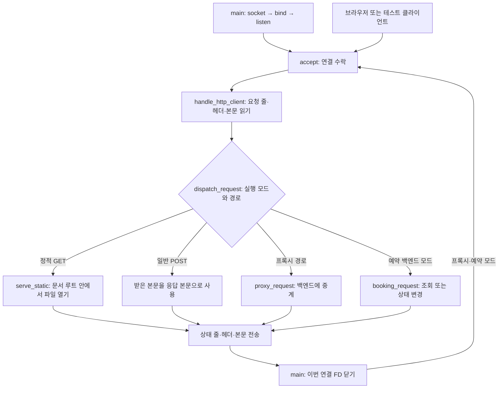

# C 웹 서버 설계

이 문서는 현재 작업 트리의 실행 구조다. 실행 방법은 [README](../README.md), 과제 요구사항은 [명세](spec.md), 검증 결과는 [진행 상태](progress.md)를 참조한다.

## 요청 처리 흐름

| 단계 | 구현과 선택 이유 |
| --- | --- |
| 접속 준비 | `main()`에서 포트·문서 루트·바인딩 주소를 받아 `listenfd`를 만든다. `accept()`는 해당 클라이언트와 송수신할 `connfd`를 돌려준다. 기본 실행 주소는 로컬 루프백이다. [main.c](../src/main.c) |
| HTTP 메시지 경계 | `read_headers()`가 바이트를 모아 `\r\n\r\n`을 찾는다. `parse_request_line()`이 메서드·요청 대상·버전을 확인하고 `parse_headers()`가 `Host`와 `Content-Length` 등을 검사한다. 헤더와 함께 들어온 본문을 먼저 사용하고 모자란 바이트만 더 읽는다. [http.c](../src/http.c) |
| 문서 루트 | 쿼리는 파일 경로에서 제외하고, `/`는 `index.html`에 연결한다. `open_static_file()`은 문서 루트부터 각 경로 구성 요소를 `openat()`으로 열며 `..`과 심볼릭 링크를 거절한다. 문서 루트는 실행 시 지정한다. [http.c](../src/http.c) |
| 파일 응답 | 확장자로 MIME 타입을 고르고 열린 파일을 `fstat()`으로 확인한다. `Content-Length`를 먼저 보낸 뒤 파일 전체를 메모리에 담지 않고 4 KiB 버퍼를 재사용한다. `write_all()`은 일부만 써진 경우 남은 위치부터 이어 보낸다. [http.c](../src/http.c) |
| 예매 화면 | `/index.html`을 받으면 스크립트가 같은 서버에서 좌석을 조회한다. 예약을 확정하면 POST를 보내고 결과에 맞게 좌석 버튼을 갱신한다. [index.html](../public/index.html) |

### 연결과 파일의 정리 책임

- `main()`은 연결을 처리할 때마다 `connfd`를 닫는다. 프록시와 예약 모드는 같은 `listenfd`에서 다음 연결을 받는다. 기본 실습 모드는 한 건을 처리한 뒤 `listenfd`를 닫고 종료한다.
- 프록시 함수는 새로 만든 백엔드 FD를 중계가 끝나거나 실패했을 때 닫는다.
- 정적 파일 처리 함수는 탐색에 사용한 디렉터리 FD와 최종 파일 FD를 닫는다.
- 서버가 응답 헤더를 보내기 전에 오류를 알면 `403`·`404`·`500` 등을 반환한다. 파일 응답을 시작한 뒤 읽기나 전송이 실패하면 연결을 닫는다.
- HTTP/1.1의 GET·POST를 처리하고 `Connection: close`로 응답한다. 요청 줄과 헤더는 합쳐서 4 KiB, 요청 본문은 8 KiB로 제한한다. 이 크기와 정적 파일 전송 버퍼는 별개다.

문서 전체는 [설계 목차](design.md)에서 찾아볼 수 있다.
