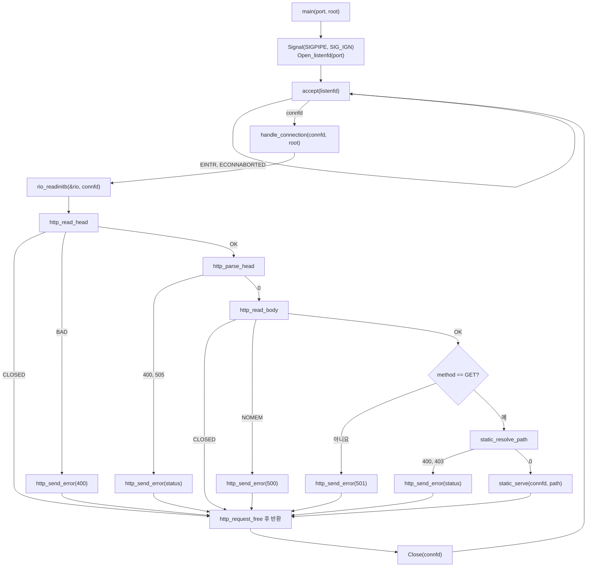

# 정적 파일 서빙 설계

과제의 정적 파일 서빙 항목을 CS:APP 3판 11.5.2의 URL 해석 규칙으로 구현할 때의 흐름과 결정입니다. [HTTP 요청 파싱](../http-request-parsing/design.md)과 [HTTP 응답 생성](../http-response/design.md)을 묶는 서버 `main`과 연결 처리도 이 문서에 둡니다.

- 함수별 입력과 출력: [functions.md](./functions.md)
- 검증 절차: [test-cases.md](./test-cases.md)

## 범위

| 포함 | 제외 |
| --- | --- |
| CLI 인자로 받은 루트 디렉터리의 파일을 GET으로 응답 | 동적 요청(CGI), POST 처리 |
| `/` 접미사를 `index.html`로 확장 | 디렉터리 목록 출력, 디렉터리 리다이렉트 |
| 확장자 기반 MIME 매핑 | 퍼센트 디코딩, 캐시와 부분 요청 |
| 400, 403, 404, 500 판정 | keep-alive. 응답마다 연결을 닫습니다 |

## 연결 처리 흐름

> 5단계에서 메서드 판정(`method == GET?`)이 [정적·CGI 분기](../dynamic-request/design.md#요청-분기)로, 6단계에서 `accept()` 반복이 [스레드 풀](../concurrency/design.md#구조)로 바뀌었습니다. 아래는 4단계 기준입니다.

서버는 `./build/httpd <port> <root>`로 실행합니다. 리스닝과 `accept()` 반복은 [보완한 순차 에코 서버](../tcp-socket-server/functions.md#echoserveric)와 같고, `echo()` 자리에 `handle_connection()`이 들어갑니다.



요청 하나에 응답 하나를 보낸 뒤 연결을 닫습니다. 응답 헤더의 `Connection: close`가 이것을 클라이언트에게 알립니다([응답 생성의 설계 결정](../http-response/design.md#설계-결정)).

### 연결 시간 제한

`accept()` 직후 `connfd`에 `SO_RCVTIMEO`와 `SO_SNDTIMEO`를 5초(`CONN_TIMEOUT_SEC`)로 겁니다. 순차 서버라 요청을 덜 보내고 멈춘 클라이언트나 응답을 읽지 않는 클라이언트 하나가 다른 연결을 모두 막기 때문입니다.

| 상황 | 결과 |
| --- | --- |
| `read()`가 5초 동안 바이트를 하나도 받지 못함 | -1과 `EAGAIN`. RIO는 `EINTR`만 다시 시도하므로 `HTTP_READ_CLOSED`가 되어 응답 없이 닫습니다 |
| `write()`가 5초 동안 1바이트도 보내지 못함 | `rio_writen()`이 -1. 헤더를 보낸 뒤라면 응답이 잘린 채 닫습니다 |
| `setsockopt()` 실패 | 표준 오류에 출력하고 시간 제한 없이 처리합니다. 요청 처리 자체는 가능하기 때문입니다 |

- 제한은 `read()`, `write()` 호출마다 따로 걸립니다. 5초 안에 1바이트씩 흘려 보내는 클라이언트는 막지 못합니다. 근본 해결은 동시 요청 처리 단계입니다.
- 5초는 순차 서버에서 다른 클라이언트가 기다리는 최대 시간이기도 하므로 짧게 잡았습니다.
- 다른 방법과 비교는 [1~4단계 리뷰의 미룬 결정](../reviews/stage-1-4-deferred-decisions.md#a-느린-클라이언트가-서버-전체를-막음)에 있습니다.

## URL 접미사 해석

교재 11.5.2의 규칙을 따릅니다. 접미사의 맨 앞 `/`는 리눅스 루트가 아니라 정적 루트 디렉터리입니다.

| 단계 | 처리 | 예: 루트 `/srv/www` |
| --- | --- | --- |
| 1 | `?`가 있으면 그 앞까지만 씁니다. 정적 파일에는 인자가 없습니다 | `/style.css?v=2` → `/style.css` |
| 2 | 경로 조각 중 `..`, `.`, 빈 조각(`//`)이 있으면 403입니다(5단계에서 `.`과 빈 조각 추가) | `/../etc/passwd`, `//cgi-bin/x` → 403 |
| 3 | 루트 뒤에 붙입니다 | `/style.css` → `/srv/www/style.css` |
| 4 | `/`로 끝나면 `index.html`을 붙입니다 | `/` → `/srv/www/index.html` |
| 5 | 결과가 `MAXLINE`을 넘으면 400입니다 | |

### 경로 탐색 차단

루트 뒤에 접미사를 그대로 붙이면 `/../../etc/passwd`가 루트 밖의 파일을 가리킵니다(경로 탐색). 교재 Tiny는 이를 막지 않습니다. 이 단계는 접미사를 `/`로 나눈 조각 중 정확히 `..`인 조각이 있으면 거부합니다. `/a..b.html`처럼 조각의 일부로 들어간 `..`은 허용합니다.

퍼센트 디코딩은 하지 않습니다. 따라서 `%2e%2e`는 `..`으로 바뀌지 않고 글자 그대로 파일 이름의 일부가 되어 404가 됩니다. 디코딩을 추가하는 단계에서는 디코딩한 뒤에 이 검사를 해야 합니다.

### 루트 경로

루트를 상대 경로로 주면 서버 프로세스의 현재 작업 디렉터리 기준으로 해석됩니다. 서버는 작업 디렉터리를 바꾸지 않으므로 실행한 위치 기준으로 일관되지만, 테스트와 문서에서는 절대 경로(`/tmp/www`)로 실행합니다.

## 상태 코드 판정

| 상황 | 상태 | 판정 위치 |
| --- | --- | --- |
| 경로에 `..` 조각 | 403 | `static_resolve_path()` |
| 만든 경로가 `MAXLINE` 초과 | 400 | `static_resolve_path()` |
| `open()` 실패, `errno`가 `ENOENT` 또는 `ENOTDIR` | 404 | `static_serve()` |
| `open()` 실패, `errno`가 `EACCES` | 403 | `static_serve()` |
| `open()` 실패, `errno`가 `ENAMETOOLONG` | 400 | `static_serve()` |
| `open()`의 다른 실패, `fstat()` 실패 | 500 | `static_serve()` |
| 일반 파일이 아님(디렉터리 등) | 403 | `static_serve()` |
| 파일을 열고 크기를 얻음 | 200 | `static_serve()` |

`/dir/`처럼 `/`로 끝나는 요청에 `index.html`이 없으면 `open()`이 `ENOENT`이므로 404입니다. `/dir`처럼 `/` 없이 디렉터리를 요청하면 일반 파일이 아니므로 403입니다.

FIFO를 `O_RDONLY`로 열면 쓰는 쪽이 나타날 때까지 `open()`이 막히고, 순차 서버라 다른 연결까지 멈춥니다. 그래서 `O_RDONLY | O_NONBLOCK`으로 엽니다. POSIX에서 이 플래그로 연 FIFO는 쓰는 쪽이 없어도 곧바로 반환하므로 `fstat()`이 일반 파일이 아님을 보고 403을 보냅니다. 일반 파일이면 `fcntl()`로 `O_NONBLOCK`을 지운 뒤 읽습니다.

읽기 권한은 직접 비트를 검사하지 않고 `open()`의 `EACCES`로 판단합니다. 커널이 소유자와 그룹까지 따져 판정하므로 서버를 실행한 사용자 기준의 결과가 나옵니다.

## 설계 결정

| 결정 | 내용 | 근거 |
| --- | --- | --- |
| `open()` 후 `fstat()` | 경로로 검사하지 않고, 연 디스크립터로 크기와 종류를 확인합니다 | `Content-Length`에 파일 크기가 필요합니다. 연 파일을 그대로 검사하므로 검사한 파일과 보내는 파일이 같습니다 |
| 모든 검사를 헤더 송신 전에 | 404, 403, 500 판정을 끝낸 뒤 `http_send_head(200)`를 호출합니다 | 응답 줄은 보낸 뒤 바꿀 수 없습니다([응답 생성](../http-response/design.md#헤더를-보낸-뒤의-실패)) |
| 고정 버퍼로 나눠 보내기 | `read()`로 `MAXLINE`바이트씩 읽어 `rio_writen()`으로 보냅니다 | 교재 Tiny의 `mmap()`은 크기 0인 파일에서 `EINVAL`로 실패합니다. 고정 버퍼는 파일 크기와 관계없이 메모리를 일정하게 씁니다. 짧은 쓰기는 `rio_writen()`이 처리합니다 |
| 본문은 바이트 수로 | 문자열 함수 없이 `read()`의 반환값만큼 보냅니다 | PNG 같은 이진 파일에는 `0x00`이 들어 있습니다 |
| MIME은 서버가 확장자로 | [MIME 타입 표](./functions.md#mime-타입-표)에서 찾고, 없으면 `application/octet-stream` | MIME 타입은 내용에서 저절로 정해지지 않고 서버가 붙입니다 |

## 파일 구성

```text
.
├── CMakeLists.txt        타깃과 테스트 추가
├── src/
│   ├── httpd.c            main, handle_connection
│   ├── http_request.h/.c  요청 파싱
│   ├── http_response.h/.c 응답 생성
│   └── static_file.h/.c   MIME, 경로 해석, 파일 송신
└── tests/
    ├── test_http_request.c
    ├── test_http_response.c
    └── test_static_file.c
```

| 파일 | 의존 | 산출물 |
| --- | --- | --- |
| `http_request.c`, `http_response.c`, `static_file.c` | `csapp.h`(RIO, `MAXLINE`) | 정적 라이브러리 `http` |
| `httpd.c` | `http`, `csapp` | 실행 파일 `httpd` |
| `tests/test_*.c` | `http`, `csapp` | 단위 테스트 실행 파일 세 개 |

## 빌드 설계

기존 `CMakeLists.txt`의 `echoclient` 타깃 뒤에 추가합니다.

```cmake
add_library(http STATIC src/http_request.c src/http_response.c src/static_file.c)
target_link_libraries(http PUBLIC csapp)

add_executable(httpd src/httpd.c)
target_link_libraries(httpd PRIVATE http)

foreach(name test_http_request test_http_response test_static_file)
    add_executable(${name} tests/${name}.c)
    target_link_libraries(${name} PRIVATE http)
    add_test(NAME ${name} COMMAND ${name})
endforeach()
```

단위 테스트는 `assert()`로 확인합니다. Release 빌드는 `-DNDEBUG`를 붙여 `assert()`를 지우므로, 각 테스트 파일은 `#include <assert.h>` 앞에 `#undef NDEBUG`를 둡니다. 실행은 `(cd build && ctest --output-on-failure)`입니다.
