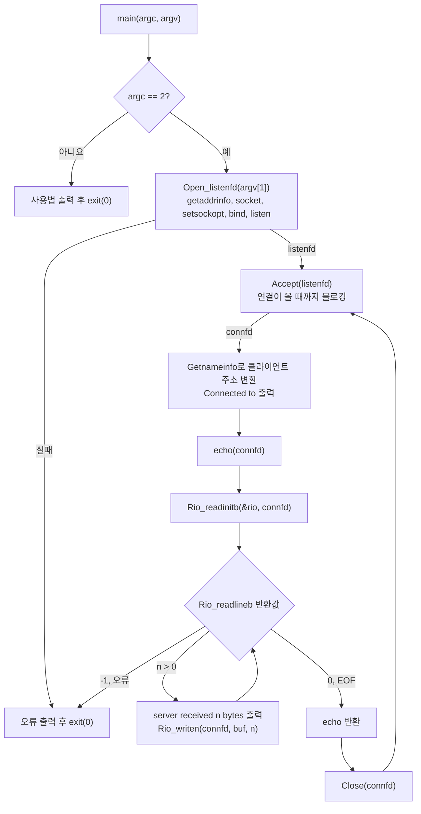
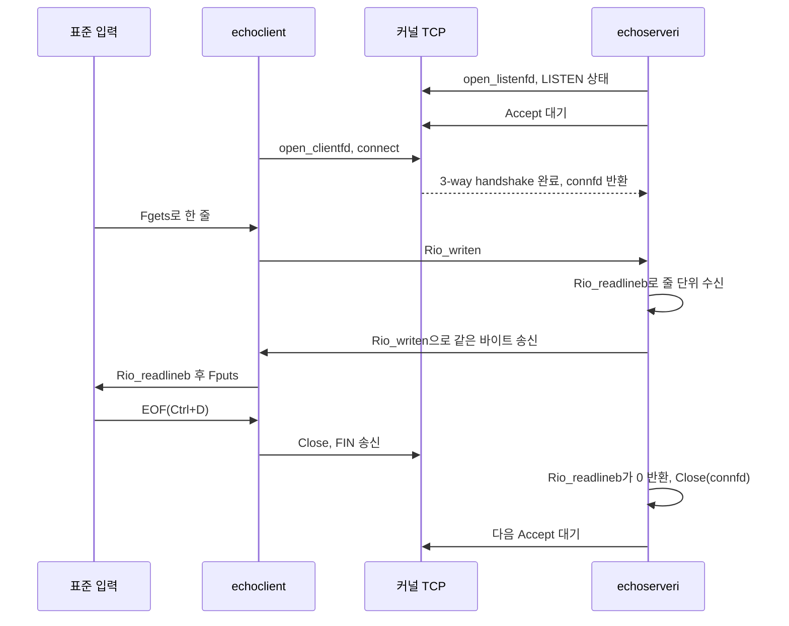

# TCP 소켓 서버 교재 구현 설계

과제의 TCP 소켓 서버 항목을 CS:APP 3판 11장 11.4.9까지의 예시 코드로 구현할 때의 전체 흐름과 파일 구성입니다.

- 함수별 입력과 출력: [functions.md](./functions.md)
- 검증 절차: [test-cases.md](./test-cases.md)

## 사용하는 교재 코드

| 출처 | 파일 | 역할 |
| --- | --- | --- |
| 그림 11.18 | `csapp.c`의 `open_clientfd()` | 서버에 연결된 클라이언트 소켓을 만듭니다. |
| 그림 11.19 | `csapp.c`의 `open_listenfd()` | `socket()`, `setsockopt()`, `bind()`, `listen()`으로 리스닝 소켓을 만듭니다. |
| 그림 11.20 | `echoclient.c` | 표준 입력의 줄을 서버로 보내고 응답 줄을 출력합니다. |
| 그림 11.21 | `echoserveri.c` | `accept()`를 반복하며 연결마다 `echo()`를 호출하는 순차 서버입니다. |
| 그림 11.22 | `echo.c` | 연결 소켓에서 줄을 읽어 같은 바이트를 되돌려 씁니다. |
| 10.5절 | `csapp.c`의 RIO 함수 | 짧은 읽기와 쓰기를 처리하고 줄 단위로 읽습니다. 11.4.9 코드가 사용합니다. |
| 공식 `csapp.h`, `csapp.c` | 오류 처리 래퍼 | `Accept`, `Close`, `Getnameinfo`처럼 실패하면 메시지를 출력하고 프로세스를 끝내는 래퍼입니다. |

원문은 저자가 제공하는 [예제 코드](https://csapp.cs.cmu.edu/3e/code.html)와 [`csapp.c`](https://csapp.cs.cmu.edu/3e/ics3/code/src/csapp.c), [`csapp.h`](https://csapp.cs.cmu.edu/3e/ics3/code/include/csapp.h)입니다.

## 요구사항 충족 판정

판정 대상은 필수 구현 항목의 TCP 소켓 서버와, 이 서버에 직접 걸리는 기술 스택, 중점 포인트, 품질 항목입니다. HTTP 파싱, 정적 파일, 동적 요청, 동시성, 프록시는 11.5 이후 단계에서 다룹니다.

| 요구사항 | 교재 코드의 처리 | 판정 |
| --- | --- | --- |
| `socket()` → `bind()` → `listen()` → `accept()` 표준 흐름 | `open_listenfd()`가 주소 후보마다 `socket()`, `bind()`를 시도한 뒤 `listen()`합니다. `main()`의 반복문이 `Accept()`를 호출합니다. | 충족 |
| 클라이언트 연결 수락과 요청, 응답 송수신 | `echo()`가 줄을 받아 같은 바이트를 보냅니다. 송수신 단위는 HTTP 메시지가 아닌 줄입니다. | TCP 수준에서 충족 |
| 포트를 CLI 인자로 받기 | `argv[1]`을 포트로 사용합니다. | 충족. 정적 파일 루트 인자는 이후 단계에서 추가 |
| `SO_REUSEADDR` | `open_listenfd()`가 `bind()` 전에 설정합니다. | 충족 |
| 허용 라이브러리만 사용 | `csapp.c`는 표준 C와 POSIX 호출을 감싼 코드입니다. | 충족 |
| 빌드 파일 제공 | 교재 본문에는 빌드 파일이 없습니다. 이 저장소는 `CMakeLists.txt`를 사용합니다. | 타깃 추가 필요. [빌드 설계](#빌드-설계) 참고 |
| 개발 환경 | Linux 기준 코드입니다. | Docker(`debian:bookworm-slim`) 또는 WSL2 Ubuntu에서 빌드. macOS 네이티브 빌드는 확인하지 않음 |
| `SIGPIPE` 무시 | 처리하지 않습니다. 클라이언트가 끊긴 소켓에 쓰면 `SIGPIPE`의 기본 동작으로 서버가 끝날 수 있습니다. | 미충족 |
| 클라이언트의 갑작스러운 연결 종료 | `Rio_readlineb`, `Rio_writen`, `Accept`가 실패하면 래퍼가 `unix_error()`로 서버 프로세스 전체를 끝냅니다. RST를 받은 연결 하나 때문에 서버가 멈춥니다. | 미충족 |
| `SIGINT`, `SIGTERM` 안전한 셧다운 | 신호 처리기가 없어 기본 동작으로 즉시 끝납니다. 열린 디스크립터는 커널이 회수합니다. | 미충족. 순차 에코 서버에는 정리할 상태가 없으므로 스레드가 생기는 12장 단계에서 구현 |
| 동시 요청 처리 | 순차 서버라 한 연결을 끝낼 때까지 다음 연결을 처리하지 않습니다. | 범위 밖. 12장에서 구현 |

**결론**: 교재 코드를 그대로 쓰면 TCP 소켓 서버 항목의 표준 흐름과 연결 수락 후 송수신은 충족합니다. 그러나 중점 포인트의 `SIGPIPE` 무시와 품질 항목의 갑작스러운 연결 종료 대응은 충족하지 못합니다. 교재대로 먼저 만들고 [비정상 종료 테스트](./test-cases.md#비정상-종료)로 한계를 확인한 뒤 보완합니다. 안전한 셧다운은 이 단계에서 다루지 않습니다.

> [!NOTE]
> 이 단계에서 보완할 지점
>
> - 서버 시작 시 `SIGPIPE`를 무시합니다. 무시만 하면 `Rio_writen` 래퍼가 `EPIPE`에서 서버를 끝내므로, `echo()`는 래퍼 대신 `rio_writen()`, `rio_readlineb()`의 반환값을 보고 해당 연결만 닫습니다.
> - `Accept` 래퍼 대신 `accept()`를 호출하고 `EINTR`, `ECONNABORTED`이면 반복문을 계속합니다.
>
> 셧다운을 나중에 구현할 때는 csapp의 `Signal()`을 쓰면 안 됩니다. `Signal()`은 `SA_RESTART`를 켜므로 `accept()`가 다시 시작되어 반복문이 종료 플래그를 확인하지 못합니다. `SA_RESTART` 없이 `sigaction()`을 직접 호출해야 합니다. 또 `rio_read()`는 `EINTR`이면 다시 읽으므로, 연결이 열려 있는 동안에는 신호를 받아도 바로 끝나지 않습니다.

## 코드 흐름

서버는 리스닝 소켓을 한 번 만든 뒤, 연결을 하나 수락하고 그 연결이 EOF에 이를 때까지 에코한 다음 다음 연결을 수락합니다.



클라이언트와 서버 사이의 한 줄 왕복은 다음 순서로 진행됩니다.



## 파일 구성

교재와 공식 예제 코드의 파일 경계를 그대로 따르고, 소스는 `src/`에 둡니다. `echo()`는 `echo.c`에 두고 `echoserveri.c`에서 원형을 선언해 호출합니다.

```text
.
├── CMakeLists.txt   타깃 추가
└── src/
    ├── csapp.h        공식 헤더: 상수, rio_t, 래퍼 원형
    ├── csapp.c        공식 구현: 오류 처리, 래퍼, RIO, open_clientfd, open_listenfd
    ├── echoserveri.c  그림 11.21 서버 main
    ├── echo.c         그림 11.22 echo()
    └── echoclient.c   그림 11.20 클라이언트 main
```

| 파일 | 의존 | 산출물 |
| --- | --- | --- |
| `csapp.c` | `csapp.h`, libc, pthread | 정적 라이브러리 `csapp` |
| `echo.c` | `csapp.h` | `echoserveri`에 포함 |
| `echoserveri.c` | `csapp.h`, `echo()` | 실행 파일 `echoserveri` |
| `echoclient.c` | `csapp.h` | 실행 파일 `echoclient` |

`csapp.c`에는 12장용 스레드와 세마포어 래퍼도 들어 있으므로 pthread를 링크해야 합니다. 이번 단계에서 의존하는 성질은 [functions.md의 csapp.c에서 가져다 쓰는 것](./functions.md#csappc에서-가져다-쓰는-것)에 정리했습니다.

## 빌드 설계

기존 `CMakeLists.txt`의 `include(CTest)` 뒤에 다음 타깃을 추가합니다.

```cmake
find_package(Threads REQUIRED)

add_library(csapp STATIC src/csapp.c)
target_include_directories(csapp PUBLIC src)
target_link_libraries(csapp PUBLIC Threads::Threads)

add_executable(echoserveri src/echoserveri.c src/echo.c)
target_link_libraries(echoserveri PRIVATE csapp)

add_executable(echoclient src/echoclient.c)
target_link_libraries(echoclient PRIVATE csapp)
```

빌드 명령은 README와 같습니다. 실행 파일은 네이티브 빌드면 `build/`, Docker 기본 명령이면 컨테이너 안 `/tmp/web-server-build/`에 생깁니다.

```sh
cmake -S . -B build
cmake --build build
```

공식 `csapp.c`는 이 저장소의 컴파일 설정(`-std=c17`, `_POSIX_C_SOURCE=200809L`)에서 그대로 빌드됩니다. 개발 이미지(Debian bookworm, gcc 12.2)에서 `-Wall`로 컴파일했을 때 경고가 없었습니다.

메모리 검사용 빌드는 디버그 정보를 넣습니다.

```sh
cmake -S . -B build-debug -DCMAKE_BUILD_TYPE=Debug
cmake --build build-debug
```

## 공통 상수와 자료구조

| 이름 | 값 | 쓰임 |
| --- | --- | --- |
| `MAXLINE` | 8192 | 줄 버퍼, 호스트 이름과 포트 문자열 버퍼 크기 |
| `RIO_BUFSIZE` | 8192 | `rio_t` 내부 버퍼 크기 |
| `LISTENQ` | 1024 | `listen()`의 `backlog` |

`rio_t`는 연결 하나의 읽기 상태입니다. `rio_fd`(읽을 디스크립터), `rio_cnt`(내부 버퍼에 남은 바이트 수), `rio_bufptr`(다음에 꺼낼 위치), `rio_buf[RIO_BUFSIZE]`(내부 버퍼)를 담습니다. `echo()`는 연결마다 지역 변수로 새로 만들고 초기화하므로 이전 연결의 남은 바이트가 섞이지 않습니다.
